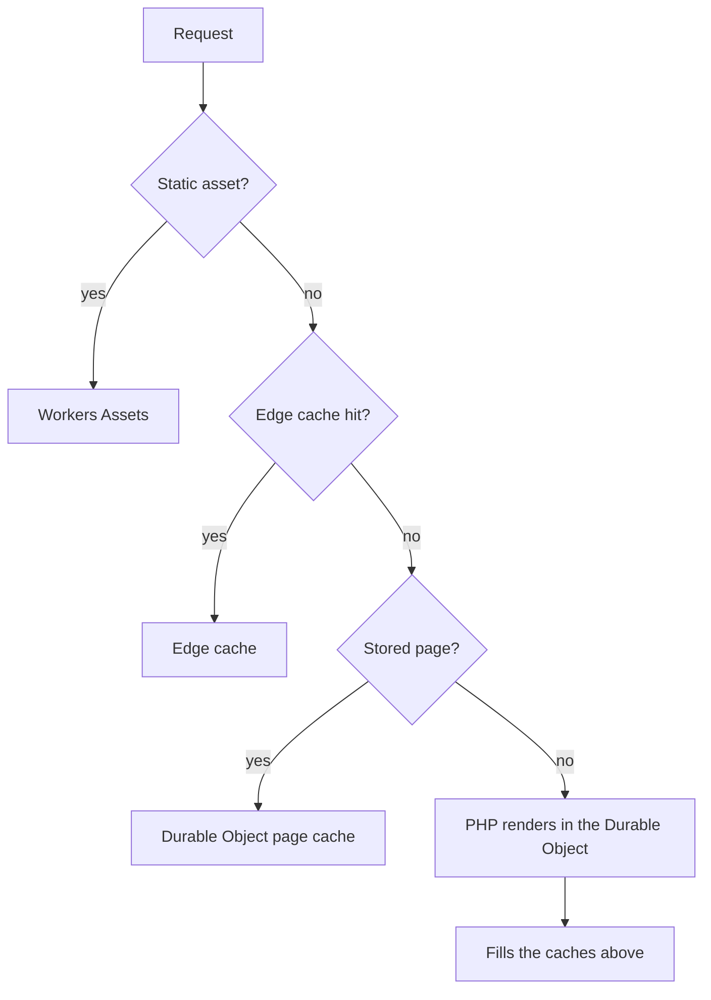

<div style="display: flex; align-items: center; flex-direction: column;" align="center">
    
    <h1 style="text-align: center;">Drupflare</h1>
    <p style="text-align: center;">Drupal 11 on Cloudflare Workers</p>
    <div align="center">
        
        
        
        
        
        
        
    </div>
</div>

---

[](https://deploy.workers.cloudflare.com/?url=https://github.com/drupflare/worker)

**Drupal 11 running on Cloudflare Workers.** No VPS, no container, no origin server. PHP 8.5
executes as WebAssembly inside a Durable Object, with the Durable Object's own SQLite as the
database. PHP 8.5 is what ships, with no extension dropped to fit.

The interpreter ships as a raw WebAssembly module that the platform compiles ahead of time, so
startup costs a few milliseconds. A paid site holds its interpreter warm between requests; a quiet
free site pays a cold boot unless it opts into warming. See [Free vs Paid](docs/free-vs-paid.md).

A site is one Durable Object by default and does not have to be. `REPLICA_COUNT` gives it read
replica lanes, each a separate object filled from the primary and kept current by a replication log,
so an authenticated read workload scales past one thread. See [Replica Lanes](docs/replica-lanes.md).

---

## 📋 Table of Contents

- [Why](#-why)
- [How It Works](#-how-it-works)
- [What It Runs](#-what-it-runs)
- [Getting Started](#-getting-started)
- [Impact](#-impact)
- [Documentation](#-documentation)
- [Contributing](#-contributing)
- [License](#-license)

---

## 🎯 Why

A small Drupal site is a strange thing to host. It needs a webserver, a PHP runtime, a database, a
cache, a CDN, backups, and someone to apply security patches, and it serves almost entirely
anonymous, cacheable traffic. The infrastructure is sized for the 1% of requests that render.

Drupflare inverts that. The 99% is served from Cloudflare's edge cache, the next slice from a
Durable Object's SQLite, and only a miss reaches PHP at all. There is nothing to patch at the OS
level, nothing to keep running, and no origin to go down.

The comparison is $5 against a VPS plus CDN, backups, monitoring and patching labour. The labour is
the part that does not scale down.

---

## 🔧 How It Works

A request stops at the first layer that can answer it.



Workers Assets answers `/core/**` without reaching the Worker. About 85% of the remaining traffic
comes from the edge cache with no Durable Object request, about 14% from the object's stored HTML
with no PHP, and about 1% renders. Authenticated pages skip the shared caches and are answered from a
compiled plan or by the object.

- **A purpose-built PHP wasm binary.** Every extension Drupal needs is statically linked, because
  workerd forbids the runtime wasm codegen that a dynamic linker needs. The toolchain is
  [`drupflare/phasm`](https://github.com/drupflare/phasm).
- **PHP inside the Durable Object.** `ctx.storage.sql` is synchronous only from within the object,
  and PHP's database calls block.
- **A Drupal database driver.** `cfw_do_sqlite`, from [`rom`](https://github.com/drupflare/rom),
  replaces everything in Drupal's database layer that assumed PDO and a file on disk.
- **Divisibility.** First-run migration runs in JavaScript, in chunks that each finish inside one
  invocation.

[Architecture](docs/architecture.md) covers static assets, self-repair and each layer in detail.

---

## 🧩 What It Runs

- **Drupal core**, at the version `composer.lock` pins, with four contributed modules in the pack: `admin_toolbar`, `ctools`, `pathauto` and `token`.
- **PHP 8.5** with 27 loaded extensions and stand-ins for curl, openssl, zip, exif, fileinfo and
  xmlwriter; see [Limitations](docs/limitations.md). The interpreter starts at 64 MiB of linear
  memory, and a boot after a dropped interpreter reuses its memory instead of allocating a second
  heap.
- **A database** in the object's own SQLite, created at first boot by replaying the packed
  `assets/drupal/site.sqlite` through the `cfw_do_sqlite` driver.
- **Real codebases.** 27 production Drupal codebases pinned in `config/corpus.yml` are scored on 13
  capabilities; see [Compatibility](docs/compatibility.md).

---

## 🚀 Getting Started

You need [Bun](https://bun.sh/), Node 24+ (a few scripts use `node:sqlite`, which Bun does not
ship), and a Cloudflare account with Durable Objects enabled, which the free plan includes.

```bash
git clone https://github.com/drupflare/worker.git
cd worker
bun install
bun run hydrate
bun run dev
```

`assets/` and `.interp/` are generated and gitignored, so `bun run hydrate` lands them on a clean
clone. Open `http://localhost:8787/`: the first visit starts the site, answering 503 with a
self-refreshing page while the packed database replays.

A new site is unclaimed until `POST /firstrun` mints the administrator password and the owner
token, each shown once:

```bash
curl -X POST "localhost:8787/firstrun" \
  -H 'content-type: application/json' \
  -d '{"siteName":"My Site","adminMail":"you@example.com"}'
```

[Getting Started](docs/getting-started.md) covers first boot, claiming, logging in, deploying and
updating a worker, and moving an existing site in with [`drangler`](https://github.com/drupflare/drangler).

---

## 📊 Impact

The saving is a total: it compares a deployment's whole year of energy, idle included, with
Drupflare's whole year for the same site. It makes no claim about the efficiency of one view,
because most of a conventional deployment's energy is idle power that does not depend on views.

Against a production deployment of three regions, each with a high-availability web pair and
database pair sized at 15% utilisation, one Drupflare site at 1,000,000 views a month draws 18.3 Wh a
year where the baseline draws 224 kWh, a total saving of 99.99%. The smallest conventional
deployment, one small VPS, still saves 99.80% at that traffic and 94.24% at 30 million views a
month. Per request the two runtimes are at parity, so the saving comes from idle nodes and not from
PHP running faster.

Every figure is derived and modelled, because no source sizes a production node. [Impact](docs/impact.md)
labels each one; [Energy](docs/energy.md), [Economics](docs/economics.md) and
[Environment](docs/environment.md) hold the detail.

---

## 📚 Documentation

### Start

| page                                       | what it covers                                                          |
| ------------------------------------------ | ----------------------------------------------------------------------- |
| [Getting Started](docs/getting-started.md) | first boot, claiming a site, deploying, and moving an existing site in  |
| [Architecture](docs/architecture.md)       | how a request is answered, static assets, and self-repair               |
| [Free vs Paid](docs/free-vs-paid.md)       | what each Cloudflare plan allows a site, and which limit binds first    |
| [VPS Comparison](docs/vps-comparison.md)   | latency, throughput and cost against nginx and PHP-FPM on the same tree |
| [Limitations](docs/limitations.md)         | what does not run, what runs differently, and the limit behind each     |

### Operate

| page                                           | what it covers                                                    |
| ---------------------------------------------- | ----------------------------------------------------------------- |
| [Administration](docs/administration.md)       | the surfaces an owner operates a site from                        |
| [Configuration](docs/configuration.md)         | every variable and binding, and the page each one lives on        |
| [Replica Lanes](docs/replica-lanes.md)         | read replicas: what a lane buys, how it scales, how it is built   |
| [Git Remotes](docs/git-remotes.md)             | delivering modules and themes from a git host                     |
| [Modules](docs/modules.md)                     | contributed modules, revisions, and which have run on a real site |
| [Recovery](docs/recovery.md)                   | point-in-time recovery, export, restore                           |
| [External Database](docs/external-database.md) | Hyperdrive and external databases                                 |

### Measure

| page                                               | what it covers                                                    |
| -------------------------------------------------- | ----------------------------------------------------------------- |
| [Impact](docs/impact.md)                           | the labels, limits and references behind every figure             |
| [Energy](docs/energy.md)                           | the saving against conventional hosting and the per-request model |
| [Energy Per View](docs/energy-views.md)            | one view, the traffic mix, visitor devices and Spool              |
| [Fleet Energy](docs/energy-fleet.md)               | many sites at once and institutional workloads                    |
| [Economics](docs/economics.md)                     | what each host costs at each traffic level                        |
| [Environment](docs/environment.md)                 | carbon, water and embodied carbon                                 |
| [Measurement Classes](docs/measurement-classes.md) | which instrument may produce which class of number                |

### Reference

| page                                                 | what it covers                                                |
| ---------------------------------------------------- | ------------------------------------------------------------- |
| [Security](docs/security.md)                         | what the architecture removes and what it leaves              |
| [Security Controls](docs/security-controls.md)       | the controls in place today                                   |
| [Security Incidents](docs/security-incidents.md)     | the CVE and incident map, PHP2Shell, planned work             |
| [Government](docs/government.md)                     | what a US federal site owner owns and what the host owns      |
| [Compatibility](docs/compatibility.md)               | per-codebase results for the 27 production codebases          |
| [Building From Source](docs/building-from-source.md) | the payload and source routes, and upgrading Drupal core      |
| [Repository Layout](docs/repository-layout.md)       | every path outside `src/` and how it arrives on a clean clone |
| [Database](docs/database.md)                         | how `assets/drupal/site.sqlite` is built                      |
| [PHP Update Delivery](docs/php-update-delivery.md)   | how a new PHP interpreter reaches this repository             |
| [Testing](docs/testing.md)                           | the test lanes and how to add a test                          |

[`TECHNICAL_REPORT.md`](TECHNICAL_REPORT.md) is the engineering record: every measurement, the
instrument behind it, and why each conclusion changed. It states the rule the project runs on: an
absolute CPU figure comes only from `cpuTime` on a deployed worker, because in-PHP `microtime()` is
frozen between I/O on the edge, so a duration taken by subtracting two of its readings is 0. The
report was written by Claude (Anthropic) while doing the work. Where a number is a local ratio and
not an edge absolute, it says so.

---

## 🤝 Contributing

```sh
bun install
bun run typecheck
bun run test # the workers and node lanes
bunx prettier --check .

bun run test:e2e # excluded from the gate; needs a running server
```

Run `bun run assets:driver` after any change in `../drupflare`, `../rom` or `../stream-http`.
Composer never runs on the edge, so `assets/driver.json` is the copy that actually executes, and
`tests/node/driver-pack.spec.ts` is what catches it going stale. The PHP suites live in those repos
and are the authority on their own module.

## 📄 License

See [LICENSE](LICENSE).
