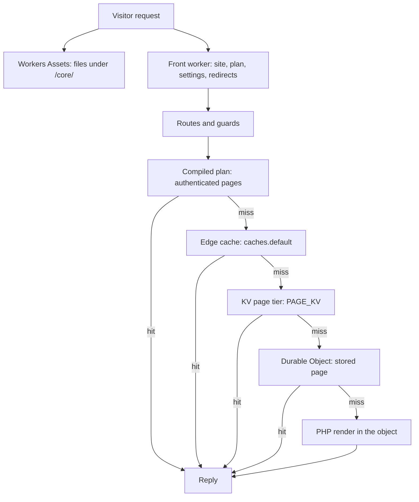
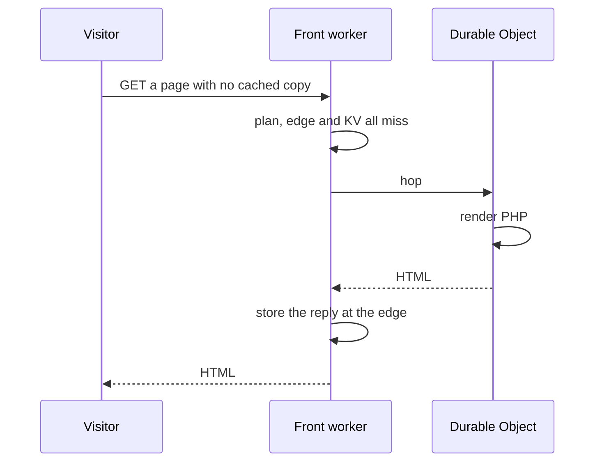

# Architecture

How a request is answered, what the build packs, and how a site repairs itself.

## Request Path

Each layer either answers the request or passes it to the next. The Durable Object is reached only
when no layer in front of it holds an answer.

Workers Assets answers a path that matches a published file before the Worker runs.
`assets/.assetsignore` publishes the `/core/` tree, and `wrangler.jsonc` sets no `run_worker_first`,
so those requests never reach `src/site.ts`. Everything else goes to the front worker.

The front worker resolves the site from the hostname. It reads the plan and settings from
`CONFIG_KV` together, then applies the redirect rules. The built-in routes and guards run next: file,
page rewrite, owner, recovery, CSP report, fill window, surface, oversize and deny checks, in that
order (`frontFetch` in `src/site.ts`). A denied path never reaches a cache. Authentication state is
decided after that, because the plan tier and the two caches key on it. An authenticated page cannot
use `caches.default` or the KV page tier, so it is answered from a compiled plan in isolate memory
(`src/ops/edge-plan.ts`) or goes to the object.

The traffic shares are about 85 percent at the edge cache, 14 percent at the object's stored page and
1 percent in PHP. This page does not split out the plan and KV tiers from those figures.

A cold request, one with no cached copy at any layer, makes three hops: the front worker misses
everywhere, the object renders, and the front worker stores the reply at the edge before it answers.

`caches.default` is the only layer that scales across colos (`src/site.ts`).

## Enabling Mechanisms

Four things make it work:

1. **A purpose-built PHP wasm binary.** No published php-wasm build can do this. workerd forbids the
   runtime wasm codegen that emscripten's dynamic linker needs, so every extension Drupal requires
   is statically linked (`MAIN_MODULE=0`). The toolchain is
   [`drupflare/phasm`](https://github.com/drupflare/phasm); this repository consumes its output.
2. **PHP runs inside the Durable Object, not beside it.** `ctx.storage.sql` is synchronous only
   from within the object, and PHP's database calls are blocking. Any other arrangement cannot
   connect the two.
3. **A real Drupal database driver.** `cfw_do_sqlite`, from the
   [`rom`](https://github.com/drupflare/rom) sibling, is a Drupal 11 driver for Durable Object
   SQLite. Drupal's query builders, schema handling and condition compiler are used unchanged; what
   is replaced is everything that assumed PDO and a file on disk.
4. **Divisibility.** A long invocation is a risk on free, and the language a step runs in decides
   whether it can be split at all. First-run migration moved from PHP to JavaScript and from one
   long invocation into chunks, each sized to complete on its own. `assets/drupal-sql/manifest.json`
   carries the current chunk count.

## Static Assets

Drupal's stylesheets, scripts, fonts and images are served by Workers Assets from `assets/core/`, at
the `/core/**` URLs Drupal already emits. All three PHP packers skip those extensions because PHP
never opens them, and nothing serves a file out of the in-memory filesystem over HTTP, so the asset
layer is the only thing that can answer them. `scripts/pack-static.ts` copies the tree. Workers
Assets content-hashes, caches and compresses what it serves, and a hit never reaches the Worker, so
it costs nothing against either free-tier ceiling.

Drupal's own CSS and JS aggregation is off, because an aggregate has no file to read: a hash
mismatch 301s and a match sends Drupal's optimiser at a path no pack carries.

The build produces its own aggregates instead. `bun run assets:agg` reads the library definitions
where the source files exist and emits one immutable file per library, and `ASSET_AGGREGATES=1`
substitutes them into a page as it is stored. The substitution is all or nothing per library, so a
partial match leaves that library's tags alone. It buys render time and a smaller stored page, not
Worker requests, since the individual files already cost none.

`tests/unit/runtime/assets-ignore.spec.ts` holds three properties: no prefilled page references a
Drupal aggregate, every `/core/**` URL those pages reference answers 200, and every aggregate URL
the substitution emits answers 200.

Workers Assets allows 20,000 files per deploy and 25 MiB per file, both documented platform limits.
`bun run release:check` prints the published count against the first and
`scripts/pack-perfile.ts` and `scripts/contrib-fixture.ts` refuse a pack file over the second. The
published set was 4,627 files at the last count, 23.1% of the file limit. The pack's 11,675 members
live inside two files (`core.pf.bin` and `core.pf.json`), so they do not count against either limit.

A pack split into layers has been measured, and it is not built. The mount takes several layers, but
`mountDrupalLazy` fetches every layer eagerly and keeps every blob resident, and a synchronous read
from PHP cannot wait for a fetch. Slicing the pack into a hot layer that holds the files an admin
render opens (2,226 files, 3.19 MiB compressed) and an index-only cold layer saved 9 to 12 MiB of
isolate memory on a boot-idle probe (`measured`, deployed, a few steady readings per arm). A strict
hot-only layer hid files PHP stat'd or listed, and admin pages failed locally on it. Serving the
same 13 MB pack as 4 or 16 asset files was slower than 1 file, so more chunks of the same bytes buy
nothing.

## Self-Repair

The self-repair layer acts; it is not a monitoring dashboard. It is a capped, GC'd health ledger; 12
host tripwires (empty render, size anomaly, asyncify called, mask leaked, semaphore dirty,
incomplete migration, halted updb, pack generation mismatch, memory highwater rising, memory trend
rising, ledger oversized, image cap projected) plus budget pressure and its forward projection; 7
PHP tripwires (anonymous cache purity, missing cache header, leaked transaction, account not
restored, over-100 params, over-50-byte LIKE, config drift); a mandatory boot self-test; and a
repair ladder whose breaker escalates on repeated failure and decays on a clean interval.

The tripwires run on the alarm and never on the request path. Recording a finding is a row write,
and rows written is the meter that binds regeneration, so a per-request pass would spend the budget
it exists to watch. A healthy site writes zero rows here: the repair state is persisted only when it
changes.

`RepairLadder::maySafelyRepair()` fails closed. It refuses to act while a transaction is open,
because a repair that runs mid-transaction is worse than the fault it was fixing.

L4 quarantine and L5 rollback act. Three consecutive findings of the same code at `error` or above
quarantine the site; a different code resets the count, because two unrelated faults are not one
durable condition. A quarantined site stops writing and stops filling, and keeps serving, so a
visitor sees a stale page and not an error. Rollback additionally requires ten consecutive failures
and a restore point that exists; with none it refuses by name, because reverting to nothing is
worse than the fault. Leaving quarantine is an explicit operator act at `/health?clear=1`, never
automatic.

---

## Pages

- [Measurement Classes](measurement-classes.md): the four classes a number belongs to, and which instrument each allows.
- [The Site Database](database.md): how the database every new site starts from is built.
- [Compatibility](compatibility.md): which Drupal codebases run, per codebase, from the corpus lane.
- [Limitations](limitations.md): what does not run, what runs differently, and the limit behind each.
- [Modules](modules.md): contributed modules, module revisions, and which modules have run on a real site.
