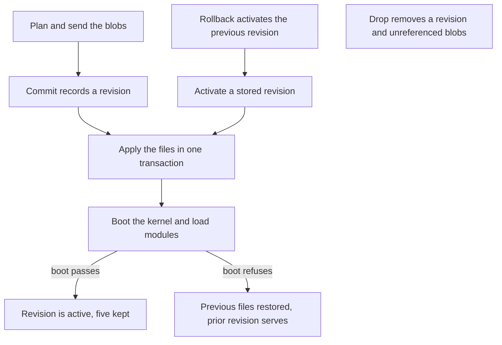

# Modules

Contributed modules, module revisions, and which modules have been run against a real site.

## Module Revisions

A module that lives on your machine and not on a git host is uploaded through `/modify`. Every
upload is a revision, and the site keeps the last five per package (`REVISION_RETENTION` in
`src/ops/module-rev.ts`). Each `/modify` request takes the owner token.

A revision is a manifest of files addressed by the hash of their contents. A second upload sends
only the files that changed. A file the site already holds costs nothing to keep, and dropping a
revision deletes only the file contents that no surviving revision names.

An upload is three steps: plan, send the blobs, then commit. The table lists every route.

| Action    | Route                                     | Method | What it does                                                            |
| --------- | ----------------------------------------- | ------ | ----------------------------------------------------------------------- |
| Plan      | `?action=plan&package=X`                  | POST   | splits declared files into what the site has and what it needs          |
| Blobs     | `?action=blobs&package=X`                 | POST   | stores the missing file bytes, verified against the hash sent with each |
| Commit    | `?action=commit&package=X`                | POST   | records a revision from a manifest and makes it live                    |
| Revisions | `?action=revisions&package=X`             | GET    | the stored revisions, newest first, and which one is active             |
| Manifest  | `?action=manifest&package=X&rev=Y`        | GET    | one revision's file list; `rev` takes `active` by default               |
| Activate  | `?action=activate&package=X&rev=Y`        | POST   | makes a stored revision live again, with no bytes on the wire           |
| Rollback  | `?action=activate&package=X&rev=previous` | POST   | activates the revision before the active one                            |
| Status    | `?action=status`                          | GET    | what is live per package, with its size and age                         |
| Drop      | `?action=drop&package=X&rev=Y`            | POST   | deletes a revision and the blobs nothing else names                     |

`plan` answers the have and want split and the change an apply would make: `counts` over every
declared file, the `removed` paths by name, and the rows an apply would charge. A file whose new
bytes have not been sent yet counts as `modified` and not as a removal, because the site does not
hold those bytes yet.

Commit and activate use the same apply, verify and restore path that a git pull takes. The files are
written in one transaction, and the kernel boots with every enabled module's PHP loaded. A boot that
fails restores the previous file set. A module whose `.module` no longer parses is rolled back, and
the reply names the parse error. A refused commit or activation returns 409. A refused commit stays
stored, and the revision it replaced stays active. A path another package already owns is reported
as a conflict and not taken (`applyRevision()` in `src/do/modify.ts`).



File contents are verified against the hash they were sent under before they are stored, so a
manifest cannot come to name content the site never received. Stored blobs are checked against their
hash again before a revision is applied.

Bytes are bounded twice: by `MAX_BODY_BYTES` per request, and by a 2,199,995-byte cap per file,
since each file is one stored row. A client batches to stay under both.

A `commit` body may carry `autoload`, one object or an array, for vendor packages a build delivers:
`{"name":"acme/widget","version":"1.4.0","mount":"vendor/acme/widget","autoload":{"psr-4":{...}}}`.
The mount must sit under `vendor/` or `libraries/`. The site registers each map with the class loader
before it boots the kernel, and puts the previous row back if the boot refuses. `/install` does not
fetch a package that is already registered.

A revision may also carry paths under `core/`, which shadow the packed files at the next boot. A
changed `core/**/*.yml` drops `cache_container` and `cache_discovery` first, so the verifying boot
rebuilds them.

A requirement on a virtual package such as `psr/log-implementation` is met by the shipped lock's
`provide` and `replace` entries, and is not fetched.

---

## Contrib Modules

Installing a module works on a deployed site, with the module present in `core.extension` afterwards
on 6 of 6 attempts. The cache is cold for one visit while the pages the install invalidated are
re-rendered.

Every contrib module has one of three states: verified, untested or blocked. A module is verified
only when the gate enabled it against a real site and asserted an observable the module owns.
Nothing reaches that state by inspection. A blocked row says which capability is missing.
`moduleTable()` in `src/ops/module-table.ts` is the census the lists below are rendered from.

Contrib is a development dependency. The shipped pack carries four modules (`admin_toolbar`,
`ctools`, `pathauto`, `token`). The rest are verified against a test build and installed by a site
that asks for them, so a new site stays small.

### Installing One

Three owner-token routes, in the order a site uses them. Each takes `Authorization: Bearer <owner
token>`, the token `/firstrun` mints when the site is claimed.

| Route                   | What it does                                                           |
| ----------------------- | ---------------------------------------------------------------------- |
| `/installable?module=X` | resolves the package and names any conflict with the shipped lock      |
| `/install?module=X`     | fetches it and writes its files; runs the check first unless `force=1` |
| `/enable?module=X`      | installs it through Drupal's own module installer                      |

`drupal/*` resolves against `packages.drupal.org/8`, and everything else against
`repo.packagist.org`. Resolution is registry first. It covers a composer graph's `replace`, stability
flags, branch aliases, branch archives, metapackages and virtual packages. Composer plugins are
skipped. Installing does not enable a module. The two are separate steps, because a package that
lands is not yet a module Drupal knows about.

A module you wrote yourself arrives through a git remote or through `/modify`. A git pull fetches
one commit at depth one and boots the kernel against the new tree, rolling back if it fatals. See
[Git Remotes](../operating/git-remotes.md) and [Module Revisions](#module-revisions). The same `/enable` step
applies afterwards.

### Verified

`access_unpublished`, `address`, `admin_toolbar`, `backup_migrate`, `better_exposed_filters`, `captcha`, `cas`, `coffee`,
`colorbox`, `config_ignore`, `config_update`, `contact_storage`, `crop`, `csv_serialization`, `ctools`, `devel`,
`diff`, `easy_breadcrumb`, `editor_advanced_link`, `editoria11y`, `embed`, `entity`, `entity_browser`,
`entity_clone`, `entity_embed`, `entity_reference_revisions`, `externalauth`, `facets`,
`features`, `field_group`, `filefield_sources`, `focal_point`, `gin`, `gin_toolbar`,
`google_analytics`, `google_tag`, `honeypot`, `imageapi_optimize`, `imageapi_optimize_binaries`,
`imce`, `inline_entity_form`, `jquery_ui`, `jquery_ui_autocomplete`, `jquery_ui_datepicker`,
`jquery_ui_menu`, `jquery_ui_slider`, `jquery_ui_touch_punch`, `json_field`, `key`,
`layout_builder_restrictions`, `libraries`, `link_attributes`, `linkit`, `mailsystem`,
`media_library_form_element`, `memcache`, `menu_block`, `metatag`, `metatag_search_gov`,
`migrate_plus`, `migrate_source_csv`, `migrate_tools`, `module_filter`, `openid_connect`,
`paragraphs`, `password_policy`, `pathauto`, `purge`, `queue_ui`, `rabbit_hole`, `recaptcha`, `redirect`, `redis`,
`samlauth`, `scheduler`, `schema_metatag`,
`search_api`, `search_api_solr`, `seckit`, `simple_sitemap`, `simplesamlphp_auth`, `smtp`, `stage_file_proxy`, `strata`, `svg_image`,
`token`, `twig_tweak`, `usfedgov_google_analytics`, `uswds_base`, `video_embed_field`,
`views_bulk_operations`, `views_data_export`, `webform`, `xmlsitemap`.

`uswds_base` is a theme and installs through `theme_installer` and not the module installer.

`strata` (Packagist `earth-app/strata`) is verified for what the run asserted: it enables, its
services, config and routes appear, and its own cipher seals and opens a frame under a key the module
created, refuses tampered frames, and matches a frame sealed by native libsodium. Its
`strata_sodium` status row reads Available, because `extension_loaded('sodium')` is true here: the
sodium stand-in covers the whole ext-sodium API and the conformance gate holds it to native
libsodium.

Strata against an S3-compatible store was run on `wrangler dev` with SeaweedFS in a container, the
same API Cloudflare R2 answers. The requests go through the parked fetch, and a loopback endpoint
needs `OUTBOUND_GUARD=0`, which exists for rigs. A seal stored its frames in the bucket and a
restore drill passed. Deleting a stored object made the drill fail with `frame.missing`, flipping a
byte inside a frame made it fail with `frame.aead_fail`, and restoring the object cleared both. Eight
of strata's 21 tripwire classes were tripped and cleared this way; the other 13 were not exercised.
On a corpus of 32 prose nodes (75,383 bytes), the codec call ratio was 2.44 for zstd level 3 and 3.06
for brotli level 11 (n=36 calls), and the whole seal stored 1.52 to 1.81 times fewer bytes than it
sealed, one run per arm. Treat the ratios as one corpus, not a spread.

Strata's scheduled work does not run in full. From cron, capture, reconcile, flush and keyspace
discovery run against the store, and the chain then ends silently inside the dictionary training
stage, so compaction, the scheduled restore drill and telemetry do not run. The cause is a parked
call inside a generator: `CommitLog::walk()` yields commits and reads the store inside its body, and
the park resumes the chain but the request ends without output. Fixing that is a change to the
park extension in `phasm`. Until then, run a drill by hand and read the engine status and the
watchdog rows, because strata records a stage as started before it runs.

Strata's codecs are `zstd` and `brotli` through `ext-zstd` and `ext-brotli`, which this runtime does
not load. Both are shimmed over `node:zlib`: `zstd_compress()`, `zstd_uncompress()`, the `_dict`
pairs and `brotli_compress()`, `brotli_uncompress()` with their constants. `extension_loaded()` stays
false for both, since the streaming API is not shimmed. In a clone with strata enabled, the registry
lists `zstd` and `brotli` as available.

Gap against native: ext-brotli 0.21.0 takes a preset dictionary as the fourth argument of
`brotli_compress()` and the second of `brotli_uncompress()`, and a dictionary frame decodes only
with that dictionary. The shim refuses a dictionary with a warning, because `node:zlib` takes none.
Strata's brotli codec reports dictionary support unconditionally, so a dictionary write fails on this
runtime. Measured 2026-11-02 against the local PHP 8.5.7 with ext-brotli 0.21.0.

The sodium stand-in is complete except for password hashing. `crypto_pwhash` and `crypto_pwhash_scryptsalsa208sha256` refuse work above a fixed cap, so a caller asking for more gets a `SodiumException` with the message `internal error`, the message libsodium gives for a failed allocation. The cap is 64 MiB of memory (`PWHASH_MEMORY_CAP` in `src/site/shims/sodium-lib.ts`), 4 Argon2 passes over 64 MiB (`PWHASH_WORK_CAP`), and scrypt `N * r * p` up to 2^21 (`SCRYPT_WORK_CAP`). The isolate has about 20 MiB spare on a large site and a Thunder-sized budget, so a 64 MiB arena is the most a single hash may take. Constants above the cap are refused: `MEMLIMIT_MODERATE` (256 MiB) and `MEMLIMIT_SENSITIVE` (1 GiB), the moderate and sensitive `OPSLIMIT` values, and scrypt sensitive (`N` of 2^20 at `r` 8 is 1 GiB). `crypto_pwhash_str_verify` and `crypto_pwhash_scryptsalsa208sha256_str_verify` return `false` past the cap rather than throwing. The interactive profiles fit: Argon2 at 64 MiB with 2 passes, and scrypt interactive at 16 MiB.

`simplesamlphp_auth` needs phpmailer 7 through SimpleSAMLphp 2.5, and `smtp` needs phpmailer 6, so the
two cannot share a composer lock. The contrib lane installs it in its own phase after `smtp` has
been removed. It is verified for a real login and logout against Keycloak: `e2e/saml.spec.ts` drives
an SP-initiated login, the ACS, the account and its `authmap` row against the NameID, a cookie-less
request staying anonymous afterwards, and Drupal's logout ending both the Drupal session and the
provider's. An altered assertion, a replayed assertion and an empty ACS call each leave the visitor
anonymous. The AuthnRequest is signed with the SP key, and the client refuses one whose signature has
been removed. Assertions are encrypted, with RSA-OAEP key transport under a SHA-1 digest, the only
transport SimpleSAMLphp's legacy decrypt path can unwrap. An IdP that sends RSA-OAEP with a SHA-256
digest, which is Keycloak's default, is not covered: that path cannot decrypt it even on native PHP.

A site needs one line of SimpleSAMLphp configuration, because none of SimpleSAMLphp's own stores can
run here (no PDO driver, no Predis, no memcache) and the module refuses `phpsession`:

```php
'store.type' => 'Drupal\drupflare\SimpleSaml\DatabaseStore',
```

It keeps sessions, AuthnRequest state and assertion ids in the site database. A site also supplies
SimpleSAMLphp's own configuration directory, loaded with `Configuration::setConfigDir()` from a small
module of its own, and its identity provider's metadata. drupflare supplies the rest: the
`/simplesaml/module.php` endpoints, a switch for SimpleSAMLphp's `exit` and its raw `Location`
header, an explicit session save in place of the `header_register_callback` that never fires here,
and its SAML2 container. SimpleSAMLphp's never-returning redirect methods raise a `TypeError` that
Drupal logs on every login start. The run has not happened on a deployed worker.

### Blocked

Nothing. `openid_connect`, `redis` and `smtp` were here.

`smtp` sends over the host transport from its own `smtp.settings`, and nothing in a render waits for
delivery. `redis` and `openid_connect` both need an answer inside the request that asked. The PHP
call is suspended, the Worker performs the socket read or the HTTP exchange, and the same call
resumes with the answer. For `openid_connect` that is the authorization-code POST and the userinfo
GET, so a login completes through the module's own client. For `redis`, the Durable Object's own
SQLite is still the faster cache backend and the recommended one.

`access_unpublished`, `contact_storage`, `editoria11y`, `password_policy` and `seckit` are verified
for a behaviour each, read through the real serve path. A tokened URL shows an unpublished node and
the next visitor without the token does not. An anonymous contact form POST leaves one stored
message. An editor's page carries the checker and a forged report is refused. A 12-character policy
rejects a short password with the module's own message. The module sends a CSP, HSTS and referrer
header and refuses a foreign `Origin`. The `access_unpublished` run found a runtime defect, now
fixed in `RequestResetter`: its token getter kept the last visitor's token. Mail delivery, the
browser checker, user-form validation and the CSP report endpoint were not asserted.

### Untested

`search_gov_results_api` renders results from an API call made while its form is building. That call
completes inside the render that makes it, so a search answers on the first request. No run has
exercised it against a live Search.gov key.

---
