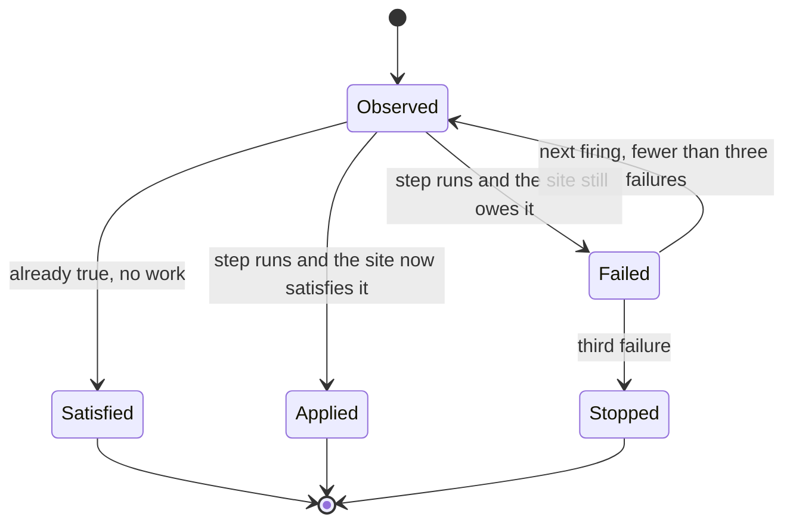

# Operations Settings

Settings for maintenance, owner access, audit, runtime overrides, database updates and pack reconciliation. The index of every variable is on [Configuration](configuration.md).

## Site Maintenance

`/armfill`, `/invalidate`, `/bump`, `/migrate` and `/updb` take the owner token. Purging your own page
cache does not expose arbitrary SQL or a whole-database overwrite, which are separate routes.

`/updb` drives a database update run. `GET` reports the run and its units; `POST` advances exactly
one beat and re-arms nothing, so a caller that wants the chain finished polls. The alarm chain drives
the same step.

`POST` takes an `action`, which is what starts a run rather than advancing one. Without it a beat has
nothing to advance and answers `{"beat":"none","reason":"no-run"}`.

| action              | what it does                                                                |
| ------------------- | --------------------------------------------------------------------------- |
| none, `run`, `beat` | advances one beat, which is what the Operate page sends                     |
| `prepare`           | raises the maintenance fence, snapshots the bookkeeping and plans the units |
| `drain`             | runs up to `maxBeats` beats in this invocation; keep it at 1 on free        |
| `rollback`          | restores what the snapshot covers; legal only from a halted run             |
| `abandon`           | accepts a halted run as-is; requires a written `reason`                     |

`abandon` will not take a default reason. The next person reading the run has to see that a human
decided, and a generated string would forge that signature.

### The Repair Surface

What an owner token can fix, and what each one costs. The class decides whether a tool may run it
unattended: `safe` changes nothing a visitor sees, `rebuild` discards derived state that comes back
on its own, and `stateful` changes what the site serves.

| route                   | class    | what it does                                              |
| ----------------------- | -------- | --------------------------------------------------------- |
| `/health`               | safe     | reads the repair state, the ledger and the worker version |
| `/health?clear=1`       | stateful | releases a quarantine, so the site serves again           |
| `/updb`                 | safe     | reads the update run                                      |
| `/updb` (POST)          | stateful | advances one beat of a database update                    |
| `/updb?action=prepare`  | stateful | starts an update run, fence and snapshot included         |
| `/updb?action=rollback` | stateful | restores the bookkeeping a halted run snapshotted         |
| `/armfill`              | rebuild  | queues a fill, so cold paths warm without a visitor       |
| `/invalidate`           | rebuild  | drops stored pages for a path or a tag                    |
| `/bump`                 | rebuild  | advances the generation, retiring every stored page       |
| `/migrate`              | stateful | resumes first-run migration on a site that stalled        |
| `/git?action=unpin`     | stateful | releases a preview pin without reaching the remote        |

`/git?action=unpin` exists because `unpreview` cannot help here: it re-syncs to the branch head, so it
needs the remote to answer, and a pin held against a remote that is down is exactly what an operator
is trying to release. Releasing without a sync leaves the site serving what it already serves and
gives the poller the branch back, so the next successful poll converges it.

A quarantine is released rather than prevented. `/health` reports what tripped it and the ledger
entry that recorded it; clearing without reading that first is how the same fault comes back.

A withdrawn replica lane is not a repair target. It asks the primary for a fresh copy itself, and the
primary queues that copy and arms an alarm to perform it. `/replica` is diagnostic only: it also
carries the path a lane uses to commit a batch it executed speculatively, which belongs to the pool
rather than to the owner token. Read the state through `/health` and `/serve-stats`. The pool itself
is on [Replica Lanes](replica-lanes.md).

### The Degradation Band

Once a site leaves `normal`, every response it serves carries these headers:

| header                 | value                                                   |
| ---------------------- | ------------------------------------------------------- |
| `x-cfw-degrade`        | `reduced` or `read-only`                                |
| `x-cfw-degrade-driver` | which meter drove it: `rows` or `do`                    |
| `x-cfw-degrade-at`     | the fraction of that meter's daily budget already spent |

A `normal` site carries none of them, so their presence is the signal and no parsing is needed to
tell the two states apart.

The band is reported on every response from `reduced` onward, not only on a refusal. The level is
not persisted: the counter is keyed per UTC day, so midnight clears it.

`/serve-stats` reports `lastGitPoll`, `lastMirrorDrain` and `lastPageMirrorDrain`, each with its
`*At`. Every alarm unit catches its own error so one failure cannot stop the chain, so these
timestamps are the way to see a unit that has been failing.

## The Admin Surface

The seven `/_cfw` pages take the same owner token. A browser cannot put a header on its own navigation,
so `/_cfw/login` exchanges the token for a cookie: `HttpOnly`, `SameSite=Strict`, twelve hours,
cleared by `/_cfw/logout`. A page reached without it redirects to the sign-in form and returns
afterwards. A bearer header reaches the same pages, so a script needs no browser.

**`PW_DIAGNOSTICS` does not open these pages.** It opens the other owner routes. These pages install
code and run privileged operations, so they take the owner token only.
`SameSite=Strict` is what stands in for a CSRF token: several owner routes act on a GET, so a
cross-site request carrying the cookie would be enough to install a module. Strict means no
cross-site request carries it, including a top-level link.

## Owner Token Recovery

The owner token is shown once, at the claim. `POST /recover-token` gives it back to anyone who can
write the deployment's `CONFIG_KV` namespace, which means anyone who can already redeploy the worker
with `PW_DIAGNOSTICS=1` and read it through `/sql`. The proof is no weaker than the token.

```sh
drangler recover-token https://mysite.example --store
```

`--store` saves the recovered token in the system keychain, or in the global config on a machine
with no keychain.

The client mints a nonce (32 random bytes, base64url, 43 characters) and writes
`recover:<host>:<sha256 hex of the nonce>` to `CONFIG_KV` with a 60-second TTL, KV's minimum. The
value is `{"host": "<host>", "exp": <epoch ms>}`. It then posts `{"nonce": "<nonce>"}` to the site. The
nonce appears only in that body; KV, wrangler's argv and the logs see its hash.

The route is public, since the caller has no token, and it is answered in the front worker like
`/settings`. The front worker reads the failure budget before it touches the object, then hops to
`/__recover-token`, which does the rest:

1. read `recover:<request host>:<sha256(nonce)>` from `CONFIG_KV`; missing is a 404;
2. refuse a record whose `host` is not the request host (403), whose `exp` has passed (410), or whose
   `exp` is more than two minutes ahead (400), since KV's TTL, not the writer's clock, is the limit;
3. add the record to the spent table in `cfw_meta` (`recover_spent`) with no `await` between the check
   and the write, so two racing requests spend it once; a spent record is a 410;
4. delete the KV record, best effort;
5. answer `{ "ok": true, "ownerToken": "..." }` with `cache-control: no-store`, or 409 if the site has
   no token yet.

| status | `reason`     | counts as a failure | the client                         |
| ------ | ------------ | ------------------- | ---------------------------------- |
| 200    |              | clears the budget   | prints the token                   |
| 400    | `malformed`  | yes                 | stops                              |
| 403    | `wrong-host` | yes                 | stops                              |
| 404    | `unknown`    | yes                 | retries; KV may not have it yet    |
| 409    | `unclaimed`  | no                  | stops; run `site claim`            |
| 410    | `spent`      | yes                 | stops; run the command again       |
| 429    | `rate`       | n/a                 | stops; `retry-after` says how long |
| 501    | `no-kv`      | no                  | stops; the deployment has no KV    |

The spent table is in the object, not in KV. A deleted KV key can be served for another minute at a
different colo, so a replay inside that window would find the record. The object is
strongly consistent, which makes it the only place single use can be enforced. The KV delete is
tidiness.

A recovery never mints. The route reads `owner_token` and never calls `ensureOwnerToken()`,
which mints on a miss. A recovery on an unclaimed site would otherwise claim it for whoever holds KV
access. The proof is spent in that case, and the client names `drangler site claim`.

The failure budget is the owner check's. `OWNER_FAIL_LIMIT` in `src/ops/admin-session.ts`: 12
failures per 60 seconds, per isolate, keyed on `cf-connecting-ip`, checked before the hop and shared
with the owner check and the sign-in form. A 404 counts because KV is eventually consistent and a
fresh record can miss, so the client paces its retries (growing pauses, at most eight attempts) to
stay under it. The budget removes the object-request cost of guessing. Guessing a 256-bit nonce was
never the threat.

Limits worth knowing:

- Edit rights on the `CONFIG_KV` namespace are owner-equivalent. A token scoped to "Workers KV
  Storage: Edit" is enough. In a managed deployment the operator owns the namespace and can already
  read every object, so tenants must never hold KV API access.
- A client clock more than about a minute behind the worker's makes `exp` already past (410).
- The token is not rotated. Whatever else holds it keeps working.
- A local `wrangler dev` site has local KV, which the Cloudflare API cannot write; the route is
  meant for a deployed site.

## Owner Audit Log

The object records every owner call that changes state or reads a secret, and `GET /audit` returns
the log. A call is recorded when it carries the owner token and reaches one of these: `/install`,
`/enable`, `/modify`, `/restore`, `/export`, `/migrate`, `/bump`, `/invalidate`, `/pitr` (POST),
`/updb` (POST), `/reconcile` (POST), `/firstrun?force=1`, `/git` with any action but `list`,
`check`, `branches`, `prs`, `diff` and `status`, `/queue?action=drop`, `/ops` with an `op`, the
`/setup/*` pages when they write, `/health?clear=1`, and a `/settings` write. A token recovery is
recorded with the actor `proof`, since it presents no token. Reads and polling (`/serve-stats`,
`/health`, `/queue?action=list`) are not, and neither is a call with no valid owner token.

An entry is `{seq, at, route, method, status, actor, prev, hash}`. `actor` is the first 8 hex
characters of the SHA-256 of the presented token, and `hash` is the SHA-256 of `prev` followed by
the entry's JSON without its hash, keys in that order. The route carries only `action`, `force`,
`secrets`, `all`, `op` and `clear` from the query. The log lives in `ctx.storage` key-value storage,
which the SQL bridge cannot read or write (the platform reserves the `_cf_` tables behind it), as a
ring of the last 1,000 entries, a head pointer, and the hash of the last entry the ring dropped.
Each entry costs two key-value writes, three when it overwrites an older one.

`GET /audit` answers `verified` and, when the chain breaks, `firstBadSeq`. `drangler audit --verify`
recomputes the chain on the caller's machine and does not use that field. Every appended entry also
writes `{"audit":{"seq":N,"hash":"..."}}` to Workers observability, which a site-level attacker
cannot rewrite.

Failed token checks are a count (`failedAttempts`, kept in memory and written with the next entry
or read), never an entry: a row per attempt is the amplification the failure budget removes.

Limits:

- Whoever holds the Cloudflare account can edit Durable Object storage, so the log is evidence
  against an attacker on the site and not against the account holder.
- A point-in-time restore rewinds the key-value table with the database, and the object cannot
  append after the rewind, so no `restore` entry is written for it. Compare the head against the
  anchor in observability: the `/pitr` entry's `seq` and `hash` there are the pre-restore head.
- A call made with `PW_DIAGNOSTICS=1` and no owner token, and the internal calls that carry none
  (provisioning, the claim), are not recorded.

## Database Updates

`updb` slices Drupal's own update path across invocations. Each var here bounds a slice, a pass or a whole run.

| var                       | default | what it does                                     |
| ------------------------- | ------- | ------------------------------------------------ |
| `UPDB_FLUSH_SPLIT`        | on      | split a cache flush across invocations           |
| `UPDB_ALLOW_UNBOUNDED`    | off     | permit an update with no measurable bound        |
| `UPDB_SNAPSHOT_MAX_ROWS`  | none    | rows a pre-update snapshot may hold              |
| `UPDB_RETRY_POLICY`       | none    | how a failed slice is retried                    |
| `UPDB_ON_ABORT`           | none    | what happens to a run that cannot continue       |
| `UPDB_MAX_ATTEMPTS`       | none    | attempts per slice                               |
| `UPDB_MAX_PASSES`         | none    | passes over the update list                      |
| `UPDB_MAX_COLD_WAITS`     | none    | consecutive cold-object waits tolerated          |
| `UPDB_MAX_BEATS`          | none    | alarm beats one run may consume                  |
| `UPDB_CHECK_REQUIREMENTS` | none    | run Drupal's own update requirements check first |

Read `src/ops/updb.ts` before changing any of these; the defaults are what a sliced update was
measured against.

## Pack Reconciliation

The pack delivers only at provisioning, so a fix that lands inside it reaches new sites and no
existing one. Reconciliation is the delivery path for the rest.

| var         | default | what it does                                            |
| ----------- | ------- | ------------------------------------------------------- |
| `RECONCILE` | on      | brings an existing site up to the pack that ships today |

Each step in `src/ops/reconcile.ts` carries an observation of the site's end state, asked before the
step runs and again afterwards. So a site provisioned after a fix answers `satisfied` and is marked
done without doing any work, and a step that ran and left the site still owing it is recorded as
failed rather than applied. A step gets three attempts before it stops being retried and stays
visible on the status report. The states a step moves through:



A step that changes configuration or state runs through Drupal's own writers rather than SQL.
`ConfigFactory::save()` already clears `cache_config` and invalidates `config:<name>`; a host
re-deriving that list gets it wrong, and the copy it forgets is the one that made the original
`cache.page.max_age` fix inert on every site.

Every applied step drops the heap image, unconditionally. A restored kernel predates whatever the
step just changed.

`GET /reconcile` reports every step and its standing. `POST /reconcile` drives one. The alarm chain
drives it on its own; the route is for an operator who wants a fix now rather than at the next
firing. Off is for a site being debugged against a known state, and leaving it off means a security
fix in the pack never arrives.

The D1 fleet inventory carries `reconcile_version` beside the pack generation. The pack generation
says which pack a site was provisioned from and never moves afterwards, so on its own it cannot tell
a patched old site from an unpatched one.

## The Addressable Sweep

Page coverage is demand-driven: a URL renders when a visitor asks for it, and that visitor waits.
The sweep enumerates the addressable space from the `router` table and the entity tables, ranks it,
and queues the top of the list for the fill batch that already exists.

| var                   | default | what it does                                   |
| --------------------- | ------- | ---------------------------------------------- |
| `SWEEP`               | off     | enumerate and queue uncovered addressable URLs |
| `SWEEP_ROWS_FRACTION` | 0.25    | share of the day's rows it may spend, 0.01-0.5 |

It never renders. Every path goes into the fill queue and the alarm's fill batch drains it under the
memory break it already has, so the sweep cannot be the batch that crosses the isolate limit.

The governor sets the limits. It refuses below a remaining-budget floor, spends at most its declared
fraction of the day's rows and Durable Object requests, resumes tomorrow when spent, and carries a
cursor so a partial sweep does not repeat work. Enumeration reads the `router` table and the entity
tables and never crawls the site's own links, which would walk the facet and pager space and spend
the budget on URLs nobody requests.

Off by default for a meter reason rather than caution: the row and DO quotas are account-wide and a
site reads only its own, so four sweeping sites saturate the account while each one reads itself as
healthy. `src/ops/fleet.ts` is the inventory a fleet-aware share would read.

`GET /sweep` reports coverage and the governor's last decision, including the reason when it
declines. `GET /sweep?run=1` forces a step off its interval.

## Runtime Overrides

The names on `KV_OVERRIDABLE` can be overridden from the `CONFIG_KV` namespace under the key
`settings`, as one JSON object. One key covers them all: a single read is atomic, costs one of the
100,000 daily KV reads instead of one per lever, and gives an operator one place to see every
override in force.

```json
{ "RENDER_BUDGET_MS": 4000, "FILL_BATCH_SIZE": 8, "PREFILL": "0" }
```

### Reading and Writing Overrides

`GET /settings` reports every lever with its value and its source (`kv`, `var` or `default`);
`PUT /settings` merges a JSON patch. Both take the owner token.

```sh
curl -H "authorization: Bearer $OWNER_TOKEN" https://your-site/settings
curl -X PUT -H "authorization: Bearer $OWNER_TOKEN" -H 'content-type: application/json' \
  -d '{"RENDER_BUDGET_MS": 4000, "PREFILL": "0"}' https://your-site/settings
```

An unlisted name is refused and named in the reply rather than dropped in silence. The allow-list is
enforced at the writer as well as the reader: a reader-side filter makes an unlisted name inert, and a
writer-side filter makes it unstorable.

The route is answered by the front Worker with no object hop: `CONFIG_KV` is a front-Worker binding,
so reaching it through the Durable Object would spend a request to get at a namespace the isolate
already holds.

### From Drupal, Without the Owner Token

The same levers are editable at `/admin/config/drupflare/settings`, gated on the
`administer drupflare site` permission. Each field holds the stored override, with the deployed value
beside it and its source named, so an operator can tell an override they chose from a default nobody
has looked at. Only the fields that changed are sent, because a patch carrying every field would turn
a deployed value into a stored override by the act of pressing save.

Every lever has a domain, `LEVER_DOMAINS` in `src/ops/plan.ts`: a flag is `0` or `1`, a number has
the range its reader clamps to, and a fixed choice (`OPCACHE_MODE`, `MAIL_TRANSPORT`,
`SITE_LOCATION_HINT`) is one of its listed values. The form offers a select or a bounded number
field from it, and `writeSettings()` refuses a value outside it and names the reason, so a mistyped
value cannot reach a reader. `LAZY_FS_BUDGET_BYTES` accepts values up to 8 MiB.

### The Three Permissions

| permission                   | reaches                                                        |
| ---------------------------- | -------------------------------------------------------------- |
| `view drupflare status`      | the runtime status page, read only                             |
| `administer drupflare site`  | the levers, and the operations terminal's cache and queue work |
| `administer drupflare owner` | code delivery, including the terminal's `en` and package lines |

`administer drupflare owner` is granted at claim, through a `Site Owner` role given to the claimed
account, and only an account that already holds it can grant it. Holding `administer permissions` is
not enough: the permission forms disable its checkboxes, and a role or user save that adds or removes
it is put back when the acting user lacks it. An administrator role carries every permission, so
assigning one is the same grant. The owner token outranks all three and works when Drupal does not.

A site created before the tiers reconciles onto them: the five older names map to the three, and
uid 1 is given the owner role.

**`PLAN` is not on that form and cannot be written through it.** Every lever there has a worst case
of a slower site; `PLAN` selects a limits profile whose quotas are account-wide, while whoever
reaches a Drupal form administers one tenant. It stays on the owner-token route above, and the host
capability behind the form refuses it at every spelling.

`/admin/modules/drupflare` is the matching read-only page for code delivery: it names the three
delivery paths and lists what has been delivered to this site. Delivering code stays an owner action
on `/_cfw/git`, for the same tenancy reason. Within the operations terminal, `en` and any package
line additionally require `administer drupflare owner`, so a site can grant the terminal without
granting the ability to add code to the runtime.

The front Worker and the Durable Object each hold their own copy of the bindings, so the overrides are
applied inside the object too. `adoptSettings()` overlays every name on the allow-list in the object,
and it runs from `alarm()` as well as `handle()`, because several levers are read on the fill chain and
an alarm never passes through `handle()`. The fast storage lane adopts nothing: it is await-free by
construction and reads no lever.

A lever is consulted from KV before its var. An operator can change a setting without a redeploy, and
the var is the fallback.

**The list is an allow-list and it is a privilege boundary.** KV is operator-writable, so merging an
arbitrary object into the environment would let anyone with KV write set `PW_DIAGNOSTICS=1`. Every
name here is a performance lever whose worst case is a slow site; none changes what is reachable.
`PLAN` has its own key, resolver and authorisation for the reason given above. The mail credentials
are absent for the same reason: `MAIL_TRANSPORT` only chooses between transports the deploy already
configured, while a KV writer who could set `SMTP_HOST` would receive every password-reset link the
site sends.

A malformed document, an unknown key and a KV error all yield no overrides, and none of them throws.
Values are read once per isolate per minute.
