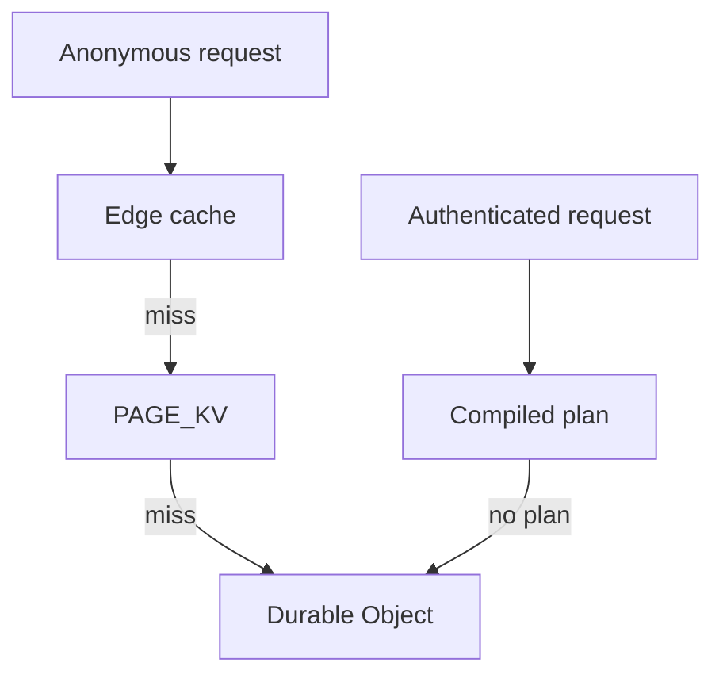

# Serving and Caching Settings

Settings for page caching, static assets, prefill, files and images, and the R2 page origin. The index of every variable is on [Configuration](configuration.md).

## Serving and Caching

| var                      | default  | what it does                                                                                              |
| ------------------------ | -------- | --------------------------------------------------------------------------------------------------------- |
| `GEN_BUCKET_MS`          | 5,000    | how long the edge reuses a resolved site generation before re-reading it                                  |
| `MAX_BODY_BYTES`         | 2 MiB    | largest non-file request body the edge forwards                                                           |
| `MAX_UPLOAD_BYTES`       | 100 MiB  | largest `multipart/form-data` body the edge forwards                                                      |
| `OUTBOUND_GUARD`         | on       | refuse an outbound fetch to a private, loopback or metadata address; `0` off                              |
| `PAGE_KV_ENABLED`        | on       | the cross-colo KV page tier; `0` off, `1` also lets free store compiled plans                             |
| `PAGE_KV_TTL`            | 86,400   | seconds a stored page lives; floored at KV's own 60 s minimum                                             |
| `KV_WRITES_PER_DAY`      | per plan | page writes to `PAGE_KV` one site may make a UTC day; 800 on free, no limit on paid                       |
| `EDGE_PLAN`              | on       | serve an authenticated page from a compiled plan in the front worker; `0` off                             |
| `CSP_MODE`               | per plan | baseline Content-Security-Policy on HTML: `off`, `report-only` or `enforce`; paid defaults to report-only |
| `SPOOL`                  | per plan | spool, the client-side replica: on for paid, off for free; `0` off, `1` on                                |
| `SPOOL_IMAGES`           | on       | convert images to WebP for browsers that accept it while spool is on; `0` off                             |
| `SPOOL_VIDEO`            | on       | add `preload="none"` to video tags while spool is on; `0` off                                             |
| `SPOOL_EMBEDS`           | on       | swap YouTube and Vimeo iframes for click-to-load facades while spool is on; `0` off                       |
| `NEVER_STALE`            | unset    | extra path prefixes that may never be served from a previous generation                                   |
| `AGED_SERVE_MAX_MS`      | 60,000   | how long a page a save superseded may still be answered while it refills; 0 off                           |
| `ASSET_AGGREGATES`       | unset    | substitute the build's CSS and JS aggregates into a stored page; `1` on, and the canonical config sets it |
| `MEMORY_CACHE_BINS`      | unset    | cache bins the interpreter holds in memory instead of in SQL; `none` turns all off                        |
| `MEMORY_CACHE_MAX_ITEMS` | 64       | entries one in-memory bin may hold before it drops its oldest                                             |
| `RENDER_BUDGET_MS`       | per plan | wall-clock ms a MISS may spend rendering before handing off to the alarm                                  |
| `FILL_BATCH_SIZE`        | per plan | pages one alarm firing may fill before re-arming; capped at 50                                            |
| `WINDOW_SITES`           | unset    | narrows the scheduled fill window to these sites; unset drives the whole fleet                            |
| `WINDOW_MAX_FILLS`       | 50       | fills one window may drive                                                                                |
| `WINDOW_WALL_MS`         | 60,000   | wall-clock ms one window may run                                                                          |

Anonymous requests pass the page tiers in this order. An authenticated request goes to a compiled plan first, and the shared tiers never hold its page.



### Static Asset Cache Lifetimes

`assets/_headers` sets `Cache-Control` on the files the asset layer serves. Without it every asset
answers `public, max-age=0, must-revalidate`, so a repeat view revalidates each stylesheet, script
and font.

| path                                 | `Cache-Control`                       |
| ------------------------------------ | ------------------------------------- |
| `/agg/*.css`, `/agg/*.js`            | `public, max-age=31536000, immutable` |
| `/core/*`, `/modules/*`, `/themes/*` | `public, max-age=31536000`            |

An aggregate's file name is the first 16 hex characters of the SHA-256 of its body
(`scripts/pack-aggregates.ts`), so a changed file gets a new URL and a year is safe. `/agg/manifest.json`
has no hash in its name and keeps the default.

The three Drupal prefixes get a year, which is what Drupal's own `.htaccess` allows
(`drupal-src/.htaccess:42`). The `?token` Drupal appends to those URLs is not tied to the shipped
files. It comes from `state` key `asset.css_js_query_string`, and only `drupal_flush_all_caches()`, a
site install and the `assets` flush step of the update chain reset it (`drupal-src/core/includes/common.inc:429`,
`src/site/php/updb/unit.php:252`). Reconciliation does not, so a pack update that changes a `/core`
file leaves an existing site's URLs the same, and a visitor keeps the old copy until it expires or
the token changes.

`_headers` has no allow line in `assets/.assetsignore` and must not get one. Wrangler ignores it by
default and reads the rules from the directory; an allow line uploads it as an ordinary asset, and a
deployed worker then answers `/_headers` with the file (200, 282 bytes, measured on a deployed worker).

HTML comes from the Worker and is not affected. `/robots.txt`, `/driver.json`, `/prefill.json`,
`/drupal-pf/*` and `/drupal-sql/*` have no rule.

### Request Headers

Drupal receives the request's headers, not only its cookie. `Authorization`, `X-Api-Key`, `Origin`,
`User-Agent` and any other header an API reads reach `$request->headers` and `$_SERVER`. Before this
the render was handed the cookie, `Accept`, the content type and the client address and nothing
else, so every bearer-token route on a headless site answered as anonymous.

Three rules keep that safe. A request that carries `Authorization` is treated like one that carries
a session: it is rendered per caller and never read from or written to the stored page, the KV tier or
the edge cache. An `Authorization` that is this deployment's owner token is dropped before PHP sees
it. `cf-*`, `x-cfw-*` and the hop-by-hop headers are dropped too, and at most 64 headers and 16 KiB
are forwarded, whole or not at all. The previous request's headers are removed from `$_SERVER` before
the next is built, so a token never outlives the request that carried it.

### `OUTBOUND_GUARD`

PHP names the URL for `cfwFetch` and `cfwQueueFetch`, so any module able to build a string chooses
where the Worker connects. The guard refuses a scheme other than `http`/`https`, a URL carrying
credentials, and any host that resolves to loopback, an RFC 1918 range, carrier-grade NAT, IPv6
unique-local or link-local, or a name ending `.local`, `.internal`, `.localhost` or `.home.arpa`.
`169.254.0.0/16` is refused as a block because `169.254.169.254` is the cloud metadata address, and
an IPv4-mapped IPv6 literal is decoded first so `::ffff:a9fe:a9fe` cannot smuggle one through.

It is a deny-list because the legitimate destination set is open-ended: every update server, OIDC
provider, webhook endpoint and CAPTCHA verifier a site might use. An allow-list would need editing
to install a module.

Checked when the request is queued and again next to the `fetch()` in the drain, since a row can
reach `cfw_http_queue` by another path. `0` turns it off, which is what the e2e rig uses to point a
site at containers on the host.

### `MAX_BODY_BYTES`

This guards the heap, and leaves bandwidth alone. `parse_str()` on a form body allocates inside a
128 MB isolate, and `foo[][][][][]=bar` repeated turns a few hundred kilobytes of wire into far more
of it. Drupal's own `post_max_size` default is 8 MB; this is tighter, because there is no separate
process to lose here.

A body that declares a `Content-Length` is checked against it, which the platform holds the body to.
A chunked body declares none, so the edge reads it under the same ceiling and stops at the first
chunk that crosses it. `GET` and `HEAD` are not checked.

`multipart/form-data` has its own ceiling, `MAX_UPLOAD_BYTES`, because a 2 MiB cap on uploads would
be a functional regression. It defaults to 100 MiB, the platform's own request limit, which is the
only limit a multipart body had before the edge counted it.

Over either limit, the edge answers 413 before any Durable Object hop. `0` disables that guard
entirely. Raising `MAX_BODY_BYTES` trades isolate headroom for larger non-upload submissions; the
failure mode of too high is an object that runs out of memory mid-parse.

Consumer: `bodyTooLarge()` and `readBounded()` in `src/site/guards.ts`.

### The KV Page Tier

`PAGE_KV` is a cross-colo tier between the edge cache and the Durable Object, on for both plans
whenever the namespace is bound. It still costs one Worker request, since the Worker has to run to
consult it, so what it buys is latency and never serving ceiling. A missing binding always wins over
`PAGE_KV_ENABLED`.

Free KV allows 1,000 writes a day for the whole account, and `CONFIG_KV` draws on the same allowance.
So the object grants each page write: an answer that may be stored carries `x-cfw-kv-grant`, and the
front worker stores nothing without it. The object counts its grants in its daily meter row and stops
at `KV_WRITES_PER_DAY`, 800 on free. Past that, the site keeps serving from what it already stored
and from the object. Only the primary grants, so replica lanes do not multiply the budget.
`/serve-stats` reports `pageKv.writesToday` against `pageKv.budget`. Compiled plans share the namespace
and carry no budget, so on free they are written only when `PAGE_KV_ENABLED` is `1`.

Stored pages are keyed by site, generation and path, so a generation bump invalidates every one of
them without enumerating or deleting anything. KV has no bulk delete, so a scheme needing one would
be uninvalidatable in practice. `PAGE_KV_TTL` is therefore a floor on garbage, and no kind of
freshness knob.

### `NEVER_STALE`

Because the previous generation's entries are still in KV after a bump, a miss at generation `N` can
be answered from `N-1` or `N-2` while the current one regenerates on the alarm chain. The response
carries `x-cfw-edge: STALE` and `x-cfw-stale-behind`, and the regeneration is queued rather than run
inline, so the visitor never waits for a render on a path that has been rendered before.

Two bounds apply together. The generation depth is 2, so a stale answer is at most two content changes
behind; a 24 hour wall-clock bound on top of it stops an abandoned site serving last month's page.

A session-carrying response can never be served stale, and that is structural rather than a check: the
stale read sits behind the same `edgeWanted` gate that requires a non-personalised response. On top of
it, a built-in deny-list refuses `/user`, `/admin`, `/cart`, `/checkout` and the other paths where a
one-change-old answer is wrong rather than merely old. `NEVER_STALE` is a comma-separated list of extra
prefixes and is added to that list rather than replacing it, so a site cannot make its own login
page staleable by configuring badly.

Consumers: `staleAllowed()` and `readStalePage()` in `src/ops/page-store.ts`.

### `MEMORY_CACHE_BINS`

A cache bin named here is held in the interpreter's memory for the life of the incarnation instead of
in the tenant's SQLite. `pib_run` performs no request shutdown, so a class static survives from one
Worker invocation to the next, which is what makes this a real tier here and a test double on an
ordinary PHP host.

The default is `dynamic_page_cache` and `menu`. `MEMORY_CACHE_BINS=none` turns the tier off, and a
variable set to an empty string takes the default, the same as an unset one.

In a measured re-render after a tag invalidation, the bin in memory charged 4 rows where the bin in
SQL charged 8, for a byte-identical page (workerd, shipping pack, the two arms differing by this
variable only). Rows written is the meter that bounds regeneration.

After an interpreter drop the in-memory bin is empty, and the next render rebuilds it. Across a drop,
the in-memory setting charged 2 rows against 6 for the SQL bin. The cost is isolate memory for the
entries held and CPU on the rebuilding render.

Bin names are bare, without the `cache_` prefix: `MEMORY_CACHE_BINS=dynamic_page_cache,render`.

An entry is validated against the cache-tag checksum on every read, the same test the database
backend applies, so an invalidation that arrives as replicated SQL rather than as a PHP call still
refuses it. That is the property a read replica depends on and the reason this is not core's
`MemoryBackend`.

`MEMORY_CACHE_MAX_ITEMS` bounds each bin. It is a count rather than a byte budget because measuring
bytes means serialising the value, which is the cost moving the bin out of SQL removes; the isolate's
own 112 MiB recycle is the backstop underneath it.

Both are on `KV_OVERRIDABLE`. The value is read when `settings.php` is composed, which happens on
every boot because the pack's filesystem is remounted each time, so a change takes effect on the
next interpreter boot rather than needing a redeploy. Source: `memoryCacheBins()` in
`src/do/levers.ts`, and `CfwCacheBackendFactory` in the `drupflare` module.

### `ASSET_AGGREGATES`

Drupal's own `css.preprocess` and `js.preprocess` ship off, because the source CSS and JS files are not
in the interpreter's filesystem and its aggregate route answers a licence header alone. `bun run
assets:agg` reads the library definitions at build time, where the files do exist, and emits immutable
per-library aggregates plus a file-to-library index. With `ASSET_AGGREGATES=1`, a page's contiguous run
of tags for a library is replaced by that library's single aggregate tag as the page is stored.

The substitution is all or nothing per library: either every tag in the run is replaced or none is.
A partial replacement would store a page that references an aggregate for some of its CSS and not
the rest.

It is on `KV_OVERRIDABLE`, so turning it on needs no redeploy.

**The aggregates have to be published as well as built, or the lever cannot work at any setting.**
`assets/.assetsignore` denies by default, so it must carry `!/agg/`. Without that the substitution
rewrites every asset tag to a URL the asset layer does not publish, the Worker answers it as a Drupal
path, and the page renders with no CSS. That is the same failure the all-or-nothing rule above exists
to prevent, arriving from the other side.
`tests/unit/runtime/assets-ignore.spec.ts` resolves every URL the substitution emits, so a page whose
stylesheets 404 fails the test suite.

Turning it on without running `assets:agg` changes nothing rather than breaking a page: an absent
manifest means no library matches.

What it buys is render time and stored bytes, not Worker requests. An individual core stylesheet,
such as `/core/themes/olivero/css/base/base.css`, is answered by the asset layer without running the
Worker, so the individual files already cost no Worker request.

### `EDGE_PLAN`

The compiled-plan tier in the front worker. On by default on both plans; `0` opts out, and an empty
value is treated as unset. It is the only tier that answers an authenticated page without a
Durable Object hop, because it is the only one whose key is per-visitor: the shared page tiers are
keyed without a user and must never hold one.

Three renders of the same page compile a plan; the first is discarded, because it warms Drupal's
asset library cache and its stylesheet list differs from every later render. The plan must reproduce
both remaining renders byte for byte, hold no slot it cannot generate, and survive a re-diff against
a freshly generated one. Anything else falls through to an ordinary render.

The key is the site, the generation, the path and the visitor's role set. Two properties make
that narrow key safe. A plan is compiled only from renders by two DIFFERENT sessions of the role set,
so anything constant for one user and different for another shows up as a region the compiler cannot
name and the plan is refused; and it is served to a session only once that session's own render has
agreed with it.

A site with a single editor never produces a second session, so a plan is also compiled under a key
that names the session and is served to nobody else. It is held in isolate memory and never mirrored
to `PAGE_KV`. The shared plan is preferred whenever one exists.

Slots are the values that differ per request or per visitor: `form_build_id`, a view's DOM id, and
the session CSRF token in the logout link. The first two are generated fresh; the token is
substituted from what the visitor's own last render carried, so a plan holding one refuses to run for
a visitor whose token this isolate has not seen.

A response that rotates the session is never compiled: a `Set-Cookie` that sets a value the request
did not already hold. Drupal re-sends the session cookie unchanged on every request when
`session.cookie_lifetime` is non-zero (its default is 2000000), so a `Set-Cookie` header alone does
not mean rotation.

Served responses carry `x-cfw-cache: PLAN` and `x-cfw-plan: mem`, `private` or `kv`; everything else
reports on `x-cfw-plan` why it did not.

`x-cfw-plan` is the edge plan and nothing else. The Cloudflare account plan is `x-cfw-account-plan`.
`x-cfw-v` carries the header contract version, and a client checks it before reading either.

An isolate serves against the last generation it learned from the object, and stops after 10 seconds
without re-learning one. That is the staleness bound, and it is the same two-window lag the shared
generation pointer already carries. A write by the visitor moves the generation on its own response,
so their own save is visible immediately.

Compiled plans are mirrored into `PAGE_KV` so a second isolate does not have to compile them again.
That read is bounded at 8 ms: a KV key a colo already holds answers in 4-5 ms, and one it has not
seen costs 46-140 ms whether it exists or not, which is more than the object hop it would replace.

Measured on a deployed paid worker, one session, one 100,748-byte authenticated page:

| where the answer came from      |          ms to response | cpuTimeMs | wallTimeMs |
| ------------------------------- | ----------------------: | --------: | ---------: |
| `EDGE_PLAN=0`, the object hop   | 10 median, 7 min (n=40) |         1 |         18 |
| a plan in this isolate's memory |  0 median and max, n=57 |         0 |          1 |

## Prefill and Mirroring

| var                     | default                   | what it does                                                                        |
| ----------------------- | ------------------------- | ----------------------------------------------------------------------------------- |
| `PREFILL`               | on for free, off for paid | seed the serving table from `assets/prefill.json`                                   |
| `PREFILL_ON_SAVE`       | on                        | re-render invalidated paths after a content save                                    |
| `PREFILL_ON_SAVE_LIMIT` | 25                        | paths one save may queue                                                            |
| `SAVE_DEBOUNCE_MS`      | 2000                      | how long the refill after a save waits for the rest of a burst; `0` refills at once |
| `MIRROR_LIMIT`          | per plan                  | files one alarm firing may push to R2; capped at 25                                 |
| `R2_WRITES_PER_MONTH`   | 900000                    | R2 writes both mirrors may spend in a UTC month; `0` turns both off                 |
| `HTTP_DRAIN_ON_ALARM`   | on                        | drain queued outbound requests from the alarm                                       |
| `HTTP_DRAIN_LIMIT`      | per plan                  | queued outbound requests one firing may fetch; capped at 25                         |

`PREFILL` is on for free because free is where a cold first request costs the most: a prefilled path
is a hit on its first ever request. It is off during a bake, or every render would be a hit of the
file being rebuilt.

`SAVE_DEBOUNCE_MS` holds the refill after a save for a short window, so a burst of saves costs one
generation bump and one render of each affected page. A refill that ran between two saves would
reopen the invalidation and make the second save pay for both again. The window starts at the first
save and later saves do not extend it. A visitor who asks for an invalidated page is still served at
once; only the pages nobody has asked for wait.

`R2_WRITES_PER_MONTH` caps what the file and page mirrors spend together. R2's allocation is
1,000,000 Class A operations a month per account, and every put past it is billed; the default stops
one site at 90% of that. The count is kept in `cfw_meta` under a key that names the month, so it
resets on the first of each month. Deletes count as well, so the tally reads high. A spent budget
leaves the rest of the queue in place and every file keeps serving from the object, which holds the
bytes either way. `/serve-stats` reports the month's tally as `r2`. Set it to `0` to stop both
mirrors while leaving `FILES` bound. On an account running several sites, divide the allocation
between them.

The share of traffic worth serving off the Worker depends on the traffic mix and on CDN absorption.
`optimalOffWorker()` in `scripts/measure/free-envelope.ts` computes it from the same model the free-plan
envelope uses.

## Files and Images

| var                 | default   | what it does                                                        |
| ------------------- | --------- | ------------------------------------------------------------------- |
| `FILES_PUBLIC_URL`  | unset     | origin a mirrored public file is linked from; unset uses the Worker |
| `IMAGE_ENGINE`      | `tinyimg` | which engine produces derivatives; `images` for Cloudflare Images   |
| `EAGER_DERIVATIVES` | on        | render an upload's image styles on the rendering lanes; `0` off     |

### Image Styles

A public image style's URL points at the Worker's delivery path, `/cfw-img/<id>/<uri>?<transform>`,
where the front worker renders the derivative with tinyimg. The drupflare module rewrites the URL
from the style's effect chain: scale, scale-and-crop, resize and convert each map to one transform.
A chain that cannot be expressed as one transform, and any private file, keeps Drupal's stock URL.

With `RENDER_LANES` bound, an image written to `public://` is queued, and the next alarm renders
every configured style at once on the rendering lanes, Durable Objects that hold no Drupal state.
The results are stored under `public://cfw-derivatives/`, and the image route answers a stored copy
in place of the source on the request it already makes, marked `x-cfw-image: STORED`. In measurement on
a deployed worker with the four shipped styles (n=5), the render job took 984-1,718 ms on four lanes
with five or six Durable Object requests. A stored first view answered in 41-91 ms, and the same style
rendered on first view took up to 1,647 ms. Stored and rendered bytes were identical in all 20
comparisons. Through the media form, an upload answered 303 in 750-939 ms and all four styles were
stored 3.9-4.4 s after the POST. `EAGER_DERIVATIVES=0` returns to rendering on first view.

### `FILES_PUBLIC_URL`

Unset, every file is served through the Worker, which is correct and costs one Worker request per
file. The front worker answers `/sites/default/files/<path>` from the object's file store and caches
it for 300 seconds. Drupal has no route for a public file, so until this route existed every public
original answered Drupal's 404 on a site with no mirror. PNG, JPEG, GIF, WebP and AVIF render inline;
every other type, SVG and PDF included, is sent as a download under a sandboxing
`Content-Security-Policy`, because the file shares the site's origin and its session cookie. Set to
an R2 custom domain, a public file that has already mirrored to the `FILES` bucket is
linked at that origin instead and costs no Worker request at all.

That is one of only two paths on the platform that cost nothing. A zone Cache Rule is not one of them:
the Worker runs before the cache is consulted, so a cache hit still spends an invocation. The two are
a static asset and a hostname that is not routed to the Worker.

Two files never get the external URL. A `private://` file is never linked externally at any setting,
because the bucket has no session and the URL would bypass Drupal's access check. A public file that
has not mirrored yet keeps the Worker URL, because the alternative is a 404 on a file the site holds.

### `IMAGE_ENGINE`

`tinyimg` is the default and runs in the front worker, where it never meets PHP's heap. It needs no
zone, no binding and no subrequest, and it has no monthly cap.

Cloudflare Images is reachable with `IMAGE_ENGINE=images`. It is the only one of the two that encodes
AVIF, and it costs a zone with transformations enabled, does not exist on `*.workers.dev`, and caps at
5,000 transformations a month. Against the four shipped image styles that is 1,250 images before a
site stops generating derivatives.

The toolkit reports the engine's real format list. All four
shipped styles are `image_scale` plus `image_convert_avif`, and core's `AvifImageEffect` asks the
toolkit whether AVIF is supported before using it, falling through to the style's configured fallback
of `webp` when the answer is no. So core degrades on its own with no config change, provided the
toolkit tells the truth. Claiming `avif` on the tinyimg engine produces a logged failure instead of a
fallback.

Measured on a deployed free worker, `cpuTime` amortised over 10 transforms per invocation, median of
12, against a source-only control at 0 ms: thumbnail 36.3 ms, medium 48.6, large 63.5, wide 188.2.
Styles at or below 480 px on the long edge are produced inline; larger ones go to the fill queue.

gd is not an engine. Code that calls PHP's `imagecreate*` functions directly finds them absent on this
runtime.

## R2 Page Origin Caching

Mirroring pages to R2 moves them off the Worker, and an R2 public bucket on a custom domain serves
them. How much of that traffic Cloudflare's CDN absorbs in front of the bucket decides whether the
off-Worker lever is worth anything: an absorbed read costs neither a Worker request nor an R2 Class B
operation.

Absorption is 0 without a Cache Rule and about 7/8 with one. Measured with GET against
a cold object each time:

| Condition                   | Result                   |
| --------------------------- | ------------------------ |
| Cache Rule on, cold object  | MISS, then 7 / 7 HIT     |
| Cache Rule off, cold object | MISS, then 7 / 7 DYNAMIC |

A second object under the same rule read 1 MISS, 7 HIT and 2 DYNAMIC across 10 requests, which is the
same picture with two requests landing at a PoP that had not filled yet.

**Measure with GET, never `curl -I`.** HEAD is what `curl -I` sends, Cloudflare does not populate its
cache from a HEAD, and every reading comes back `DYNAMIC`.

### The Cache Rule

One rule, scoped to the CDN hostname and nothing else:

```text
expression:        (http.host eq "drupflare-cdn.example.com")
action:            set_cache_settings
action_parameters: { "cache": true, "edge_ttl": { "mode": "override_origin", "default": 3600 } }
```

In the dashboard it is Caching > Cache Rules > Create rule, with the hostname as the only
condition and "Eligible for cache" plus an edge TTL override. Over the API it is
`PUT /zones/{ZONE_ID}/rulesets/phases/http_request_cache_settings/entrypoint`.

**A PUT to an entrypoint replaces every rule in it.** Read the entrypoint first and merge; on a zone
that has never had a cache-phase ruleset the entrypoint does not exist yet and creating it destroys
nothing.

One zone-scoped permission creates it: `Zone > Cache Rules > Edit`. Cloudflare's documentation
also lists the account-scoped `Account Rulesets: Edit` and `Account Filter Lists: Edit`. This rule
shape needs neither.

### Smart Tiered Cache

Every PoP fills independently, so a request reaching a cold PoP is a MISS and an R2 Class B read.
Tiering routes a PoP miss through an upper tier instead of to the bucket, which changes absorption
from per-PoP to hierarchical.

Enable it at Caching > Tiered Cache, or with the API:

<details>
<summary>Tiered Cache API command</summary>

```sh
curl "https://api.cloudflare.com/client/v4/zones/$ZONE_ID/cache/tiered_cache_smart_topology_enable" \
  --request PATCH \
  --header "Authorization: Bearer $CLOUDFLARE_API_TOKEN" \
  --json '{ "value": "on" }'
```

</details>

The token needs `Zone Settings Write` or `Zone Write`. Tiered Cache and Smart Topology are both
available on the Free plan; Generic Global, Regional and Custom topologies are Enterprise only.
Cloudflare selects the upper tier automatically for a zone using R2 as an origin.

### Absorption in the Model

`cdnAbsorption` in `scripts/measure/free-envelope.ts` defaults to 0.

Absorption follows the traffic. It depends on reads per colo per TTL window, so a site with few views
spread over many PoPs absorbs almost nothing, and the same site at high traffic absorbs nearly
everything. Zero is the floor for a low-traffic site and for any site with no rule.

`cdnAbsorption` is a code-level option. The command line takes `--visits`, `--dynamic` and `--warmth`
only; absorption is passed to `envelope()`, `optimalOffWorker()` and `scoreWorkload()` in
`scripts/measure/free-envelope.ts`.

Drupflare does not create the Cache Rule. It changes a zone the operator owns, and the model's default
stays at 0 until an operator applies the rule.
