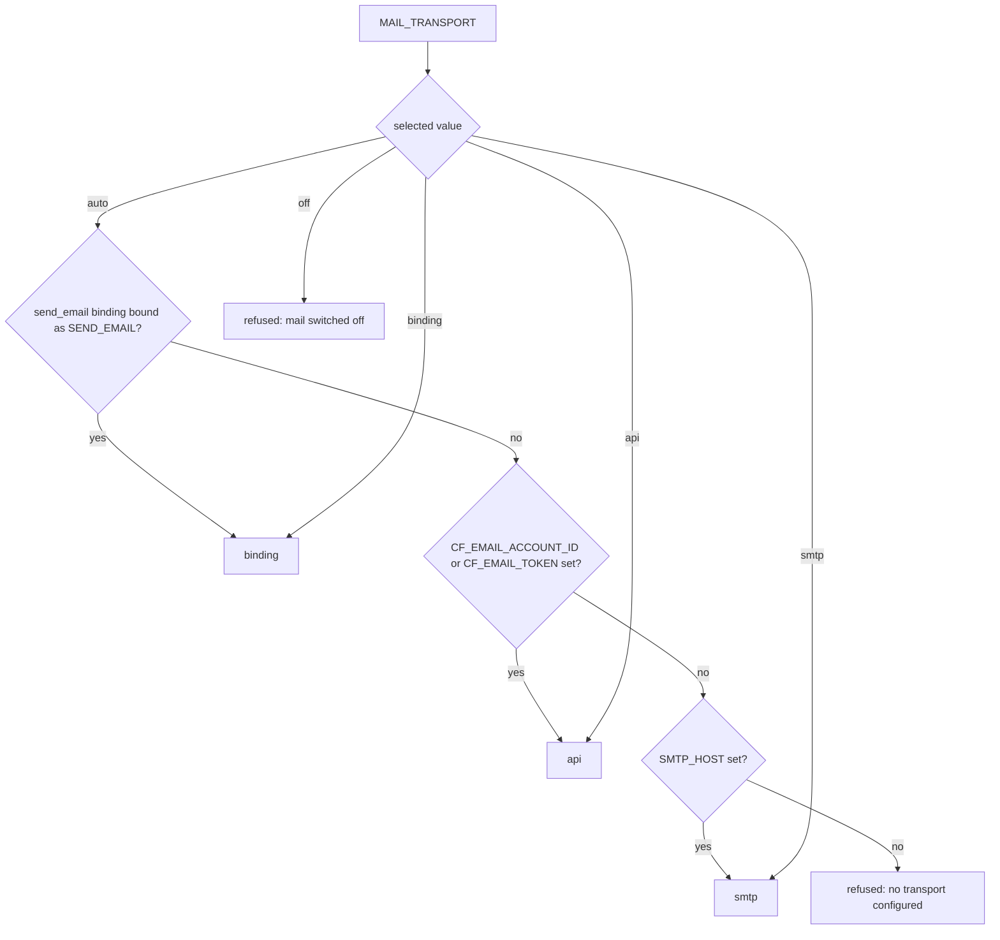

# Outbound Mail

Drupal's mail plugin is `cfw_mail`, and it hands the message to the Worker. The Worker resolves one
of three transports and commits the message to `cfw_mail_queue`; the alarm sends it. `src/ops/mail.ts`
is the implementation.

The plugin is claimed by a config override that the module registers, not by `settings.php`.
Assigning `system.mail:interface.default = cfw_mail` from `settings.php` would name a plugin of a
module the site may not have installed, and `MailManager` throws `PluginNotFoundException` for an id it
cannot resolve. `MailInterfaceOverride` runs only when `drupflare` is installed, and it yields to `smtp`
on a site that has `smtp`.

| var                   | default  | what it does                                               |
| --------------------- | -------- | ---------------------------------------------------------- |
| `MAIL_TRANSPORT`      | `auto`   | `auto`, `binding`, `api`, `smtp` or `off`                  |
| `MAIL_FROM`           | none     | the From for a message that carries none                   |
| `MAIL_DRAIN_ON_ALARM` | on       | send queued mail from the alarm                            |
| `MAIL_DRAIN_LIMIT`    | 5        | messages one firing may send; capped at 25                 |
| `CF_EMAIL_ACCOUNT_ID` | none     | the account the Email Sending REST API posts under         |
| `CF_EMAIL_TOKEN`      | none     | an API token with Email Sending: Edit; a secret, not a var |
| `SMTP_HOST`           | none     | submission host for the third-party lane                   |
| `SMTP_PORT`           | 587/465  | 587 for STARTTLS, 465 for implicit TLS                     |
| `SMTP_TLS`            | starttls | `starttls`, `implicit` or `off`                            |
| `SMTP_USER`           | none     | submission user; omit for an unauthenticated relay         |
| `SMTP_PASS`           | none     | submission password; a secret                              |
| `SMTP_AUTH`           | `PLAIN`  | `PLAIN` or `LOGIN`                                         |

`auto` takes the first transport that is configured, in the order binding, api, smtp. The binding
leads because it spends no credential. The api transport is selected by either of its two variables,
and when only one is set the send is refused rather than falling through to smtp. The choice runs as
follows.

## The `smtp` Module's Own Settings

A site with `drupal/smtp` installed and configured needs none of the `SMTP_*` vars. The module
installs on this runtime and its socket never runs, so its settings would otherwise sit unread while
an operator typed the same relay a second time. Its
`smtp.settings` is read and mapped onto the transport: `smtp_host`, `smtp_port`, `smtp_username`,
`smtp_password` and `smtp_from` map across directly, and `smtp_protocol` maps `ssl` to implicit TLS,
`tls` to STARTTLS and `standard` to no encryption. `smtp_on` turned off is honoured.

A var always wins over the setting it corresponds to. A var is set by whoever can deploy the
Worker; the settings form is reachable by anyone who can get to a Drupal admin page. So the settings
fill gaps only, and setting `SMTP_HOST` pins the relay regardless of what the site is configured
with.

## What Each Transport Reaches

`binding` uses a `send_email` binding named `SEND_EMAIL`, declared in your own Wrangler config. `api`
uses the Email Sending REST API. Cloudflare applies the same limits to both, and to its own SMTP
endpoint, so the choice between them comes down to credentials. Two account-level facts decide what
either can reach:

- **A sending domain that is not onboarded** reaches verified destination addresses only: the 200
  per account that somebody confirmed by clicking a link. Onboarding the domain with SPF and DKIM on
  Cloudflare DNS lifts that immediately.
- **Workers Free has no outbound Email Sending.** The one carve-out is that sends to verified
  destination addresses are free on every plan, from your routing domains, against no quota.

So a free site can mail its owner and cannot mail a visitor who just registered. Third-party SMTP is
the only general answer on free, and a rejected Cloudflare send says so in its error text, with no
status code to read.

## The `send_email` Binding

The canonical config does not declare `send_email`. It is an ordinary Wrangler binding, so adding
one is a redeploy, and `allowed_destination_addresses` / `destination_address` narrow what it may reach.
Its prerequisites are account state the deploy button cannot provision: Email Routing enabled, at least
one verified destination address, and an onboarded sending domain. `api` needs only the token that
`/setup/cf` grants, so it is the transport the product provisions, and the binding is an opt-in.

## SMTP

SMTP is the only transport that opens an outbound TCP socket, and an outbound socket is on
Cloudflare's list of conditions that prevent a Durable Object from hibernating. The object is
therefore billed for compute duration for the length of the send, and the queue drains sequentially,
so a batch is billed for the whole batch. The socket is closed in a `finally`, which caps the
exposure at the send itself, well under the 15-minute maximum a connection can defer eviction by.
The `api` and `binding` transports use `fetch`, which never holds an object in memory.

Port and TLS refusals

Port 25 is blocked on Workers; `MAIL_TRANSPORT=smtp` with `SMTP_PORT=25` is refused by name, before
any attempt. `smtp.mx.cloudflare.net` is refused too: it resolves inside `162.158.0.0/15`, a
published Cloudflare range, and outbound TCP to those is blocked. Use `MAIL_TRANSPORT=api` or the
binding for Cloudflare mail. `SMTP_TLS=off` together with `SMTP_USER` is refused, because it would
put the relay password on the wire.

## Limits and What a Refusal Means

A message is refused at commit, where `CfwMail` logs the reason next to the operation that produced
it, for: no recipient, no From, more than 50 recipients across To/Cc/Bcc, a subject over 998
characters, headers over 16 KB, or a payload over 1,000,000 bytes. That last one derives from the
Durable Object record ceiling of 2,199,995 bytes; Cloudflare's own 5 MiB is the looser of the two and
never fires first.

A failure after commit is only visible on `/serve-stats`, under `mailQueue`, `lastMailDrain` and
`lastMailDrainAt`. A failed send is not retried: a send is not idempotent, and a password reset
delivered twice with two different one-time links is worse than one that did not arrive.

Mail sent through the `send_email` binding shows as dropped in the Email Routing summary even
when it was delivered. Read Email Sending metrics instead.

## Connecting a Cloudflare Account

Two ways, both owner-authenticated. Pasting `CF_EMAIL_ACCOUNT_ID` and `CF_EMAIL_TOKEN` needs no
setup. OAuth issues a short-lived scoped grant instead, revocable from the Cloudflare dashboard.

Owner-authenticated means `Authorization: Bearer <ownerToken>`, the token `/firstrun` returns once
when the site is claimed. Without it these routes answer 401 with a `WWW-Authenticate: Bearer`
challenge. `README.md` covers claiming.

`GET /setup/cf?action=connect&client_id=<id>` starts the flow and returns an authorize URL;
`/setup/cf/callback` completes it; `?action=status` reports whether an account is connected and
`?action=disconnect` revokes the grant at Cloudflare as well as forgetting it locally.

Registering the OAuth client

OAuth needs a client the operator registers once, under Manage account > OAuth clients, with
`https://<your-site>/setup/cf/callback` as its redirect URI and `private` visibility. A redirect URI
is registered against the client and every deployment answers on a different origin, so there is no
shared client that could serve all of them. The flow is Authorization Code with PKCE (S256) and
carries no client secret.

The client ID is stored in the site's own database, away from KV. It carries no secret, and a KV
writer who could change it would point the consent screen at an application they control.

Scopes requested: `user:read`, `account:read`, `email:read`, `email:write`. Onboarding a sending
domain additionally needs zone DNS write, which is why it is a separate opt-in step.

## Onboarding a Sending Domain

`GET /setup/mail?zone=<zone-id>` reports which step the domain is waiting on;
`?action=apply` creates the sending subdomain and writes the DNS records. Owner-authenticated, and
safe to re-run: a settled zone costs zero API calls.

| stage                   | meaning                                                      |
| ----------------------- | ------------------------------------------------------------ |
| `no-zone`               | pick the zone this site sends from                           |
| `needs-subdomain`       | create the sending subdomain on that zone                    |
| `needs-dns`             | records still to write, counted in `waitingOn`               |
| `awaiting-verification` | click the link Cloudflare emailed to the destination address |
| `ready`                 | mail can send                                                |

`settled` means re-running changes nothing; onboarding may still be unfinished.
`awaiting-verification` is settled, because nothing more can be done from this side.

A sending subdomain is zone-scoped. Six records are written: three MX and an SPF TXT on the
return-path host, a DKIM TXT at `<selector>._domainkey`, and a DMARC TXT on the apex.

**An existing DMARC record is reported, never overwritten.** It states a policy for every mail
stream on the domain, so replacing `p=none` with `p=reject` would tell receivers to bounce
unauthenticated mail from senders that have nothing to do with this site. It appears under
`advisories` with both values, and the flow still reaches `ready`.

Destination-address verification is pollable: the address carries `status` and a `verified`
timestamp, so the surface updates on its own.
