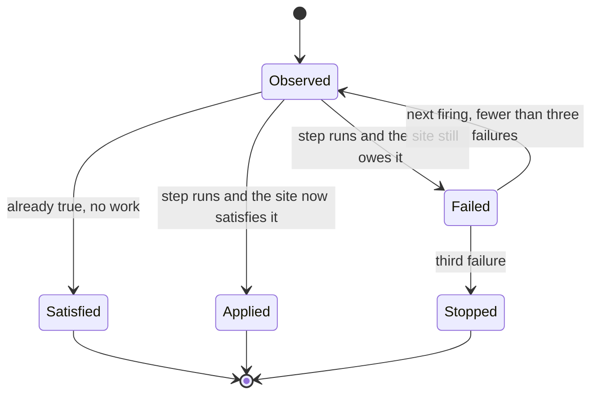

# Updates and Reconciliation

How database updates run, how a pack update reaches an existing site, and the sweep over addressable state.

## Database Updates

`updb` slices Drupal's own update path across invocations. Each var here bounds a slice, a pass or a whole run.

| var                       | default | what it does                                     |
| ------------------------- | ------- | ------------------------------------------------ |
| `UPDB_FLUSH_SPLIT`        | on      | split a cache flush across invocations           |
| `UPDB_ALLOW_UNBOUNDED`    | off     | permit an update with no measurable bound        |
| `UPDB_SNAPSHOT_MAX_ROWS`  | none    | rows a pre-update snapshot may hold              |
| `UPDB_RETRY_POLICY`       | none    | how a failed slice is retried                    |
| `UPDB_ON_ABORT`           | none    | what happens to a run that cannot continue       |
| `UPDB_MAX_ATTEMPTS`       | none    | attempts per slice                               |
| `UPDB_MAX_PASSES`         | none    | passes over the update list                      |
| `UPDB_MAX_COLD_WAITS`     | none    | consecutive cold-object waits tolerated          |
| `UPDB_MAX_BEATS`          | none    | alarm beats one run may consume                  |
| `UPDB_CHECK_REQUIREMENTS` | none    | run Drupal's own update requirements check first |

Read `src/ops/updb.ts` before changing any of these; the defaults are what a sliced update was
measured against.

## Pack Reconciliation

The pack delivers only at provisioning, so a fix that lands inside it reaches new sites and no
existing one. Reconciliation is the delivery path for the rest.

| var         | default | what it does                                            |
| ----------- | ------- | ------------------------------------------------------- |
| `RECONCILE` | on      | brings an existing site up to the pack that ships today |

Each step in `src/ops/reconcile.ts` carries an observation of the site's end state, asked before the
step runs and again afterwards. So a site provisioned after a fix answers `satisfied` and is marked
done without doing any work, and a step that ran and left the site still owing it is recorded as
failed rather than applied. A step gets three attempts before it stops being retried and stays
visible on the status report. The states a step moves through:

A step that changes configuration or state runs through Drupal's own writers rather than SQL.
`ConfigFactory::save()` already clears `cache_config` and invalidates `config:<name>`; a host
re-deriving that list gets it wrong, and the copy it forgets is the one that made the original
`cache.page.max_age` fix inert on every site.

Every applied step drops the heap image, unconditionally. A restored kernel predates whatever the
step just changed.

`GET /reconcile` reports every step and its standing. `POST /reconcile` drives one. The alarm chain
drives it on its own; the route is for an operator who wants a fix now rather than at the next
firing. Off is for a site being debugged against a known state, and leaving it off means a security
fix in the pack never arrives.

The D1 fleet inventory carries `reconcile_version` beside the pack generation. The pack generation
says which pack a site was provisioned from and never moves afterwards, so on its own it cannot tell
a patched old site from an unpatched one.

## The Addressable Sweep

Page coverage is demand-driven: a URL renders when a visitor asks for it, and that visitor waits.
The sweep enumerates the addressable space from the `router` table and the entity tables, ranks it,
and queues the top of the list for the fill batch that already exists.

| var                   | default | what it does                                   |
| --------------------- | ------- | ---------------------------------------------- |
| `SWEEP`               | off     | enumerate and queue uncovered addressable URLs |
| `SWEEP_ROWS_FRACTION` | 0.25    | share of the day's rows it may spend, 0.01-0.5 |

It never renders. Every path goes into the fill queue and the alarm's fill batch drains it under the
memory break it already has, so the sweep cannot be the batch that crosses the isolate limit.

The governor sets the limits. It refuses below a remaining-budget floor, spends at most its declared
fraction of the day's rows and Durable Object requests, resumes tomorrow when spent, and carries a
cursor so a partial sweep does not repeat work. Enumeration reads the `router` table and the entity
tables and never crawls the site's own links, which would walk the facet and pager space and spend
the budget on URLs nobody requests.

Off by default for a meter reason rather than caution: the row and DO quotas are account-wide and a
site reads only its own, so four sweeping sites saturate the account while each one reads itself as
healthy. `src/ops/fleet.ts` is the inventory a fleet-aware share would read.

`GET /sweep` reports coverage and the governor's last decision, including the reason when it
declines. `GET /sweep?run=1` forces a step off its interval.
