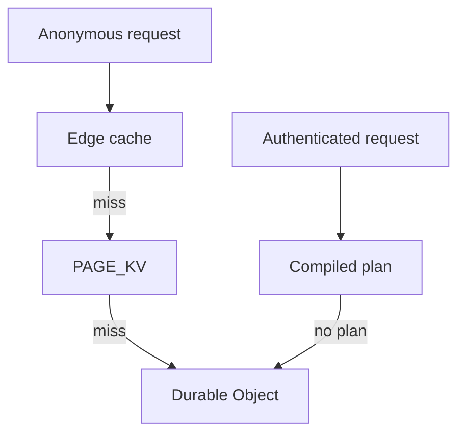

# Serving and Caching Settings

Settings for page caching, static assets, prefill, files and images, and the R2 page origin. The index of every variable is on [Configuration](../index.md).

## Pages

- [Page Cache Settings](page-cache.md): the KV page tier, NEVER_STALE, MEMORY_CACHE_BINS and EDGE_PLAN.
- [Static Asset Settings](static-assets.md): asset cache lifetimes, request headers and ASSET_AGGREGATES.
- [Request Limits](request-limits.md): OUTBOUND_GUARD and MAX_BODY_BYTES.
- [Files, Images and Prefill](files-and-images.md): prefill and mirroring, files and image styles.
- [R2 Page Origin Caching](r2-page-origin.md): a cache rule, tiered cache and the model terms for an R2 page origin.

## Serving and Caching

| var                      | default  | what it does                                                                                              |
| ------------------------ | -------- | --------------------------------------------------------------------------------------------------------- |
| `GEN_BUCKET_MS`          | 5,000    | how long the edge reuses a resolved site generation before re-reading it                                  |
| `MAX_BODY_BYTES`         | 2 MiB    | largest non-file request body the edge forwards                                                           |
| `MAX_UPLOAD_BYTES`       | 100 MiB  | largest `multipart/form-data` body the edge forwards                                                      |
| `OUTBOUND_GUARD`         | on       | refuse an outbound fetch to a private, loopback or metadata address; `0` off                              |
| `PAGE_KV_ENABLED`        | on       | the cross-colo KV page tier; `0` off, `1` also lets free store compiled plans                             |
| `PAGE_KV_TTL`            | 86,400   | seconds a stored page lives; floored at KV's own 60 s minimum                                             |
| `KV_WRITES_PER_DAY`      | per plan | page writes to `PAGE_KV` one site may make a UTC day; 800 on free, no limit on paid                       |
| `EDGE_PLAN`              | on       | serve an authenticated page from a compiled plan in the front worker; `0` off                             |
| `CSP_MODE`               | per plan | baseline Content-Security-Policy on HTML: `off`, `report-only` or `enforce`; paid defaults to report-only |
| `SPOOL`                  | per plan | spool, the client-side replica: on for paid, off for free; `0` off, `1` on                                |
| `SPOOL_IMAGES`           | on       | convert images to WebP for browsers that accept it while spool is on; `0` off                             |
| `SPOOL_VIDEO`            | on       | add `preload="none"` to video tags while spool is on; `0` off                                             |
| `SPOOL_EMBEDS`           | on       | swap YouTube and Vimeo iframes for click-to-load facades while spool is on; `0` off                       |
| `NEVER_STALE`            | unset    | extra path prefixes that may never be served from a previous generation                                   |
| `AGED_SERVE_MAX_MS`      | 60,000   | how long a page a save superseded may still be answered while it refills; 0 off                           |
| `ASSET_AGGREGATES`       | unset    | substitute the build's CSS and JS aggregates into a stored page; `1` on, and the canonical config sets it |
| `MEMORY_CACHE_BINS`      | unset    | cache bins the interpreter holds in memory instead of in SQL; `none` turns all off                        |
| `MEMORY_CACHE_MAX_ITEMS` | 64       | entries one in-memory bin may hold before it drops its oldest                                             |
| `RENDER_BUDGET_MS`       | per plan | wall-clock ms a MISS may spend rendering before handing off to the alarm                                  |
| `FILL_BATCH_SIZE`        | per plan | pages one alarm firing may fill before re-arming; capped at 50                                            |
| `WINDOW_SITES`           | unset    | narrows the scheduled fill window to these sites; unset drives the whole fleet                            |
| `WINDOW_MAX_FILLS`       | 50       | fills one window may drive                                                                                |
| `WINDOW_WALL_MS`         | 60,000   | wall-clock ms one window may run                                                                          |

Anonymous requests pass the page tiers in this order. An authenticated request goes to a compiled plan first, and the shared tiers never hold its page.

