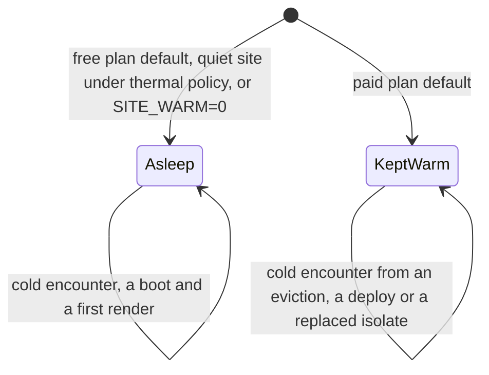

# Energy

How much electricity a Drupflare site uses against the hosting it replaces, and where the saving comes from. [Energy Per View](energy-views.md) and [Fleet Energy](energy-fleet.md) extend the model; [Environment](environment.md) turns the totals into carbon and water, and [Economics](economics.md) prices them. Every figure carries a label defined on [Impact](impact.md#measurement-labels). Numbered citations such as [1] refer to the [References](impact.md#references) list on Impact.

## Energy Savings

Total energy of one site over a year, idle included, for drupflare and for a production deployment. A
conventional deployment draws power whether or not anyone visits; drupflare's figure is the CPU time
its views use, logged-in views included. Every cell is `derived (modelled)`: no source sizes a
production node, so the production shapes are modelled, and drupflare's energy is derived from
measured CPU time on the traffic mix. A month is a twelfth of each figure. Generated by
`bun scripts/economics/perview.ts`.

This is the sleeping state, a site that holds nothing between requests. A site kept warm, or one that
wakes cold, draws more. [Operating States](#operating-states) prices both, and the saving against
production stays above 99.5% in every state.

| views a month | drupflare, energy a year | production, energy a year | energy saved a year | saving against production | saving against peak-sized |
| ------------: | -----------------------: | ------------------------: | ------------------: | ------------------------: | ------------------------: |
|        10,000 |                 0.525 Wh |                   224 kWh |             224 kWh |        426,766x, 99.9998% |        742,503x, 99.9999% |
|       100,000 |                  2.14 Wh |                   224 kWh |             224 kWh |        104,856x, 99.9990% |        182,432x, 99.9995% |
|     1,000,000 |                  18.3 Wh |                   224 kWh |             224 kWh |         12,274x, 99.9919% |         21,355x, 99.9953% |
|    10,000,000 |                   180 Wh |                   224 kWh |             224 kWh |          1,249x, 99.9199% |          2,173x, 99.9540% |
|    30,000,000 |                   538 Wh |                   224 kWh |             224 kWh |            417x, 99.7601% |            725x, 99.8621% |

Production is three regions with a high-availability web pair and database pair in each, sized at 15%
utilisation. Peak-sized is the same three regions with 8-vCPU nodes at 10%, 390 kWh a year. The
multiple is the ratio of the two totals. It grows as traffic falls because drupflare's total has no
idle term, so quote the percentage.

What those savings compare to, at 10,000,000 views per site per month, `derived` from the same totals
by `bun scripts/economics/comparison.ts --md`:

| sites | against               | electricity              | carbon               | servers not built                 |
| ----- | --------------------- | ------------------------ | -------------------- | --------------------------------- |
| 1     | production            | one US home for 7 days   | 180 lb CO2e          | 1/14 of one server not built      |
| 1     | peak-sized production | one US home for 13 days  | 330 lb CO2e          | a seventh of one server not built |
| 10    | production            | one US home for 75 days  | 1,800 lb CO2e        | a half of one server not built    |
| 10    | peak-sized production | one US home for 131 days | 3,300 lb CO2e        | 1 server not built                |
| 100   | production            | 2 US homes for a year    | 1 car off the road   | 7 servers not built               |
| 100   | peak-sized production | 3 US homes for a year    | 3 cars off the road  | 15 servers not built              |
| 1,000 | production            | 20 US homes for a year   | 18 cars off the road | 75 servers not built              |
| 1,000 | peak-sized production | 36 US homes for a year   | 32 cars off the road | 150 servers not built             |

Every figure is rounded down, so each is a floor. A server is the share of one 640-thread host the
model assigns to the deployment: 12 nodes at 4 or 8 vCPU each, counted in whole servers and, below
one, as the largest unit fraction that fits, `derived (modelled)`. The host is the SPECpower result
for a Dell PowerEdge R6725 with two AMD EPYC 9845 chips, 320 cores and 640 hardware threads, which
idles at 135 W and draws 711 W at 100% load [1]. A US home is the EIA's 2022 average of 10,791 kWh
a year [2], and a passenger vehicle emits about 4.6 t of CO2 a year [3].

## Production Baseline

Enterprise Drupal runs oversupplied. Teams that put performance ahead of cost run high-availability,
multi-region deployments sized for peak, and those nodes draw their idle power around the clock. The
baseline is three regions, a high-availability web pair and database pair in each (12 nodes), 4-vCPU
nodes sized at 15% utilisation. Each node owns its vCPUs' share of a 640-thread host drawing 135 W
idle and 711 W at full load, at the 1.54 colocation PUE.

A deployment's annual energy `E`, in kWh, is its node count `n` times each node's share of the
640-thread host (`v` vCPUs over 640), times the host's power at utilisation `u`, times PUE, over
8,766 hours. The host's power is 135 W idle plus 576 W (711 less 135) scaled by `u`:

```math
E = \frac{n v}{640} (135 + 576 u) \cdot 1.54 \cdot \frac{8766}{1000}
```

That deployment draws 224 kWh a year while idle-dominated. drupflare serving the same site at 1
million views a month draws 18.3 Wh a year. The saving is the percentage by which drupflare's annual
energy `E_d` falls below the deployment's `E_p`:

```math
S = 100 \cdot (1 - \frac{E_d}{E_p})
```

At one million views that is a saving of 99.9919%.

Idle energy of each deployment, and the saving of one drupflare site against it by views a month, the
worst case last. `derived (modelled)`, from `bun scripts/economics/perview.ts`.

| deployment                                       | idle energy (kWh a year) |   10,000 |  100,000 | 1,000,000 | 10,000,000 | 30,000,000 |
| ------------------------------------------------ | -----------------------: | -------: | -------: | --------: | ---------: | ---------: |
| production: 3 regions, 12 nodes, 4 vCPU, 15%     |                    224.2 | 99.9998% | 99.9990% |  99.9919% |   99.9199% |   99.7601% |
| peak-sized: 3 regions, 12 nodes, 8 vCPU, 10%     |                    390.0 | 99.9999% | 99.9995% |  99.9953% |   99.9540% |   99.8621% |
| single-region HA: 1 region, 4 nodes, 4 vCPU, 15% |                     74.7 | 99.9993% | 99.9971% |  99.9756% |   99.7597% |   99.2802% |
| worst case: one small VPS, 2 vCPU, 15%           |                     9.34 | 99.9944% | 99.9771% |  99.8045% |   98.0780% |   94.2413% |

The node count, the vCPU per node and the utilisation are modelled, because no source sizes a
production node. The topology follows Acquia's high-availability design, which spreads a site over several
availability zones of one region [4], and the AWS reference architecture for Drupal, whose subnets
sit in two or three zones [5]. Neither states instance sizes. The 135 W and 711 W server power, the 320 cores and the
640 threads are the SPECpower result [1]. The PUE is 1.54 for the conventional host and 1.15 for
Cloudflare's hyperscale facilities, both Uptime Institute averages [6]. A VPS vCPU is a hardware thread,
so a node owns its vCPUs over 640 of the host.

drupflare's busy core is a physical core, because each Workers isolate thread runs on one. Its energy
is CPU time on the traffic mix at 2.22 W a core, charged under [Watts For A Busy
Core](#watts-for-a-busy-core), with logged-in views at the compiled-plan cost. [Energy Per
View](energy-views.md#energy-per-view) has the mix and the plan.

The saving is the idle term. These nodes are provisioned for peak, so almost all of their energy is
spent waiting. A site that sleeps between requests holds no compute and spends energy only while a
view, a render or a cold boot executes. A site kept warm also pays for its warming and holds its
memory, which [Operating States](#operating-states) prices. Per request the two runtimes are at
parity, as the measurements below show, so none of this comes from PHP running faster.

### Watts For A Busy Core

The 2.22 W charge is the host's 711 W at full load over its 320 cores. A busy core is charged its
idle share plus the marginal draw that load adds, where `W_core` is watts per busy core, 135 W is the
idle draw and 576 W the rise from idle to full load:

```math
W_{\text{core}} = \frac{135 + 576}{320} = \frac{711}{320} = 2.22
```

The 2.22 W charge is the full-load end of the measured curve, so it is a floor: a host that runs
below full load spends more per busy core-second. From the same SPECpower result [1], `derived`:

| host load | watts per busy core | against the model | linear model understates the draw by |
| --------: | ------------------: | ----------------: | -----------------------------------: |
|      100% |                2.22 |             1.00x |                                1.00x |
|       50% |                2.91 |             1.31x |                                1.10x |
|       30% |                3.76 |             1.69x |                                1.17x |
|       15% |                5.88 |             2.65x |                                1.27x |
|       10% |                8.00 |             3.60x |                                1.33x |

The idle and full-load points are the result's own, and the 256 W at 10% load and 466 W at 50% are
read from it. Charging 8.0 W a busy core raises drupflare's 0.525 Wh a year at 10,000 views to 1.89 Wh
and leaves the saving at 99.98% against one small VPS. It cancels in every per-view ratio below,
because both sides are priced at the same watts per core.

The conventional figures carry the opposite error. The model interpolates linearly between idle and
peak, which gives 221 W for a host at 15% load where the measured curve gives 282 W, so every
conventional figure here is about 22% low (the measured curve is 1.27 times the model) and the saving is understated. SPECpower's load is a share
of throughput rather than of CPU utilisation, so read the 22% as a direction and not a correction.

### The Worst Case

The last row of the production table is the smallest conventional deployment there is: one small VPS
of two vCPUs, a 320th of a host at 15% utilisation, no redundancy and one region. It draws 9.34 kWh a
year, and the saving holds there too: 99.8045% at a million views a month and 94.2413% at 30 million,
`derived (modelled)`. The utilisation and host share are chosen to be generous to the VPS, so this is
the lowest saving the model produces, not a typical one. The sections below use this deployment
wherever they quote a single-site VPS.

## Operating States

A site is either asleep or kept warm, and a third accounting charges the kept-warm site for the memory
it holds. The headline above is the sleeping state, the ceiling on efficiency. The last row of the
second table is the most pessimistic bound the model carries; it is not a floor under every possible
state.

| state                     | what selects it                                                                                           | an editor's first request after idle                           |
| ------------------------- | --------------------------------------------------------------------------------------------------------- | -------------------------------------------------------------- |
| asleep                    | the free plan's default, where the thermal policy leaves a quiet site alone, or `SITE_WARM=0` on any plan | a cold interpreter boot, 2 to 4 s; a cached page is unaffected |
| kept warm                 | the paid plan's default: the alarm re-arms every 8 s and the object never hibernates                      | 156 to 371 ms                                                  |
| kept warm, memory charged | an accounting of the row above, not a configuration                                                       | 156 to 371 ms                                                  |

The transitions, as the table and prose describe them:



The latencies are the measured warming curve in the [configuration reference](configuration.md).
Choosing between the first two trades cost and energy against an editor's cold start, and both are
supported. A thousand sites at 10,000 views each cost $5.80 a month asleep and $350.65 kept warm on
one account, $0.0058 and $0.351 a site, because the warming chain's 10,800 firings and 10,896 rows a
site a day are billed against an allowance that is account-wide; [What It Costs To
Run](economics.md) has the tables.

Energy a year of one site in each state, `derived (modelled)`, from `bun scripts/economics/states.ts`.
Savings are against the production deployment and against one small VPS, the worst case:

| state                                                      | 10,000 views | against production | against one VPS | 1,000,000 views | against production | against one VPS |
| ---------------------------------------------------------- | -----------: | -----------------: | --------------: | --------------: | -----------------: | --------------: |
| asleep, no cold encounters (the headline)                  |      0.53 Wh |           99.9998% |        99.9944% |         18.3 Wh |           99.9919% |          99.80% |
| asleep, 1 cold encounter a day                             |      1.40 Wh |           99.9994% |        99.9850% |         19.1 Wh |           99.9915% |          99.80% |
| asleep, 5 cold encounters a day                            |      4.92 Wh |           99.9978% |        99.9473% |         22.7 Wh |           99.9899% |          99.76% |
| kept warm, warming CPU at the billed wall time             |      65.7 Wh |           99.9707% |          99.30% |         83.5 Wh |           99.9628% |          99.11% |
| kept warm, a tenth of that                                 |      7.04 Wh |           99.9969% |        99.9246% |         24.8 Wh |           99.9889% |          99.73% |
| kept warm, charged a booted interpreter's measured 170 MiB |       589 Wh |             99.74% |          93.69% |          607 Wh |             99.73% |          93.51% |
| kept warm, large-site stress: the full 195 MiB budget      |       675 Wh |             99.70% |          92.77% |          693 Wh |             99.69% |          92.58% |
| compound adversarial bound                                 |       745 Wh |             99.67% |          92.02% |          763 Wh |             99.66% |          91.83% |

At 10,000,000 views the same rows run from 179.5 Wh asleep to 924 Wh in the last row, which is 99.92%
to 99.59% against production and 98.08% to 90.11% against one VPS. Every row saves more than 99.5%
against production and more than 90% against the worst case. The compound bound adds the full object
budget, the warming CPU at the billed wall time and five cold encounters a day. It is not a state a
site sits in: an object that stays warm does not meet idle cold boots, so those encounters come from
outside causes such as an eviction, a deploy or a replaced isolate.

- **Cold encounters:** a sensitivity with no measured rate. A cold encounter is a boot plus a first
  render with the cache bins empty, 1,264 ms plus 2,127 ms of CPU, both measured. How many a site
  meets is the number of editor sessions that find the object cold, and cached anonymous views never
  boot PHP. `coldOfTraffic` is the instrument for the rate and no deployed site has reported a
  reading, so the headline carries none. At 10,000 views, five a day moves the saving from 99.9998% to
  99.9978%.
- **Warming CPU:** bounded, not read. A firing bills 23.3 ms of wall time (n=116 on two deployed
  objects) and its CPU time has not been read. The first warm row charges all of the wall time as
  CPU, an upper bound; the second charges a tenth.
- **Memory:** the memory rows charge a kept-warm object for the memory it holds, as accounting bounds.
  A booted interpreter takes about 165 to 175 MiB of an object's 195 MiB budget, measured on a paid
  object with a build whose linear memory started at 80 MiB; the shipping build starts at 64 MiB,
  which can only lower it. A large site such as farmOS holds 196 to 201 MB warm. The first row
  charges 170 MiB and the second the full 195 MiB, the limit at which the platform resets an object
  and not a measured footprint for every site. The memory of a warm object is a plateau: an
  interpreter's linear memory is reused after a drop and keeps the largest size any interpreter
  reached, so a kept-warm object holds its high-water mark until its incarnation ends. 170 MiB of the
  384 GiB host is 0.0432%, charged at the host's 135 W idle draw and the 1.15 PUE: 589 Wh a year. That
  assumes the host is provisioned for memory. Cloudflare does not publish how objects are packed, and
  if the memory sits in DRAM that is powered anyway the marginal charge is zero. A site that sleeps
  ends its incarnation after ten idle seconds, and a cached page is served without booting the
  interpreter, so it holds the interpreter's memory only while it renders. The sleeping rows carry no
  memory charge.

## Where The Saving Comes From

The saving has two sources, and neither depends on PHP running faster.

- **Idle capacity:** conventional multi-tenant hosting for small sites is memory-bound. Packed at
  1,000 sites of 1 GB on a 1.5 TB two-socket host, the fleet runs its processors near zero and draws
  about 1,826 kWh a year at 10,000 views a site, 1,822 of it idle (99.8%). It buys processors it never
  uses and powers them continuously. A sleeping site consumes energy only while it executes.
- **Invalidation:** a page store invalidates on content change, while a CDN expires on a clock.
  `cfw_page` carries a `stale_at` column set when a save invalidates a tag, so a cached page survives
  until the content behind it changes. A CDN in front of a conventional origin re-renders every path,
  at every edge location, once per TTL whether or not anything changed. Modelled at 20 million views
  per site per month with five saves a day, that is 28.34% of requests rendering for a CDN and origin
  against 0.004% for drupflare, 186,371 renders a day against 25. A per-location cache miss reaches
  the page store, which answers without PHP.

### The Render Fraction

`derived (modelled)`. Models of edge-cached hosting often assume a flat share of requests that
render. The share depends on traffic:

```
renders = sum over paths of min(requests, window / TTL)   per path, per edge location
          + saves x pages invalidated per save
```

The floor does not depend on traffic, so the fraction falls as traffic rises. It is a property of a
site's content-to-traffic ratio, and a single number for a whole fleet is wrong in both directions.
For a CDN and origin a common 1% assumption is first reached at roughly 723 million views per site
per month, far above the range these models cover.

drupflare has no TTL term and no location term. Its renders are saves times the pages each save
invalidates, 5 for an ordinary node save, so at five saves a day a site renders about 25 pages a day
whatever its traffic. The fraction is 7.6% at 10,000 views a month, 1% at about 76,000 and 0.004% at
20 million. A save the main menu references invalidates every cached page, 34 on the measured site,
and is the pessimistic arm.

For a CDN and origin the edge-location count is the largest term: at 20 million views it spans 4.38%
at one location to 62.91% at fifty. A measurement taken from a single source address reads a floor,
because a one-address generator drives one edge location while real visitors spread across many.

`scripts/measure/render-fraction.ts` computes it, with each input named as measured or modelled.

## Where The Figures Come From

Three deployments appear on this page, and they are not equally observable.

| deployment                           | label                          | what it answers                            |
| ------------------------------------ | ------------------------------ | ------------------------------------------ |
| conventional VPS, nginx plus PHP-FPM | `measured`                     | joules per cached serve and per render     |
| drupflare on standalone `workerd`    | `measured`                     | the same, for this runtime, on one counter |
| drupflare on Cloudflare              | measured CPU, `derived` joules | the workload; joules need published W/core |

Rows one and two run on the same machine against the same RAPL counter, so the runtime comparison
under [Energy Per Request](#energy-per-request) is a measurement. Row three stays derived: Cloudflare exposes no energy
counter to a container and no energy field in its analytics, so its CPU time is read and its wattage
is an allocation.

### Model Inputs

Each input to the model, with the file that holds it in `scripts/economics/` or `scripts/measure/`
and its reference on [Impact](impact.md#references) where one exists.

- **Server power.** The 135 W idle draw and 711 W full-load draw, with the 256 W at 10% load and 466 W
  at 50%, are the SPECpower result [1]. `scripts/economics/energy.ts` holds them as `IDLE_W`,
  `PEAK_W` and `SPEC_LOAD_POINTS`.
- **Cores and memory.** 320 cores, 640 hardware threads and 384 GiB of memory come from the same
  result [1], held as `CORES`, `THREADS_PER_HOST` and `HOST_MEMORY_GIB` in `scripts/economics/energy.ts`.
- **PUE.** `PUE_COLO` is 1.54, the Uptime Institute 2025 weighted average [6]. `PUE_HYPER` is 1.15, the
  worse end of Uptime's 1.10 to 1.15 hyperscale band [6], and it prices drupflare's Cloudflare side.
  Both are in `scripts/economics/energy.ts`.
- **Per-core charge.** `W_PER_CORE` in `scripts/economics/energy.ts` is computed from the server power
  and core count above. It has no source of its own.
- **Traffic mix.** The share of views in each class is in `config/traffic.yml`: 82% anonymous cached,
  9.5% anonymous miss, 3% each for signed-in front-end and editor views, and 2.5% for a signed-in
  user's own page. `scripts/measure/verdict-math.ts` loads it as `TRAFFIC_MIX`. The file gives a reason
  for each class, not a source for the weights.
- **Render fraction.** `pageStoreFraction` in `scripts/measure/render-fraction.ts` takes the monthly view
  count, with the save rate and pages per save as defaults. `scripts/economics/perview.ts` calls it for
  drupflare. The file marks the result `derived (modelled)`.
- **CPU per view.** A warm-bin render is 60.2 ms and a cached serve is 1.8 ms, front worker plus object,
  both in `scripts/economics/measured.ts`. The render figure is Durable Object `cpuTime` on a deployed
  paid worker, per the comment on `RENDER_WARM_BIN_MS`.

### The Two Hosts

Joules come from one machine and Cloudflare CPU time from another, because only one of the two can
report energy at all. Both were probed before either was used.

|                | Cloudflare Container             | `paisley-park`           |
| -------------- | -------------------------------- | ------------------------ |
| kind           | Firecracker microVM              | bare metal               |
| processor      | AMD EPYC, Zen 4                  | AMD Ryzen 9 9900X, Zen 5 |
| cores visible  | 1 vCPU                           | 12 cores, 24 threads     |
| cores enforced | 1/16 vCPU on the `lite` type     | all                      |
| memory         | 256 MiB                          | 30 GB                    |
| kernel         | `6.18.36-cloudflare-firecracker` | Ubuntu 24.04, 6.8        |
| discrete GPU   | none                             | RTX 4070, 11.1 W idle    |
| power supply   | not visible                      | 750 W, 80 Plus Bronze    |

The container runs as root with the full capability set, no seccomp filter, a writable `/sys` and
`/dev/cpu/0/msr` present, and still has no energy counter: `/sys/class/powercap` is absent, no
`power` PMU is registered, the AMD RAPL MSRs answer `I/O error` and the Intel ones return a constant
zero. `nomodule` on the kernel command line means no driver can be inserted to change that.

`paisley-park` has the counter the comparison needs. `/sys/class/powercap/intel-rapl:0` exposes
`package-0` and `core` domains with a 65,532,610,987 uJ range. The file is root-only by default
under the Platypus mitigation, and a session-scoped permission change makes it readable.

Two readings from the container. Its `lite` instance type is enforced outside the guest's view: the
guest sees one full vCPU and `nr_throttled` stays at zero, while `/proc/stat` reports 48% of wall
clock as steal time, which is how the 1/16 share arrives. And its own accounting sits between
Cloudflare's two published datasets for the same run, at 11.06 CPU-seconds against 5.59 reported for
the workload and 22.10 for the workload plus its micro-VM sandbox.

The container measures CPU time, memory, disk and network, and can never measure joules.
`paisley-park` measures processor-package joules for both runtimes, drupflare under standalone
`workerd` and the VPS stack, and cannot measure the wall, because a wall meter needs physical access.
Neither host can measure drupflare on Cloudflare's own hardware. That side is `cpuTime` from a
deployed worker priced at watts per core, and the per-view figures price both arms from CPU time at
the same watts, so a measured joule is never set against a derived one.

## Energy Per Request

`measured`. RAPL package and core domains on a bare-metal AMD Ryzen 9 9900X, load generated off-box,
arms rotated per round, idle subtracted, n=5 per rung with no sample discarded. Both stacks run on
the same machine against the same counter in one interleaved run: the shipped `docker/vps.yml`
(nginx plus PHP 8.5 FPM with opcache and JIT) and drupflare under standalone `workerd serve`, each
capped at 3 CPUs by cgroup.

The cap is the VPS stack's total, `vps-php` at 2 plus `vps-web` at 1. It is read back from the running
containers as a `cpu.max` of `200000 100000` and `100000 100000`, because a `deploy.resources` block
is honoured by some Compose versions and ignored by others.

### A Per-Request Figure Needs Its Rate

The same arm reads 279, 202 and 131 mJ per request at 29, 57 and 114 requests per second. The decline
is the processor package leaving its idle C-states, a step that costs the same whether the window
carried 300 requests or 1,100. Idle subtraction cannot remove it, because it is absent from the idle
arm by definition. A per-request figure quoted without its rate is that fixed cost divided by
whatever throughput the run reached.

A fixed-plus-marginal fit does not fix this. The marginal cost itself falls with rate, 123 mJ per
additional request between 29 and 57 per second against 60 mJ between 57 and 114, so the curve is
concave and a fitted slope describes the spacing of the rungs. Both arms are compared at the same
request count instead, interpolating between measured rungs.

### The Two Runtimes At Matched Load

`measured`. Package energy over idle per 10-second window, drupflare against the VPS stack at the same
request count. Two independent runs, n=5 and n=3 per rung, 104 samples with zero failed requests. The
second ran on a freshly provisioned site.

| tier   | requests per window | drupflare (J per window) | VPS (J per window) |  ratio |
| ------ | ------------------: | -----------------------: | -----------------: | -----: |
| cached |                 565 |                   114.62 |             114.72 | 0.999x |
| cached |               1,101 |                   154.60 |             147.28 | 1.050x |
| cached |                 532 |                   105.53 |             100.68 | 1.048x |
| cached |               1,043 |                   145.51 |             144.62 | 1.006x |
| render |                 332 |                   248.63 |             220.80 | 1.126x |
| render |                 409 |                   253.31 |             252.27 | 1.004x |
| render |                 342 |                   247.23 |             218.48 | 1.132x |
| render |                 408 |                   255.39 |             241.69 | 1.057x |

The two runtimes cost the same energy per request to within about 13%, on identical hardware, on both
the cached tier and a full render. PHP compiled to wasm and executed inside a Durable Object is
neither cheaper nor meaningfully dearer per unit of work than native PHP-FPM.

That agrees with the same-machine timing: a re-render on a tag-invalidated page is 24 ms on the VPS
against 30 on drupflare, and a page whose dynamic page cache is still warm is 24 against 22.

Throughput differs. On this host the VPS stack saturates near 525 requests per second and the
drupflare arm near 220, because a site is one single-threaded Durable Object while the VPS has 32
PHP-FPM children. The [replica pool](replica-lanes.md) addresses that and was not enabled for this run. Both arms were
driven well below their ceilings, so the energy figures measure work and not queueing.

### Logged-In Views

`measured`. A logged-in administrator's view of `/admin/content` is answered by the compiled-plan tier
at 2.1 ms of CPU against 19.9 ms natively, and costs 503 mJ against 751 mJ per view on the same
machine, 33% less. Conditions: RAPL package on `paisley-park`, idle subtracted, 40 offered views a
second, n=6 to 7 rounds per cell, drupflare on a `bastion` node under a 3-CPU cgroup against the
shipped nginx and PHP-FPM stack at 3 CPUs.

### What The Idle Floor Costs

Idle power of the processor package and cores, `measured` by RAPL with idle windows interleaved with
the load windows of each run:

| run             | package (W)               | core (W) |
| --------------- | ------------------------- | -------: |
| per-request run | 18.17                     |     0.15 |
| per-view run    | 20.65 (19.65-21.85, n=15) |     0.23 |

RAPL covers the processor package only. PSU loss, the VRM, the GPU, drives, DRAM, the chipset and
fans sit outside its domains, so these are a floor on machine energy. The whole machine is modelled
component by component below. No wall meter reading was taken, because that needs physical access to
the host.

<details>
<summary>Idle power by component</summary>

Each component of the host's idle power, with its label:

| component                       | power                     | label                                             |
| ------------------------------- | ------------------------- | ------------------------------------------------- |
| CPU package at idle             | 20.65 W                   | `measured`, RAPL                                  |
| CPU at idle, published          | about 40 W                | `published`, PC Gamer 9900X review, another board |
| CPU VRM loss                    | 12% of package            | `derived (modelled)`                              |
| RTX 4070 at idle                | 11 W                      | `measured`, `nvidia-smi`                          |
| WD2003FZEX hard drive           | 8.1 W idle, 1.3 W standby | `published`, datasheet, not checked on the drive  |
| NVMe SSD                        | 0.05 W in its idle state  | `measured`, NVMe Identify power states            |
| DDR5, chipset, board, fans      | modelled per part         | `derived (modelled)`                              |
| PSU efficiency, 20 W to 80 W DC | 62.9% rising to 81.3%     | `published`, Tom's Hardware, a sibling 750 W unit |

</details>

`derived (modelled)` from those parts, idle at the wall:

| case                                    | DC   | AC (wall) |
| --------------------------------------- | ---- | --------- |
| floor from measured RAPL, disks parked  | 46 W | 62 W      |
| floor from measured RAPL, one disk spun | 53 W | 69 W      |
| floor at the published 40 W CPU         | 69 W | 87 W      |
| reasonable, disks parked                | 75 W | 94 W      |
| reasonable, every disk spinning         | 87 W | 107 W     |

Disk spin state during the runs is unknown, so both cases are carried. Under load, marginal wall
energy is about 1.22 times the RAPL figure (PSU 1.09 between 60 and 80 W DC, VRM 1.12).

The idle figure does not transfer to a production server, and the direction favours the conventional
host. This is a desktop: 62 to 107 W at the wall for 24 threads, or 2.6 to 4.5 W per thread, with a
discrete GPU, two hard drives and a desktop chipset. A production server idles at 135 W for 640
threads, 0.21 W per thread for the whole machine (SPECpower [1]). The idle-charged figures on this
host therefore overstate a production host's idle per view, and the energy model above uses the
server figure. Ratios between arms do transfer, because both stacks run on the same processor. The
same wasm render takes 1.85 times longer on a deployed EPYC core than on this machine's cores, so
every Cloudflare figure is priced from `cpuTime` and not from these joules.

On Cloudflare the equivalent readings are CPU time rather than joules, taken from `cpuTime` on a
deployed worker: 60.2 ms for a re-render on a page a content change invalidated, and 0.42 ms
of Durable Object time for a cached serve. A page served from the previous generation at the edge
answers in 12 ms at the median and costs no Durable Object invocation at all.
