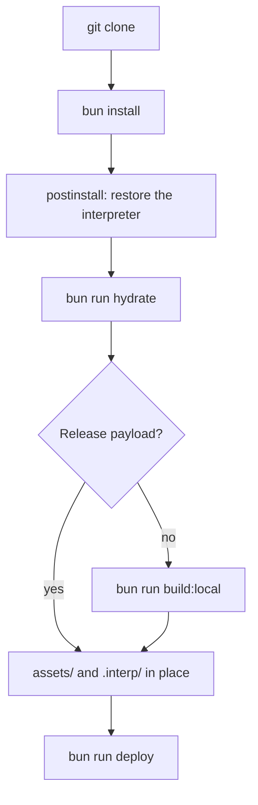

# Repository Layout

Every path in the repository, how it arrives on a clean clone, and what breaks without it. Sizes are
`du -sh` on a development machine.

## Pages

- [Tracked and Generated Paths](paths.md): tracked against untracked paths and what each directory holds.
- [Scripts and Automation](automation.md): unwired scripts, test coverage of the headline claims, nightly jobs.

## Source Tree

```text
src/
  site.ts            the edge front end: cache tiers, generation counter, deny filter, body cap
  site-do.ts         the Durable Object: PHP lifecycle, render, fill queue, alarms
  env.ts             the vars this worker reads beyond @drupflare/durabledb's own
  runtime/           interpreter plumbing: mount, lazy FS, interrupt mask, gate, binary seam
  db/                codec, the ctx.storage.sql bridge, chunked migration, heap snapshot store
  drupal/            PHP composition helpers and the shims Drupal runs
  do/                the object split by concern: routes/, alarm/ phases, capabilities, meters
  site/              the front worker split by concern, plus the assets it serves
    php/             the PHP fragments, real files, packed by gen-assets into generated/assets.ts
    html|css|js/     the setup, warming and guard pages
  ops/               cron/GC, sliced database updates, site identity, origin, setup page
  util/              shared helpers and the null/undefined contract types
  ui/admin/          the /_cfw admin surface
  probes/            measurement workers, kept so a report figure can be reproduced
assets/
  core/              the browser-fetchable Drupal tree, served by Workers Assets
  driver.json        the two Drupal modules and the stream-http library, packed; this executes
  drupal-pf/         the per-file pack PHP materialises from
  drupal-sql/        the migration chunks, counted by their own manifest
  drupal/site.sqlite the installed database the chunks are cut from; the one tracked database
config/              the contrib census, the corpus, the traffic mix and the quotas
docker/              the integration rig and the VPS comparison arm
```

## Repositories

| repo                    | what it is                                                                    | install                                |
| ----------------------- | ----------------------------------------------------------------------------- | -------------------------------------- |
| **`worker`** (this one) | the Worker: cache tiers, the Durable Object, the packers                      | clone                                  |
| **`drangler`**          | the CLI: stand a site up, check it, migrate one on or off                     | `bun add -g @drupflare/drangler`       |
| **`drupflare`**         | the capability module: mail, fetch, images and KV bridged to Workers bindings | `composer require drupflare/drupflare` |
| **`rom`**               | `cfw_do_sqlite`, the Drupal database driver for Durable Object SQLite         | `composer require drupflare/rom`       |
| **`stream-http`**       | the `https://` stream wrapper `drupflare` extends                             | pulled in by `drupflare/drupflare`     |
| **`phasm`**             | the PHP-to-WebAssembly build toolchain                                        | GitHub Releases                        |
| **`cartridge`**         | the pack format and the lazy filesystem                                       | `@drupflare/cartridge`                 |
| **`durabledb`**         | the `ctx.storage.sql` bridge and its codec                                    | `@drupflare/durabledb`                 |

## Data Risk

`assets/drupal/site.sqlite` is the packed Drupal database. `scripts/drupal/install-site-db.php` builds
it from nothing (`bun run build:site-db`, with `docs/architecture/database.md` as the recipe), and it is tracked,
so the copy in the tree is the one that ships. Two other lineages exist in the `drupflare-cdn`
bucket: `.pack-backup/site.sqlite.bak`, which is the rollback point for an earlier lineage, and an
older hand-trimmed artifact from a different one. The SQLite header change counter is what orders
them.

`bun run backup:cdn` archives a key's remote bytes to `snapshots/<name>.<sha12>` before replacing
them, so nothing is lost by replacing one, and records the archive in `cdn-manifest.json` in the same
run, so the manifest is the only file left to commit. It refuses for a tracked file with uncommitted
changes, where the bytes going up are recorded nowhere. `bun run backup:verify` compares every key by
size and ETag.

## `.pack-backup/`

7.2 MB, one file, and it stays. It is the rollback point for an earlier lineage of the packed
database (7,585,792 bytes, against 5,832,704 for the current one), and `bun run bake:pack`
**overwrites it on its next run** (the `snapshot` step of `scripts/bake-pack.ts`). Its content is also in the
bucket at `snapshots/site.sqlite.064105ca7223`.

## Clean Clone to Deploy

A clean clone reaches a deployed worker through the scripts in `package.json`.



`bun install` restores two of the three `.interp/` files, and `hydrate` or `build:local` supplies the
rest. `bun run deploy` is `wrangler deploy -c wrangler.jsonc`. Workers Builds runs `bun run hydrate` as
its build command (`build.command` in `wrangler.jsonc`), so its build takes the same route. A managed
deployment uses `wrangler.managed.jsonc` instead, which adds the R2 and `send_email` bindings; see
[Configuration](../../configuration/index.md#the-managed-config).
[Building From Source](../building-from-source/index.md) has the two routes in full.
