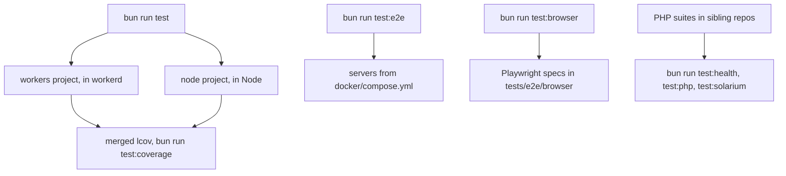

# Testing

The test lanes, what each one can and cannot see, and how to add a test.

Three vitest projects, plus PHP suites in the sibling repositories and an end-to-end lane that needs
a running server.

| lane                  | command                | runs in                                        |
| --------------------- | ---------------------- | ---------------------------------------------- |
| vitest `workers`      | `bun run test:workers` | workerd, via `@cloudflare/vitest-pool-workers` |
| vitest `node`         | `bun run test:node`    | Node, for oracles workerd cannot host          |
| both, merged coverage | `bun run test`         | one invocation; this is the commit gate        |
| PHP suites            | see below              | real PHP, in the sibling repos                 |
| e2e                   | `bun run test:e2e`     | needs a running server                         |
| browser               | `bun run test:browser` | Playwright, against a `wrangler dev` it starts |

The e2e lane talks to real servers, not mocks: Keycloak for single sign-on, Gitea, Forgejo and
GitLab for git, GreenMail for SMTP, Redis and a syslog collector for the TCP tier, and Postgres and
MySQL as external databases. `docker/compose.yml` carries all of them pinned by digest, with GitLab
behind `--profile heavy`, and `tests/e2e/README.md` has the commands.

`bun run test` runs the two vitest projects in one invocation. The other lanes are separate commands,
and the flowchart shows what each one runs in.



The PHP suites live in the sibling repositories, which are the authority on their own module. Three
have a script here. Where the table says `with the var`, set `DRUPAL_ROOT` to this repository's
`drupal-src/`:

| suite                          | repo        | run from here           |
| ------------------------------ | ----------- | ----------------------- |
| `tests/health-suite.php`       | `drupflare` | `bun run test:health`   |
| `tests/run-driver-suite.php`   | `rom`       | `bun run test:php`      |
| `tests/load-classes.php`       | `drupflare` | `php`, with the var     |
| `tests/pdo-shim.php`           | `rom`       | `php`, with the var     |
| `tests/cfw-tcp.php`            | `drupflare` | `php`                   |
| `tests/solarium-transport.php` | `drupflare` | `bun run test:solarium` |
| `tests/run-installer.php`      | `rom`       | `php`, with the var     |

```sh
DRUPAL_ROOT=$PWD/drupal-src php ../rom/tests/run-installer.php
```

`run-installer.php` drives Drupal's own installer against the driver with core's sqlite driver as a
child-process control. It needs a real filesystem, so it has no counterpart here.

## Three Vitest Projects

`workers` is the default lane and where most of the subject lives. `node` exists because workerd
cannot host two things the suite needs:

- `node:child_process` is not implemented. A probe calling `execFileSync('php', ...)` fails with
  "The child_process.execFileSync method is not implemented", so any suite whose oracle is a real
  PHP process cannot run in the workers project at all.
- `node:sqlite` is not available under workerd, and `tests/node/migrate-sql.spec.ts` needs it to diff
  a replayed database against its source.

Without that second project a PHP-oracle suite has to either transliterate the PHP and test the
copy, or stay outside vitest. `tests/node/mb-fix-iconv.spec.ts` is the first occupant: it recovers
two platform controls that had to be dropped when `mb-fix` moved into workerd, and it skips when no
`php` is on PATH.

`e2e` is the third and is excluded from `bun run test`: it needs a running worker and, for most of
its specs, a running server to talk to. It skips when nothing is reachable and fails when `CI` is
set, so a lane that quietly stopped running is distinguishable from one that passed.

Coverage from the two gate projects is merged into one lcov by `bun run test:coverage`; Codecov gets
a `coverage` flag for the merged report and `workers` / `node` flags for per-lane test results, all
with `carryforward: true`.

## The Integration Lane

Specs under `tests/integration/` use `ctx.storage.sql`, `transactionSync()`, `setAlarm()` and
`caches.default`. A mock of any of those would be testing the mock, and `runInDurableObject` from
`cloudflare:test` gives the real thing without a manually started server.

## The Contrib Lane

`contrib-verify.spec.ts` and `contrib-generic.spec.ts` re-establish the `verified` rows for contributed
modules, and only against a pack that carries them. `bun scripts/install-census.ts` puts the census
into `drupal-src` and `bun run test:contrib` builds that pack, runs both specs, runs one phase per
module that cannot share a composer lock, and puts the shipping pack back.

A run that mounts the fixture sets `CONTRIB_FIXTURE=1`, which turns every module the pack lacks into
a failure. Without it the specs skip such a module, so a census that failed to install passed with
every row skipped. The run ends by counting both reports into `.contrib-fixture/summary.md` and exits
1 on any failed row or any row nothing reached. If `config/contrib-usage.json` exists as
`{ "counts": { "<machine name>": <weekly installs> } }`, the summary adds the usage-weighted share of
the modules that passed.

`.github/workflows/contrib.yml` runs this weekly and on demand. It restores the other lanes' caches
and never saves one, because the census install rewrites `drupal-src`.

## Testing Inside workerd

Every one of these has already produced a defect that a Node-hosted mock passed:

- `ctx.storage.sql` is synchronous only from inside a Durable Object.
- `transactionSync()` has no Node equivalent; `BEGIN` as SQL is refused outright.
- The host caps a statement at 100 bound parameters; local PDO allows 32,766. That gap hid a live
  cache-write defect behind a green suite.
- Neither clock advances across a synchronous `php._run()`, so a duration taken by subtracting two
  readings either side of one is 0. A `Date.now()` delta that spans I/O is usable, because the
  clock updates on I/O completion.

## Coverage

Coverage uses `provider: 'istanbul'`, not `v8`. The v8 provider reads coverage off the Node
inspector and these tests run inside workerd's isolate, so it instruments every statement and
attributes none of them while the suite passes. istanbul instruments at transform time, so it
travels into the isolate with the code.

The sibling repos split on the same axis: `earth-app/cloud` and `js/edgeport` are workerd and use
istanbul; `earth-app/crust` and `earth-app/sky` are happy-dom and use v8.

Thresholds sit just under the current measured figure and are ratcheted upward as coverage lands.

## Rules for a New Test

Assert on behaviour or a counter, never on timing, except where timing is the claim. Name which
cache bins were emptied for every render figure. An absolute CPU number comes only from a deployed
worker; nothing in `tests/` can produce one. [Measurement Classes](../architecture/measurement-classes.md) is the full rule: which
instrument may produce which class of number, and which class is banned outright.
