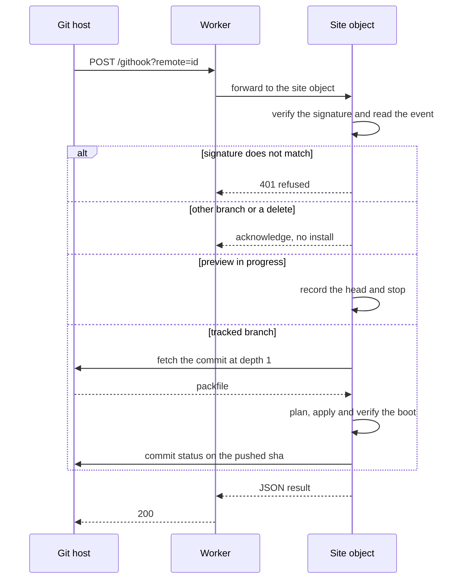
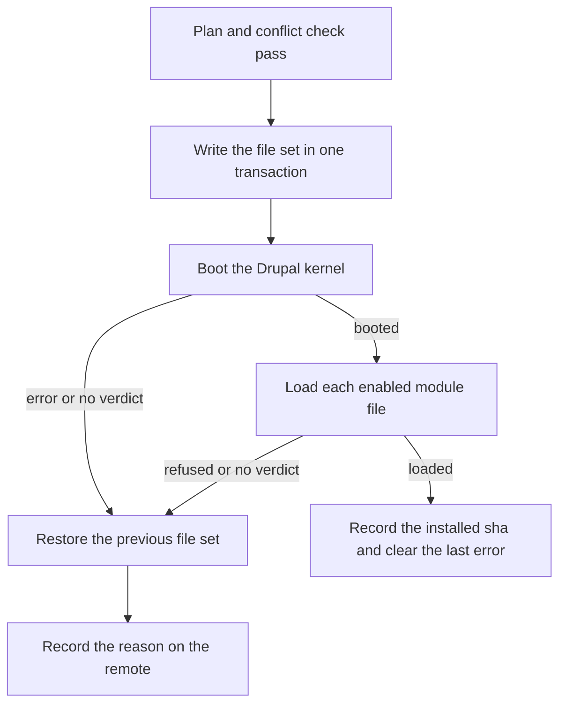

# Git Remotes

A site follows as many git repositories as you connect to it. A push installs the module, and the
result is written back to the provider as a commit status. The page that manages remotes is
`/_cfw/git`, and it drives three files: `src/ops/git-smart.ts` (the transport),
`src/ops/git-provider.ts` (the provider layer above it) and `src/ops/git-sync.ts` (the layout and
diff).

## The Transport

The transport is git's own smart HTTP, so anything that serves a repository over HTTPS works:
GitHub, GitLab, Bitbucket, Gitea, Forgejo, a bare repository behind nginx, or an internal mirror. Two
requests do the whole job:

| Step | Request                                      | Cost                                       |
| ---- | -------------------------------------------- | ------------------------------------------ |
| Poll | `GET /info/refs?service=git-upload-pack`     | a few hundred bytes when nothing has moved |
| Pull | `POST /git-upload-pack`, one commit, depth 1 | the changed objects, as a packfile         |

The packfile is read in the Worker: pkt-line framing, both delta forms, and the tree walk that turns
a commit into files. Private repositories authenticate with the operator's access token over HTTPS.
A public repository needs no credential.

### Provider APIs

Provider APIs sit above the transport, and the transport does not depend on them. The `generic`
provider uses no API at all. Its branches and open requests come from the ref advertisement, since
every provider publishes `refs/pull/N/head` or `refs/merge-requests/N/head`.

| Provider    | API                  | Default host                |
| ----------- | -------------------- | --------------------------- |
| `github`    | REST v3              | `https://api.github.com`    |
| `gitlab`    | REST v4              | `https://gitlab.com`        |
| `bitbucket` | REST 2.0             | `https://api.bitbucket.org` |
| `gitea`     | REST v1, Forgejo too | none; the host is required  |
| `generic`   | none                 | none; the host is required  |

## What Gets Installed

Module names come from `*.info.yml` and not from the directory. A repository checked out under one
name that provides another installs correctly, and a repository holding several extensions installs
all of them at their own paths. Modules land in `modules/custom/`, themes in `themes/custom/` and
profiles in `profiles/custom/`.

Only mountable files are kept: PHP, YAML, Twig, JavaScript and CSS. `tests/`, `vendor/`,
`node_modules/`, `.github/` and dotfiles are dropped. Each kept file is stored as its own row, and
the pull reports what it skipped and why.

PHP costs no bundle bytes. Module source is fetched over the assets binding and not compiled into
the Worker, so the size ceiling that governs the rest of the runtime does not apply to a custom
module written in PHP.

A submodule inside another module's tree stays where it is and is mounted once.

### Mount Path

A remote can name a `mount`: a path inside `modules`, `themes` or `profiles`, such as
`modules/mantle2`. Set it when a site already keeps the module somewhere else. A pull then updates
the module where it lives, instead of adding a second copy beside it. The setting applies when the
repository holds one module. With several, each keeps its default mount. `/git?action=add&mount=`
takes it.

A path containing `..`, a dot segment, a leading slash or a `core/` prefix is refused, both when the
remote is added and on every pull.

`vendor/` is never delivered. A module whose dependencies are bundled inside `vendor/` keeps the
ones it was carried with, and a new dependency in a later commit has to arrive another way.

## Branches, Requests and Diffs

| Action        | What it does                                                                             |
| ------------- | ---------------------------------------------------------------------------------------- |
| Check         | reads the remote head without downloading anything                                       |
| Diff          | fetches the commit and reports added, modified and removed files with line counts        |
| Pull          | applies that diff and mounts the result                                                  |
| Branch switch | moves the site to another branch, deleting what the old one had and the new one does not |
| Requests      | lists open pull and merge requests                                                       |
| Preview       | installs a request's head instead of the branch, and holds it there                      |

A preview is held against polling and against pushes, so a branch that moves while somebody is
reviewing does not replace what they are looking at. Leaving the preview returns the site to its
branch.

## Triggers

Polling works against any remote and needs no cooperation from it. Each repository has its own
interval. It defaults to 60 minutes and cannot go below 5; `0` turns polling off. A poll costs one
ref advertisement. The alarm polls at most three due remotes per firing, oldest first, so one slow
remote cannot starve the others.

A 429 response sets a backoff. The first is one minute, each refusal doubles it, and a
`Retry-After` header replaces the calculation when the provider sends one. Both are capped at one
hour (`src/ops/git-sync.ts`).

Webhooks make a push arrive immediately. GitHub, GitLab, Bitbucket, Gitea and Forgejo can register
one from the page. For any other remote, the page mints a secret and shows the delivery URL to
register by hand.

## Deliveries

`/githook?remote=<id>` receives deliveries. The caller carries no credential this Worker controls,
so the signature is the whole of the authentication. An unverifiable delivery is refused.

| Provider       | Header                | What it proves                                           |
| -------------- | --------------------- | -------------------------------------------------------- |
| GitHub         | `X-Hub-Signature-256` | HMAC-SHA256 over the raw body                            |
| Gitea, Forgejo | `X-Hub-Signature-256` | the same scheme, verified the same way                   |
| Bitbucket      | `X-Hub-Signature`     | HMAC, method read from the header prefix                 |
| GitLab         | `webhook-signature`   | HMAC-SHA256, GitLab 19.0 and a feature flag              |
| GitLab         | `X-Gitlab-Token`      | the shared secret, in plaintext                          |
| Any git remote | `X-Hub-Signature-256` | accepted if the sender can produce it; refused otherwise |

GitLab installs before 19.0 send the secret in plaintext and cannot be HMAC-verified. Both forms are
accepted, and the page shows which one the last delivery used, since the two differ in what they
prove.

## What a Push Does

A push to the tracked branch installs the commit inline and writes the result back as a status. A
push to any other branch and a branch delete are acknowledged without installing or recording the head. A push to the
tracked branch arriving while a request is being previewed records the head and stops there.

The status write runs only when the provider has an API and the remote holds a token. A plain remote
gets no status.

## Verify and Roll Back

A pull is applied in one transaction and then verified. Verification has two checks. The kernel boot
builds the container, and the module load runs every enabled module's PHP, because a boot alone reads
no `.module` file when the container comes from `cache_container`. A missing verdict from either
check counts as a failure.

If either check fails, the previous file set is restored and the site keeps serving. The reason is
stored on the remote as its last error, and the pull reports `rolledBack`. A path already owned by
another remote or by a `composer require` is reported as a conflict and not taken.

The checks are in `gitVerifyBoot()` (`src/do/git-delivery.ts`). `gitApply()` and `gitRestore()` in
the same file write and restore the set.

## Write-Back

A commit status goes on the pushed sha: a state, a context, a description and a link. All three
providers support it, and an access token can write it.

| Provider       | Read the tree          | Write a status           | Create a webhook           |
| -------------- | ---------------------- | ------------------------ | -------------------------- |
| GitHub         | `Contents: read`       | `Commit statuses: write` | `Webhooks: write`          |
| GitLab         | `read_api`             | `api`                    | `api`, Maintainer or Owner |
| Bitbucket      | `repository:read`      | `repository:read`        | `webhook`                  |
| Gitea, Forgejo | `read:repository`      | `write:repository`       | `write:repository`         |
| Any git remote | read access over HTTPS | no API                   | register by hand           |

Provider scope notes

GitHub's Checks API carries annotations and per-line output, and only a GitHub App can write one. A
repository-scoped fine-grained token is refused with `Resource not accessible by personal access
token` on both check-run endpoints and accepted on the status endpoint, so the product writes commit
statuses.

GitLab has no scope narrower than `api` for writing a status.

Bitbucket has no personal access token. An Atlassian API token authenticates as HTTP Basic with the
account email as the username, so its row asks for one.

Gitea takes `state` on the way in and answers `status` on the way out, which matters when reading a
status back through its API.

A plain remote has nowhere to put a status, so `statusRequest()` returns null for it.

## Storage

| Setting                 | Where      | What it does                                      |
| ----------------------- | ---------- | ------------------------------------------------- |
| `git_remotes`           | `cfw_meta` | the configured remotes, as one JSON row           |
| `git_token_<id>`        | `cfw_meta` | the access token for one remote                   |
| `git_email_<id>`        | `cfw_meta` | the Atlassian account email, Bitbucket only       |
| `git_hooksecret_<id>`   | `cfw_meta` | the shared secret a delivery is verified against  |
| `git_head_<id>`         | `cfw_meta` | the sha the last poll saw                         |
| `git_installedsha_<id>` | `cfw_meta` | the sha whose files are mounted                   |
| `git_interval_<id>`     | `cfw_meta` | poll cadence in minutes; `0` turns polling off    |
| `git_backoff_<id>`      | `cfw_meta` | epoch ms before which nothing polls this remote   |
| `git_previewof_<id>`    | `cfw_meta` | the request being previewed instead of the branch |

Module source lands in `cfw_module_file`, one row per file, owned by the remote id. That is the same
table `composer require` writes to, which is what makes a conflict detectable.

Everything in this table lives in the object's own storage, and none of it can be set from KV. A
writer who could change a remote could point the site at a repository they control. A writer who
could read a token would have push access to the operator's repository. Access tokens therefore live
in the site's own database, never in the KV namespace that carries runtime overrides. The scopes each
provider needs are under [Write-Back](#write-back).

## Provider Coverage

| Provider         | State     | Exercised Against          |
| ---------------- | --------- | -------------------------- |
| GitHub           | verified  | github.com                 |
| GitLab           | verified  | GitLab CE                  |
| Gitea            | verified  | Gitea 28.0.0               |
| Forgejo          | verified  | Forgejo 16                 |
| Any HTTPS remote | verified  | `git upload-pack` directly |
| Bitbucket        | supported | n/m                        |

Bitbucket authenticates with one API token and two names. The REST API takes the Atlassian account
email, and git over HTTPS takes the Bitbucket username, which is case sensitive. Both fields are on
the page.
