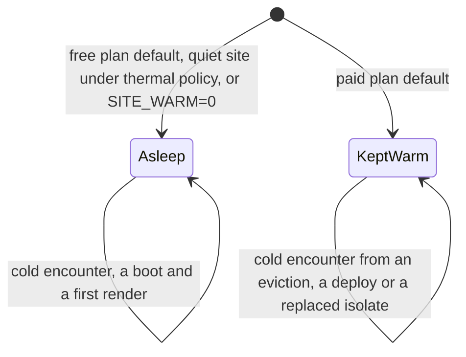

# Operating States and Where the Saving Comes From

The states a site operates in, and which part of the work accounts for the saving.

## Operating States

A site is either asleep or kept warm, and a third accounting charges the kept-warm site for the memory
it holds. The headline on [Energy](index.md#energy-savings) is the sleeping state, the ceiling on efficiency. The last row of the
second table is the most pessimistic bound the model carries; it is not a floor under every possible
state.

| state                     | what selects it                                                                                           | an editor's first request after idle                           |
| ------------------------- | --------------------------------------------------------------------------------------------------------- | -------------------------------------------------------------- |
| asleep                    | the free plan's default, where the thermal policy leaves a quiet site alone, or `SITE_WARM=0` on any plan | a cold interpreter boot, 2 to 4 s; a cached page is unaffected |
| kept warm                 | the paid plan's default: the alarm re-arms every 8 s and the object never hibernates                      | 156 to 371 ms                                                  |
| kept warm, memory charged | an accounting of the row above, not a configuration                                                       | 156 to 371 ms                                                  |

The transitions, as the table and prose describe them:



The latencies are the measured warming curve in the [configuration reference](../../configuration/index.md).
Choosing between the first two trades cost and energy against an editor's cold start, and both are
supported. A thousand sites at 10,000 views each cost $5.80 a month asleep and $350.65 kept warm on
one account, $0.0058 and $0.351 a site, because the warming chain's 10,800 firings and 10,896 rows a
site a day are billed against an allowance that is account-wide; [What It Costs To
Run](../economics/index.md) has the tables.

Energy a year of one site in each state, `derived (modelled)`, from `bun scripts/economics/states.ts`.
Savings are against the production deployment and against one small VPS, the worst case:

| state                                                      | 10,000 views | against production | against one VPS | 1,000,000 views | against production | against one VPS |
| ---------------------------------------------------------- | -----------: | -----------------: | --------------: | --------------: | -----------------: | --------------: |
| asleep, no cold encounters (the headline)                  |      0.53 Wh |           99.9998% |        99.9944% |         18.3 Wh |           99.9919% |          99.80% |
| asleep, 1 cold encounter a day                             |      1.40 Wh |           99.9994% |        99.9850% |         19.1 Wh |           99.9915% |          99.80% |
| asleep, 5 cold encounters a day                            |      4.92 Wh |           99.9978% |        99.9473% |         22.7 Wh |           99.9899% |          99.76% |
| kept warm, warming CPU at the billed wall time             |      65.7 Wh |           99.9707% |          99.30% |         83.5 Wh |           99.9628% |          99.11% |
| kept warm, a tenth of that                                 |      7.04 Wh |           99.9969% |        99.9246% |         24.8 Wh |           99.9889% |          99.73% |
| kept warm, charged a booted interpreter's measured 170 MiB |       589 Wh |             99.74% |          93.69% |          607 Wh |             99.73% |          93.51% |
| kept warm, large-site stress: the full 195 MiB budget      |       675 Wh |             99.70% |          92.77% |          693 Wh |             99.69% |          92.58% |
| compound adversarial bound                                 |       745 Wh |             99.67% |          92.02% |          763 Wh |             99.66% |          91.83% |

At 10,000,000 views the same rows run from 179.5 Wh asleep to 924 Wh in the last row, which is 99.92%
to 99.59% against production and 98.08% to 90.11% against one VPS. Every row saves more than 99.5%
against production and more than 90% against the worst case. The compound bound adds the full object
budget, the warming CPU at the billed wall time and five cold encounters a day. It is not a state a
site sits in: an object that stays warm does not meet idle cold boots, so those encounters come from
outside causes such as an eviction, a deploy or a replaced isolate.

- **Cold encounters:** a sensitivity with no measured rate. A cold encounter is a boot plus a first
  render with the cache bins empty, 1,264 ms plus 2,127 ms of CPU, both measured. How many a site
  meets is the number of editor sessions that find the object cold, and cached anonymous views never
  boot PHP. `coldOfTraffic` is the instrument for the rate and no deployed site has reported a
  reading, so the headline carries none. At 10,000 views, five a day moves the saving from 99.9998% to
  99.9978%.
- **Warming CPU:** bounded, not read. A firing bills 23.3 ms of wall time (n=116 on two deployed
  objects) and its CPU time has not been read. The first warm row charges all of the wall time as
  CPU, an upper bound; the second charges a tenth.
- **Memory:** the memory rows charge a kept-warm object for the memory it holds, as accounting bounds.
  A booted interpreter takes about 165 to 175 MiB of an object's 195 MiB budget, measured on a paid
  object with a build whose linear memory started at 80 MiB; the shipping build starts at 64 MiB,
  which can only lower it. A large site such as farmOS holds 196 to 201 MB warm. The first row
  charges 170 MiB and the second the full 195 MiB, the limit at which the platform resets an object
  and not a measured footprint for every site. The memory of a warm object is a plateau: an
  interpreter's linear memory is reused after a drop and keeps the largest size any interpreter
  reached, so a kept-warm object holds its high-water mark until its incarnation ends. 170 MiB of the
  384 GiB host is 0.0432%, charged at the host's 135 W idle draw and the 1.15 PUE: 589 Wh a year. That
  assumes the host is provisioned for memory. Cloudflare does not publish how objects are packed, and
  if the memory sits in DRAM that is powered anyway the marginal charge is zero. A site that sleeps
  ends its incarnation after ten idle seconds, and a cached page is served without booting the
  interpreter, so it holds the interpreter's memory only while it renders. The sleeping rows carry no
  memory charge.

## Where The Saving Comes From

The saving has two sources, and neither depends on PHP running faster.

- **Idle capacity:** conventional multi-tenant hosting for small sites is memory-bound. Packed at
  1,000 sites of 1 GB on a 1.5 TB two-socket host, the fleet runs its processors near zero and draws
  about 1,826 kWh a year at 10,000 views a site, 1,822 of it idle (99.8%). It buys processors it never
  uses and powers them continuously. A sleeping site consumes energy only while it executes.
- **Invalidation:** a page store invalidates on content change, while a CDN expires on a clock.
  `cfw_page` carries a `stale_at` column set when a save invalidates a tag, so a cached page survives
  until the content behind it changes. A CDN in front of a conventional origin re-renders every path,
  at every edge location, once per TTL whether or not anything changed. Modelled at 20 million views
  per site per month with five saves a day, that is 28.34% of requests rendering for a CDN and origin
  against 0.004% for drupflare, 186,371 renders a day against 25. A per-location cache miss reaches
  the page store, which answers without PHP.

### The Render Fraction

`derived (modelled)`. Models of edge-cached hosting often assume a flat share of requests that
render. The share depends on traffic:

```
renders = sum over paths of min(requests, window / TTL)   per path, per edge location
          + saves x pages invalidated per save
```

The floor does not depend on traffic, so the fraction falls as traffic rises. It is a property of a
site's content-to-traffic ratio, and a single number for a whole fleet is wrong in both directions.
For a CDN and origin a common 1% assumption is first reached at roughly 723 million views per site
per month, far above the range these models cover.

drupflare has no TTL term and no location term. Its renders are saves times the pages each save
invalidates, 5 for an ordinary node save, so at five saves a day a site renders about 25 pages a day
whatever its traffic. The fraction is 7.6% at 10,000 views a month, 1% at about 76,000 and 0.004% at
20 million. A save the main menu references invalidates every cached page, 34 on the measured site,
and is the pessimistic arm.

For a CDN and origin the edge-location count is the largest term: at 20 million views it spans 4.38%
at one location to 62.91% at fifty. A measurement taken from a single source address reads a floor,
because a one-address generator drives one edge location while real visitors spread across many.

`scripts/measure/render-fraction.ts` computes it, with each input named as measured or modelled.
