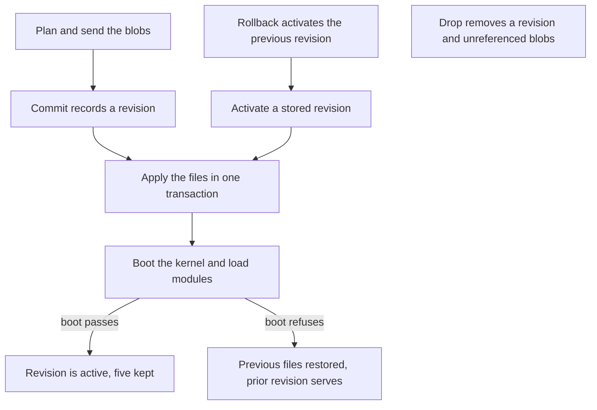

# Modules

Contributed modules, module revisions, and which modules have been run against a real site.

## Module Revisions

A module that lives on your machine and not on a git host is uploaded through `/modify`. Every
upload is a revision, and the site keeps the last five per package (`REVISION_RETENTION` in
`src/ops/module-rev.ts`). Each `/modify` request takes the owner token.

A revision is a manifest of files addressed by the hash of their contents. A second upload sends
only the files that changed. A file the site already holds costs nothing to keep, and dropping a
revision deletes only the file contents that no surviving revision names.

An upload is three steps: plan, send the blobs, then commit. The table lists every route.

| Action    | Route                                     | Method | What it does                                                            |
| --------- | ----------------------------------------- | ------ | ----------------------------------------------------------------------- |
| Plan      | `?action=plan&package=X`                  | POST   | splits declared files into what the site has and what it needs          |
| Blobs     | `?action=blobs&package=X`                 | POST   | stores the missing file bytes, verified against the hash sent with each |
| Commit    | `?action=commit&package=X`                | POST   | records a revision from a manifest and makes it live                    |
| Revisions | `?action=revisions&package=X`             | GET    | the stored revisions, newest first, and which one is active             |
| Manifest  | `?action=manifest&package=X&rev=Y`        | GET    | one revision's file list; `rev` takes `active` by default               |
| Activate  | `?action=activate&package=X&rev=Y`        | POST   | makes a stored revision live again, with no bytes on the wire           |
| Rollback  | `?action=activate&package=X&rev=previous` | POST   | activates the revision before the active one                            |
| Status    | `?action=status`                          | GET    | what is live per package, with its size and age                         |
| Drop      | `?action=drop&package=X&rev=Y`            | POST   | deletes a revision and the blobs nothing else names                     |

`plan` answers the have and want split and the change an apply would make: `counts` over every
declared file, the `removed` paths by name, and the rows an apply would charge. A file whose new
bytes have not been sent yet counts as `modified` and not as a removal, because the site does not
hold those bytes yet.

Commit and activate use the same apply, verify and restore path that a git pull takes. The files are
written in one transaction, and the kernel boots with every enabled module's PHP loaded. A boot that
fails restores the previous file set. A module whose `.module` no longer parses is rolled back, and
the reply names the parse error. A refused commit or activation returns 409. A refused commit stays
stored, and the revision it replaced stays active. A path another package already owns is reported
as a conflict and not taken (`applyRevision()` in `src/do/modify.ts`).

File contents are verified against the hash they were sent under before they are stored, so a
manifest cannot come to name content the site never received. Stored blobs are checked against their
hash again before a revision is applied.

Bytes are bounded twice: by `MAX_BODY_BYTES` per request, and by a 2,199,995-byte cap per file,
since each file is one stored row. A client batches to stay under both.

A `commit` body may carry `autoload`, one object or an array, for vendor packages a build delivers:
`{"name":"acme/widget","version":"1.4.0","mount":"vendor/acme/widget","autoload":{"psr-4":{...}}}`.
The mount must sit under `vendor/` or `libraries/`. The site registers each map with the class loader
before it boots the kernel, and puts the previous row back if the boot refuses. `/install` does not
fetch a package that is already registered.

A revision may also carry paths under `core/`, which shadow the packed files at the next boot. A
changed `core/**/*.yml` drops `cache_container` and `cache_discovery` first, so the verifying boot
rebuilds them.

A requirement on a virtual package such as `psr/log-implementation` is met by the shipped lock's
`provide` and `replace` entries, and is not fetched.

---

## Contrib Modules

Installing a module works on a deployed site, with the module present in `core.extension` afterwards
on 6 of 6 attempts. The cache is cold for one visit while the pages the install invalidated are
re-rendered.

Every contrib module has one of three states: verified, untested or blocked. A module is verified
only when the gate enabled it against a real site and asserted an observable the module owns.
Nothing reaches that state by inspection. A blocked row says which capability is missing.
`moduleTable()` in `src/ops/module-table.ts` is the census the lists below are rendered from.

Contrib is a development dependency. The shipped pack carries four modules (`admin_toolbar`,
`ctools`, `pathauto`, `token`). The rest are verified against a test build and installed by a site
that asks for them, so a new site stays small.

### Installing One

Three owner-token routes, in the order a site uses them. Each takes `Authorization: Bearer <owner
token>`, the token `/firstrun` mints when the site is claimed.

| Route                   | What it does                                                           |
| ----------------------- | ---------------------------------------------------------------------- |
| `/installable?module=X` | resolves the package and names any conflict with the shipped lock      |
| `/install?module=X`     | fetches it and writes its files; runs the check first unless `force=1` |
| `/enable?module=X`      | installs it through Drupal's own module installer                      |

`drupal/*` resolves against `packages.drupal.org/8`, and everything else against
`repo.packagist.org`. Resolution is registry first. It covers a composer graph's `replace`, stability
flags, branch aliases, branch archives, metapackages and virtual packages. Composer plugins are
skipped. Installing does not enable a module. The two are separate steps, because a package that
lands is not yet a module Drupal knows about.

A module you wrote yourself arrives through a git remote or through `/modify`. A git pull fetches
one commit at depth one and boots the kernel against the new tree, rolling back if it fatals. See
[Git Remotes](git-remotes.md) and [Module Revisions](#module-revisions). The same `/enable` step
applies afterwards.

### Verified

`address`, `admin_toolbar`, `backup_migrate`, `better_exposed_filters`, `captcha`, `coffee`,
`colorbox`, `config_ignore`, `crop`, `csv_serialization`, `ctools`, `devel`, `easy_breadcrumb`,
`editor_advanced_link`, `entity`, `entity_browser`, `entity_reference_revisions`, `externalauth`,
`facets`, `field_group`, `filefield_sources`, `focal_point`, `google_analytics`, `google_tag`,
`honeypot`, `imageapi_optimize`, `imageapi_optimize_binaries`, `imce`, `jquery_ui`, `jquery_ui_autocomplete`,
`jquery_ui_datepicker`, `jquery_ui_menu`, `json_field`, `key`, `libraries`, `linkit`, `mailsystem`,
`memcache`, `menu_block`, `metatag`, `metatag_search_gov`, `migrate_plus`, `module_filter`, `openid_connect`,
`paragraphs`, `pathauto`, `purge`, `queue_ui`, `recaptcha`, `redirect`, `redis`, `scheduler`,
`search_api`, `search_api_solr`, `simple_sitemap`, `smtp`, `stage_file_proxy`, `svg_image`, `token`,
`twig_tweak`, `usfedgov_google_analytics`, `uswds_base`, `video_embed_field`,
`views_bulk_operations`, `views_data_export`, `webform`, `xmlsitemap`.

`uswds_base` is a theme and installs through `theme_installer` and not the module installer.

### Blocked

Nothing. `openid_connect`, `redis` and `smtp` were here.

`smtp` sends over the host transport from its own `smtp.settings`, and nothing in a render waits for
delivery. `redis` and `openid_connect` both need an answer inside the request that asked. The PHP
call is suspended, the Worker performs the socket read or the HTTP exchange, and the same call
resumes with the answer. For `openid_connect` that is the authorization-code POST and the userinfo
GET, so a login completes through the module's own client. For `redis`, the Durable Object's own
SQLite is still the faster cache backend and the recommended one.

### Untested

`search_gov_results_api` renders results from an API call made while its form is building. That call
completes inside the render that makes it, so a search answers on the first request. No run has
exercised it against a live Search.gov key.

---
