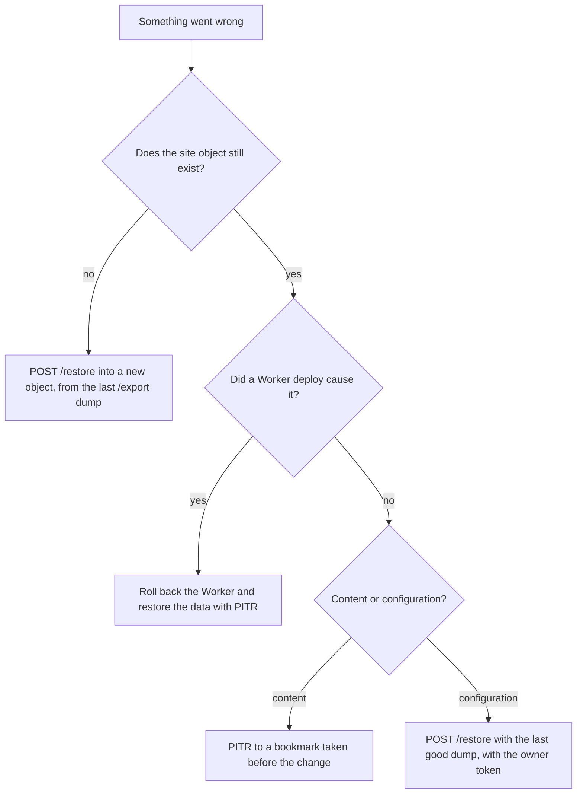

# Recovery

A site is a Durable Object holding a SQLite database. Four primitives can move it backwards, and
they answer different failures. Picking the wrong one either does nothing or destroys more than it
restores.

| Primitive              | Scope                             | Window                 | Survives object loss             |
| ---------------------- | --------------------------------- | ---------------------- | -------------------------------- |
| Point-in-time recovery | the object's whole storage        | 30 days                | no                               |
| `/export` dump         | the site database, as SQL text    | as long as you keep it | yes                              |
| `wrangler rollback`    | Worker code and config            | 100 versions           | n/a                              |
| The R2 mirror          | rendered pages and uploaded files | current state          | yes                              |
| The R2 file store      | file bytes (`FILE_STORE=r2`)      | current state          | no; the dump holds metadata only |

**PITR is operational recovery, not backup.** It reverses a change to an object that still exists.
It lives in the same place as the data it protects, so a deleted namespace, a deleted Worker or a
lost account takes the recovery log with it. The `/export` dump is the only thing on this page that
leaves the platform, and it is the only thing that answers "the object is gone".

## Point-in-Time Recovery

SQLite-backed Durable Objects can be restored to any point in the past 30 days. The window
covers the whole of `ctx.storage`, both SQL tables and key-value pairs.

Recovery is addressed by bookmarks, not timestamps. A bookmark is a mostly alphanumeric string
such as `0000007b-0000b26e-00001538-0c3e87bb37b3db5cc52eedb93cd3b96b`, and bookmarks are lexically
comparable, so ordering them as strings orders them in time. Three methods:

| Method                                        | Returns                                                     |
| --------------------------------------------- | ----------------------------------------------------------- |
| `ctx.storage.getCurrentBookmark()`            | a bookmark for now                                          |
| `ctx.storage.getBookmarkForTime(t)`           | a bookmark for a `Date` or epoch ms within the last 30 days |
| `ctx.storage.onNextSessionRestoreBookmark(b)` | a bookmark that undoes the restore it schedules             |

The restore is applied on the object's next start, not immediately. The bookmark returned by
`onNextSessionRestoreBookmark()` is the undo, so capture it before restarting.

**There is no wrangler command and no dashboard button.** PITR is a runtime API only, so an operator
can reach it only through code running inside the Durable Object.

`GET /pitr` is that code. It takes the owner token or `PW_DIAGNOSTICS=1`, and so does `/restore`.
A restore body names a state the caller invents, where a `/pitr` bookmark names one the platform
holds.

| Request                    | Answers                                             |
| -------------------------- | --------------------------------------------------- |
| `GET /pitr`                | the current bookmark and the window                 |
| `GET /pitr?at=<ms or ISO>` | the bookmark for that time, refused outside 30 days |
| `POST /pitr?bookmark=<b>`  | schedules the restore and returns the undo bookmark |

The restore applies on the object's next start. The undo bookmark is obtainable only from the call
that schedules the restore, so it is returned rather than logged.

**It is unsupported in local development, and the local runtime signals that badly.** Cloudflare's
wording is that "a durable log of data changes is not stored locally". All three
methods exist in the local runtime. `getBookmarkForTime()` throws "This Durable Object's storage
back-end does not implement point-in-time recovery", while `getCurrentBookmark()` returns
`00000000-00000000-00000000-00000000000000000000000000000000` and throws nothing.

A feature-detect on the method therefore passes and hands back a bookmark that would schedule a
restore to the beginning of time. `/pitr` refuses an all-zero bookmark by value, and reports
`supported: false` with the platform's own sentence when the API throws. Restore behaviour is
verified on a deployed object only.

## The Export Dump

`GET /export` with `Authorization: Bearer <ownerToken>` dumps the site database as replayable SQL.
It is one of the owner routes, which the owner token reaches without `PW_DIAGNOSTICS=1`;
`OWNER_ROUTES` in `src/site/routes.ts` is the list.

The dump is produced host-side by `dumpDatabase()` in `src/db/export-sql.ts`, not by PHP. Every value
is read as `typeof()` plus `hex()` and never as the column, because a Durable Object SQLite integer
read loses precision above 2^53 and a `hex()` of an integer never passes its digits through a double.
REAL is the one class read directly.

What a dump contains:

- **Structure only** for tables whose rows regenerate: every `cache_*` bin, `cachetags`, `sessions`,
  `semaphore`, `flood`, `queue`, `watchdog`, `history`, `search_dataset`, `search_index`,
  `search_total` and `cfw_page`. A restored `cache_container` would boot the site on the previous
  site's service container, and `cachetags` checksums that disagree with the bins they describe leave
  rows that are present and permanently rejected.
- **Nothing at all** from `cfw_migrate`, `cfw_import` and `cfw_import_chunk`. A dump carrying
  `cfw_import_chunk` would contain itself, and one carrying `cfw_migrate` would have a replay
  overwrite the cursor that makes the replay resumable.
- **No secrets by default.** The owner token, the Cloudflare OAuth token and client id, the SMTP
  settings, `hash_salt`, and the git provider tokens and webhook secrets (`git_token_*`,
  `git_hooksecret_*`) are withheld. `?secrets=1` carries them. A faithful restore needs `hash_salt`,
  since it signs one-time login links and form tokens; a backup stored anywhere else should not have
  it.

Options:

| Parameter       | Effect                                                            |
| --------------- | ----------------------------------------------------------------- |
| `?cursor=start` | chunked and resumable; each response carries `nextCursor`         |
| `?body=1`       | include the SQL text in a chunked response rather than its length |
| `?all=1`        | carry rows for the regenerable tables too                         |
| `?secrets=1`    | carry the withheld `cfw_meta` secrets                             |
| `?limit=N`      | cap rows per table                                                |
| `?chunkChars=N` | override the 1,000,000-character chunk size                       |

**A dump that cannot be replayed answers 409 rather than 200.** A restore point nobody can replay
reads as a backup while being useless. `?all=1` includes the `cache_container` row, which measures
960,544 characters against the 100,000-character Durable Object statement ceiling, so a dump carrying
it is not replayable. A chunked export also answers 409 on a shape mismatch, so two dumps cannot be
spliced into one file unnoticed.

## Restore

`POST /restore` with the dump as the request body. It takes the owner token (`Authorization: Bearer
<token>`) or `PW_DIAGNOSTICS=1`. It was diagnostic-only until v1.0.5, because a body overwrites a whole
database; the owner token already runs code the site did not ship (`/modify`, `/install`), so
restoring a dump gives it no further reach, and a backup into a new site no longer has to open `/sql`
and `/php` to do it.

The dump is one body. `/export` pages as JSON, so a client joins the `sql` field of every page, in
order, and sends the result. The body ceiling is `MAX_RESTORE_BYTES`, 16 MiB by default, separate from
`MAX_BODY_BYTES`; a fresh site's dump is 1.9 MB (n=1). A site whose dump exceeds the ceiling cannot be
restored through this route until a paged restore exists. The reply is `{ok, id, chunks, statements,
generation}`; the replay then runs on the alarm, and `GET /health` reports the stored import.

To restore into a new site, provision the site, take its owner token, then POST the dump to it. The
dump carries the database and not the owner token, `hash_salt` (unless exported with `?secrets=1`) or
any file bytes held in R2.

**A dump never says which site it came from.** `site_name` and `site_origin` are left out of every
export, `?secrets=1` included, and a restore drops them from a dump that still carries them. Before
this, a restore replaced the target's pinned name with the source's, so the target keyed its R2 objects
under the source's prefix and read the source's KV settings. The restore replaces `cfw_meta`, so the
target answers to the name `site` until its next request teaches it the real one, and R2 mode waits for
that.

Under `FILE_STORE=r2` a file row records which site's prefix holds its object (`r2site`), and a
restored row names the source. **That name is a claim, not an authority.** It arrives in a request body
that a site's owner writes, and the managed buckets are shared between tenants, so honouring it would
let one tenant read another's files by naming them as the source. A target reads or copies a source's
objects only when the platform has granted that source: the key `file_clone:<target site>` in
`CONFIG_KV` holds a comma-separated list of source site names. A tenant's own writes reach only
`plan:` and `settings:` keys, so the grant has to come from whoever holds the account's credentials,
which is the dashboard. Write it before the target's first alarm after the restore, and remove it once
`storage.adopting` reads `0`. The worker reads it with a 30 second cache, and a failed read grants
nothing.

With a grant, on the first alarm after the target learns its name each foreign row is queued. An
offloaded file is copied from the source prefix to the target's own, checked against the hash and size
the row recorded (a row with no recorded hash is refused), and the row is re-pointed. A resident file
has its bytes in the target already, so it drops the claim and is sent as an ordinary verified put;
nothing foreign is read. Without a grant, an offloaded file under a foreign prefix stays unreadable and
`/serve-stats` shows it as offloaded. A foreign row stops claiming a mirror at once, so no public link
points at an object that is not at the target's prefix, and it is never evicted on the strength of
another site's object. The source's objects are read and never written or deleted, so two sites never
share one. `storage.adopting` counts the copies still queued. Keep the source's buckets and objects
until it reads `0`.

The body is stored, not executed. `storeImport()` splits it into statements, refuses at store time if
any statement exceeds the 100,000-character ceiling, and writes the parent row and every chunk in one
`transactionSync()`. Then the object arms its alarm and the replay runs there, a chunk at a time. The
invocation that accepts the upload is never the one holding a half-overwritten site open.

`?label=` names the restore point; it defaults to the current time. `GET /health` reports whether a
complete stored import exists.

## The Recovery Matrix

| Failure                     | Primitive                                   | Does not cover                                                                                                                                     | Command                                                                     |
| --------------------------- | ------------------------------------------- | -------------------------------------------------------------------------------------------------------------------------------------------------- | --------------------------------------------------------------------------- |
| Accidental content deletion | PITR to just before the delete              | anything written after the bookmark; the object must still exist                                                                                   | `GET /pitr?at=<t>` then `POST /pitr?bookmark=<b>`                           |
| Bad module update           | PITR, and `wrangler rollback` if code moved | files already mirrored to R2; a config change an editor made after the update                                                                      | as above, plus `wrangler rollback [VERSION_ID]`                             |
| Corrupted config            | `/restore` of the last good dump            | content created since that dump; takes the owner token                                                                                             | `POST /restore?label=pre-fix` with the dump as the body                     |
| Failed migration            | re-run the migration                        | nothing, if the cursor survived; `cfw_migrate` is resumable and a dump excludes it                                                                 | `drangler migrate ...`; `GET /migrate` reports `chunk`, `chunks` and `done` |
| Whole-object loss           | `/restore` into a new object                | PITR entirely; the log died with the object; `hash_salt` unless the dump used `?secrets=1`                                                         | `POST /restore` against the new site name                                   |
| Worker version rollback     | `wrangler rollback`                         | **the database.** Code moves, data does not. Refused if a Durable Object class lifecycle change or a deleted binding sits between the two versions | `wrangler rollback [VERSION_ID] --name <worker>`                            |
| R2 asset loss               | the mirror refills from the object          | nothing; the object is the durable copy and R2 is a cache in front of it                                                                           | the alarm drains the queue; `/mirror` (owner token) runs a pass by hand     |

The flowchart reads the matrix from the top: whether the object survived, then what caused the change.

Two rows carry the distinctions that matter most.

**A Worker rollback is not a data rollback.** `wrangler rollback` creates a new deployment from a
previous version and becomes active across every route immediately. It reaches the 100 most recent
versions. It does not touch `ctx.storage`, so a bad deploy that also wrote bad rows needs both a
rollback and a PITR restore. Cloudflare refuses the rollback outright if a Durable
Object class lifecycle change happened between the two versions, or if the target version binds an R2
bucket, KV namespace or queue that no longer exists.

**R2 is a mirror, not a backup, unless `FILE_STORE=r2`.** With no `FILES` bucket bound, which is the shipped configuration, the
object is the durable copy and there is nothing to lose. With one bound, the bucket holds rendered pages and
uploaded files that the object still has, and the mirror queue refills it on the alarm.

With `FILE_STORE=r2`, which the managed config sets, a file leaves the object once its upload is
verified and the grace window has passed. The bucket then holds the only copy of its bytes, so the
`/export` dump carries the file's row and no bytes, and losing the bucket loses the file. Object
point-in-time recovery does not cover R2. Treat the buckets as primary storage: keep them out of
any teardown, and do not restore the object without them. This release has no blob export; a
restore drill for blobs is open work.

Before moving a site to a config without `FILES`, restore every file into the object:
`POST /mirror?rehydrate=1` with the owner token, then poll `/serve-stats` until `storage.offloaded.files` reads `0`.

## Keeping a Dump

Nothing schedules an export. A dump exists because someone asked for one, and it lives wherever they
put it. For a site whose object still exists, PITR covers the last 30 days with no storage of your
own; the dump is what covers everything else.

Two properties make an unattended export practical: `?cursor=` walks the database in bounded chunks
instead of building the whole file in one invocation, and a 409 tells the caller the file it just
built is not replayable, so a backup job can fail loudly instead of storing something that reads
like a backup.

## Related

- [Configuration](../configuration/index.md): `PW_DIAGNOSTICS`, the `FILES` binding and the runtime overrides
- [External Databases and Hyperdrive](external-database/index.md): why the data lives in the object
- [Technical report](../../TECHNICAL_REPORT.md), Platform Constraints: the 100,000-character statement
  ceiling and the other measured Durable Object SQLite limits
