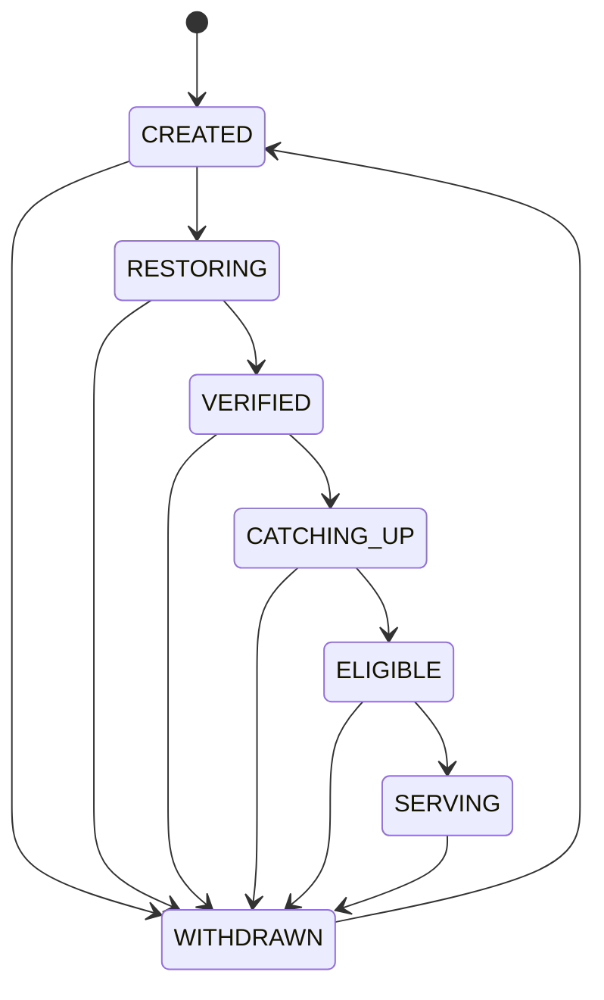
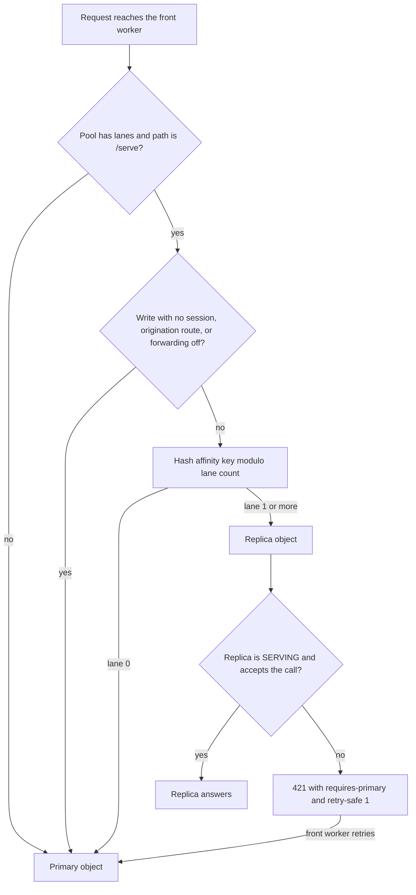

# Replica Lanes

Read replicas for a site, each a separate Durable Object filled from the primary.

A Durable Object runs one request at a time, and a PHP render holds it for the whole render. A site is not confined to one object. A namespace holds unlimited objects, so a site spreads its serving path across lanes, each a separate object named `<site>#r<n>`. Only `/serve` spreads. Owner and diagnostic routes pin to the primary, so `/export` cannot answer from a lane's copy.

A lane removes queueing, not service time. A cached page is answered from the edge cache or the object's own SQLite without booting PHP, so a site taking 100 req/s of cached traffic queues nothing and needs no lane. A site taking 20 req/s of authenticated renders may need several.

Lanes work because an authenticated GET writes no authoritative state under this SAPI. Measured per table on real renders: no `sessions` row, no `users_field_data.access`, no `flood`. Core throttles the access write on `KernelEvents::TERMINATE`, which this SAPI never dispatches. A lane keeps its own copy, sweeps expired rows (`src/ops/replica.ts`) and applies the primary's replication log. It refuses anything authoritative with a 421, and the front worker retries that request on the primary.

## Scaling

Two quantities carry different claims.

### Per Object

Driven alone on a deployed paid worker, a lane answered 31 authenticated renders per second at a p50 of 216 ms, with 8 concurrent clients and every response reporting `x-cfw-cache: RENDER`. The same object answered 268 cached pages per second at a p50 near 20 ms, reporting `x-cfw-cache: HIT`. A render is roughly ten times the work of a cached hit.

### Across a Pool

Addressing each object directly and summing, a pool reaches 1.00, 1.72, 3.64, 7.10 and 15.19x at 1, 2, 4, 8 and 16 lanes, which is 95% of perfect at sixteen. This describes how many objects a site has and what each one serves. It does not describe what a visitor gets, so quote the routed figure.

Routed traffic is hashed to a lane, and the primary serves bucket 0 as well as feeding replication. Driven that way against deployed sites with authenticated admin pages, with a fixed 20 second window per cell, sixteen lanes served 4.74x what one object served at 16 clients and 4.54x at 64 clients. p50 fell 16.4x at 16 clients and 24.8x at 64.

<details>
<summary>Routed measurements by lane count</summary>

| lanes | served, 16 clients | p50     | served, 64 clients | p50      |
| ----- | ------------------ | ------- | ------------------ | -------- |
| 0     | 62                 | 5969 ms | 98                 | 16048 ms |
| 1     | 54                 | 7712 ms | 78                 | 33741 ms |
| 2     | 79                 | 3172 ms | 154                | 10431 ms |
| 4     | 81                 | 2867 ms | 147                | 6506 ms  |
| 8     | 128                | 1715 ms | 220                | 6125 ms  |
| 16    | 294                | 364 ms  | 445                | 647 ms   |

Each cell counts served requests, not a rate. Every cell drives the same window, and a rate computed over elapsed time charges an arm twice for its own tail.

</details>

The routed throughput ratio compares a pool with one object at the same client count and window. Here `S_N` is the count of requests served with `N` replica lanes, and `S_0` the count with none:

```math
R_N = \frac{S_N}{S_0}
```

At sixteen lanes `R` is 4.74 at 16 clients and 4.54 at 64 clients, from the table above.

### When a Lane Helps

Below saturation a lane loses: 0.87x at 32 clients and 0.98x at 64. Routing hashes over two buckets, so the lane takes about 60% of the traffic onto an object whose Drupal caches are colder than the primary's, and adds no parallelism. Above saturation it is the difference between answering and not. At 128 clients one lane serves 2.06x what no pool serves.

At 512 concurrent clients over 200 distinct authenticated node pages, the same 20 second window served 0 requests with no lane, 426 with one lane, 814 with two and 1,889 with eight. A single object sheds every request at that load. This workload differs from the routed table, and the two sets of numbers must not be divided into each other.

<details>
<summary>Saturation measurements</summary>

| lanes | served, 512 clients | vs one lane |
| ----- | ------------------- | ----------- |
| 0     | 0                   | none        |
| 1     | 426                 | 1.00x       |
| 2     | 814                 | 1.91x       |
| 8     | 1,889               | 4.43x       |

The 4-lane cell is withheld. Its site returned a 500 rate the other arms did not reproduce, and the rig was torn down before the cell could be driven again.

</details>

The load comes from a Worker, not a laptop, driven through a service binding and fanned out across sub-invocations. A probe that holds service time fixed and sweeps only the fan-out puts that generator's own ceiling above 512 concurrent subrequests, so the pool is what gets measured.

The rig confirms the pool is addressed correctly. At 32 lanes all 33 objects answer, the distribution across buckets is even, and content writes forward from a lane to the primary without collision.

### Rows Written

Every row written on the primary is written again on each lane. Rows written is the meter that bounds regeneration, so a pool buys read throughput at a write-amplification cost. An 8-lane pool reaches the daily row ceiling nine times sooner than one object. Size a pool against the write rate as well as the read rate: it is a lever for read-heavy sites and a penalty on write-heavy ones.

With `N` replica lanes, and `W` the rows one change writes on the primary, the pool writes this many rows for that change:

```math
W_{\text{pool}} = (N + 1)\, W
```

## What a Lane Buys Against a VPS

A VPS has no lane axis. Its ceiling is the cores it was bought with. Raising it means resizing the box or putting a load balancer in front of several, with shared session and cache state behind them. That is an architecture change, done by hand.

A lane is a Durable Object the primary copies itself into, addressed by a hash of the visitor's affinity key. Adding one changes no configuration a site owner writes. The comparison splits by traffic shape, not by hardware:

- **Anonymous cached traffic**, which is most of it, never reaches an object on either side. Drupflare answers from the colo nearest the visitor and a VPS answers from its one region, so the difference is the network term in [Geography](../impact/economics/vps-comparison.md#geography).
- **Authenticated traffic** is where lanes decide it. A converged session is answered from the compiled plan in the front worker's isolate, and the lanes exist for the requests that miss it.

The two bill on different axes. A VPS bills for its box whether or not anyone visits. Hetzner's CX22 is 2 vCPU and 4 GB for EUR 3.79 a month, and DigitalOcean's equivalent is $24. Drupflare bills per request and per row written on a $5 Workers Paid plan. For one busy site the monthly figures are close enough that price does not decide it. For a fleet, or for a site whose traffic is bursty, they are not comparable: the VPS pays for its peak all month.

On an uncached render Drupflare is not the faster side. It competes on the traffic a real site receives. Where it is slower is listed under [Limitations](../architecture/limitations.md).

## Autoscaling

The primary counts, per alarm window, how many requests waited for its gate. Three consecutive windows must all show waiting before a lane is provisioned. The target is the smallest queue depth across those three, one lane per sustained waiter (`laneTarget()` in `src/ops/replica-demand.ts`). A burst that clears inside one window provisions nothing. A quiet window clears the run.

Autoscaling stops at 32 lanes by default. That bound is per-lane idle cost, which is storage plus replication catch-up, not a throughput limit. A new lane is also refused when the projected day's rows would pass 80% of the plan's daily row limit (`laneFitsRows()`, same file), because each lane rewrites every replicated row. `REPLICA_MAX_LANES` moves the cap, and `REPLICA_AUTOSCALE=0` turns autoscaling off. The variables are listed on [Replica Settings](../configuration/replicas.md).

## How a Lane Is Built

| piece            | what it does                                                                                                                          |
| ---------------- | ------------------------------------------------------------------------------------------------------------------------------------- |
| **Provisioning** | `?action=provision&lane=<n>` on the primary copies itself into a lane, bounded per invocation and resumable by a cursor it hands back |
| **Restore**      | each chunk carries the table's DDL, so a lane needs no Drupal install of its own                                                      |
| **Catch-up**     | the lane pulls the primary's replication log on its own alarm and is promoted through `admissionVerdict()`                            |
| **Routing**      | a lane is chosen by hashing an affinity key; see [Routing a Request](#routing-a-request)                                              |
| **Failover**     | a lane that is not `SERVING`, or meets a call it may not perform, answers 421 with a retry-safe flag                                  |
| **Staleness**    | `REPLICA_LAG_MS` bounds how far behind a serving lane may fall, at 30 s                                                               |

Three refusals hold the copy together. A torn copy, where table A is at generation 12 and table B at 13, is refused by `chunkRefusal()` (`src/ops/replica-restore.ts`), and the position stays in flight until a whole consistent copy lands. A lane cannot pass for one that has finished, because the first chunk declares every table the copy will deliver (`expect`), and the lane holds the driver to that list. No lane is admitted until `system.private_key` arrives from the primary, since two objects each minting their own would issue CSRF tokens the other rejects (`MANDATORY_STATE` in `src/ops/replica-admission.ts`).

### Lane Stages

A lane's stage is stored in the object's `replica_stage` meta key, and the serve route answers 421 to any lane not at `SERVING` (`src/do/routes/serve.ts`). `ReplicaStage` in `src/ops/replica-admission.ts` names the stages. `setReplicaStage()` in `src/site-do.ts` refuses any move `canTransition()` does not allow.



Forward moves go one step at a time. Any stage except `WITHDRAWN` may move to `WITHDRAWN`, and `WITHDRAWN` may move only to `CREATED`. The code takes these moves:

- **CREATED to RESTORING**: the first restore chunk lands (`src/do/replication.ts`).
- **RESTORING to VERIFIED**: the `done` chunk lands, and the mandatory state and every expected table are present.
- **VERIFIED to CATCHING_UP**: a log pull finds the primary ahead of the lane.
- **CATCHING_UP to ELIGIBLE to SERVING**: `admissionVerdict()` admits the lane, and the loop in `catchUpOnce()` walks both steps in one call. `ELIGIBLE` is never left stored between calls.
- **To WITHDRAWN**: `catchUpOnce()` withdraws a lane when a record is refused or the stored position is untrusted. The lane can be at `VERIFIED`, `CATCHING_UP` or `SERVING` at that point.
- **WITHDRAWN to CREATED**: `requestReadmission()` (`src/do/lanes.ts`) clears the copy and asks the primary for a new one.

`admissionVerdict()` admits a lane only when the mandatory state is present, the schema versions match, the applied generation equals the primary's advertised generation, and the fingerprints agree. An unknown on either side refuses.

A restored lane drives itself. Reaching `VERIFIED` arms its alarm. Each firing pulls `action=log` from the primary and applies it, then `admissionVerdict()` decides promotion to `SERVING` (`src/do/alarm/lane.ts`). A lane below `SERVING` owns its alarm chain and re-arms every 2 s. A `WITHDRAWN` lane resets itself to `CREATED`, clears its torn-copy markers and asks the primary for a fresh copy, then re-arms and repeats the ask until the copy lands. The primary queues the lane and takes the repair before growing the pool, on a quiet site as well as a busy one.

### Routing a Request

`openContext()` in `src/site/target.ts` picks the object, and `sendHop()` in `src/site/hop.ts` sends the request. `chooseTarget()` in `src/ops/replica-routing.ts` makes the decision.



The lane count is the larger of `REPLICA_COUNT` and the pool size this isolate last learned from the primary's `x-cfw-lanes` header (`src/site/target.ts`, `believedLanes()` in `src/ops/replica-routing.ts`). The affinity key is the path for a request that carries a session, the client address for an anonymous one, and the path when neither is present (`affinityKey()`).

Writes stay on the primary in three cases: `WRITE_FORWARD` is off, the write carries no session (a lane cannot mint one, because its `Set-Cookie` never reaches the client), or the route originates state only the primary may write, such as module installs, settings and uploads (`originationRoute()`).

The front worker retries on the primary only when the 421 carries `x-cfw-requires-primary` and `x-cfw-retry-safe: 1` (`shouldFailover()`, `src/ops/replica-routing.ts`). The replica sets `retry-safe` from `didMutate()`. If a refusal arrives after a mutating call started, the replica answers 500 with `retry-safe: 0` and the request is not retried (`replicaHandoff()`, `src/do/serve.ts`). The router keeps no readiness cache. A lane that is not ready answers 421, and the retry costs one extra hop.

### The Replication Log

The primary records each invocation's authoritative writes as one log record, sealed at the end of the invocation (`sealGeneration()` in `src/do/replication.ts`). Lanes pull records with `action=log`. Each record holds:

- **`generation`**: the commit sequence value when the invocation sealed.
- **`parent`**: the generation of the last sealed record, which this record builds on.
- **`schemaVersion`**: the pack generation both sides must agree on.
- **`fingerprint`**: the primary's hash of the authoritative state at `generation`.
- **`statements`**: the writes in order, each with positional parameters.
- **`overflowed`**: set when the writes were too many to log. The record then carries no statements, and a lane that meets it must restore.

The record shape and the applier are in `src/ops/replication-log.ts`.

Generations can skip numbers. The sequence advances on invalidation, and one invocation can move it several steps before it seals. A number that no record carries is then skipped. `malformed()` requires only that `generation` be greater than `parent`, and its comment says gaps are normal.

The chain check is `planApply()`, and it accepts a record only when `parent` equals the lane's applied generation. A higher parent means a record is missing. A lower parent means the record builds on a position the lane already passed. Either refuses, and `catchUpOnce()` withdraws the lane. The parent is the last sealed record rather than `commitSeq() - 1`, because a seal can land past the current sequence value. A caught-up lane sits on that last sealed record, so the equality holds by construction. A record at or below the applied generation is a duplicate and is skipped.

`catchUpOnce()` applies each record in one transaction, since it does not pass a `chunkSize` to `applyRecord()`.

---
