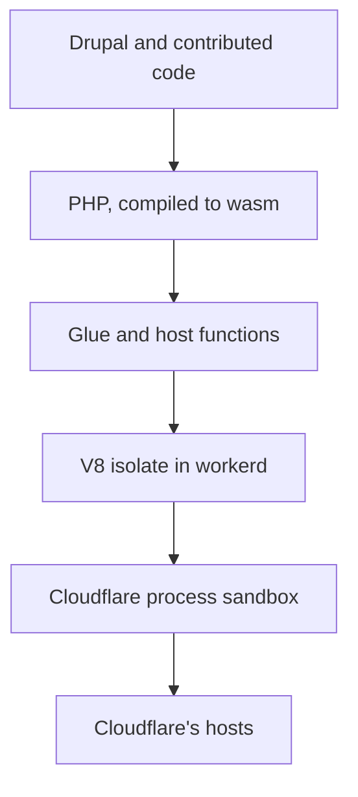

# Security

Drupflare runs unmodified Drupal 11 on PHP 8.5 compiled to WebAssembly, inside a Durable Object on
Cloudflare Workers. This page says what that changes about the attacks a Drupal site faces, what it
leaves alone, and how each statement was established. It is written for a security reviewer, and the
weak points sit beside the strong ones.

The short version: a bug in Drupal, a contributed module or PHP still compromises the site. What
changes is the next step. On a conventional host an attacker who can run code gets a process on an
operating system, with a shell, a filesystem, a network, neighbouring services and a kernel to
attack. Here the attacker gets a PHP interpreter inside two sandboxes with a fixed list of host
functions and no operating system to enumerate. Several well-known classes of server takeover have
no path left to run. Application-layer bugs, and the data inside the same object, are exposed
exactly as they were.

## How to Read the Claims

Every statement carries a tag for how it was established.

| Tag      | Meaning                                                                          |
| -------- | -------------------------------------------------------------------------------- |
| Read     | The source file or the primary document was read, and the line or quote is cited |
| Measured | A command or a test was run, and the command or the spec is named                |
| Inferred | It follows from the architecture and nothing was run against it                  |

Every row is closed to one of three verdicts. There is no fourth.

- `removed`: the attack path needs a component the object does not have.
- `contained`: the flaw or the attacker's foothold exists, and a control limits what it reaches or
  what it keeps. The control and its residual are named.
- `open`: the flaw works as it does on any host, or it could not be established either way. A claim
  that could not be established counts as `open` at full capacity, and the row says what would
  settle it.

A measurement taken on a local `workerd` is labelled that way. It runs the same runtime code as the
platform and not the platform's extra protections, so it never upgrades a row to `removed` by
itself.

No study measures how much a serverless or sandboxed runtime lowers breach probability. The page
does not put a percentage on safety. It counts attack classes instead, and the count is only as good
as the inference behind each row (see [How Much Safer](#how-much-safer)).

Sources were read through a page extractor. The quotes from Cloudflare's security model and Spectre
post, SA-CORE-2026-014, the Lehmann and Stiévenart abstracts and the GTIG report were also checked
against the live page. Check the live page before quoting any source to a third party, because
Cloudflare's pages and the PHP and Drupal advisories change.

## What Is Claimed and What Is Not

| Claim                                                                                         | Status                                                                                                                             |
| --------------------------------------------------------------------------------------------- | ---------------------------------------------------------------------------------------------------------------------------------- |
| There is no operating system, shell, web server or PHP-FPM pool in the site's trust boundary  | Read: [layers](#the-layers)                                                                                                        |
| A PHP exploit runs inside WebAssembly linear memory and reaches the host only through imports | Read: webassembly.org security page                                                                                                |
| Cloudflare states a V8 patch gap under 24 hours                                               | Read: Cloudflare security model                                                                                                    |
| Server-takeover classes (FPM, CGI, Shellshock, Apache, container and kernel escapes) are gone | Inferred: [map](security-incidents.md#the-cve-and-incident-map)                                                                    |
| PHP in the interpreter cannot open a socket, call a JavaScript global or spawn a process      | Measured: control 3 recorded calls, shipping glue 0; see [Host Surface](security-controls.md#host-surface)                         |
| An owner token stored by Drupflare can be read by code with SQL access                        | False since v1.0.4. Only its hash is kept, outside SQL: [Credentials](security-controls.md#credentials-and-persistence)            |
| Arbitrary code execution is impossible                                                        | False. Any Drupal RCE runs PHP in the sandbox                                                                                      |
| A compromised PHP cannot read the site's own data                                             | False. The database sits in the same object                                                                                        |
| WebAssembly makes memory corruption harder to exploit than native                             | False. See [Memory Corruption](#memory-corruption-inside-the-sandbox)                                                              |
| A published PHP2Shell chain works against a Drupflare site                                    | No. Each needs a per-request startup and shutdown cycle that does not exist here; see [PHP2Shell](security-incidents.md#php2shell) |
| Drupflare is safer than a VPS                                                                 | Inferred, per attack class, and unmeasured as a whole: [How Much Safer](#how-much-safer)                                           |

## The Layers

A request passes through these layers, from the attacker's side inward.

| Layer                       | What it is                                                       | Source                                            |
| --------------------------- | ---------------------------------------------------------------- | ------------------------------------------------- |
| Drupal and contributed code | Application authorization, SQL, templates                        | the site itself                                   |
| PHP, compiled to wasm       | The interpreter in WebAssembly linear memory, built by `phasm`   | `interp.lock.json`                                |
| Glue and host functions     | 102 JavaScript imports from the module, plus 31 `cfw*` functions | [Host Surface](security-controls.md#host-surface) |
| V8 isolate in workerd       | The JavaScript sandbox that holds the module and the glue        | Cloudflare docs                                   |
| Cloudflare process sandbox  | Linux namespaces and seccomp around the process                  | Cloudflare docs                                   |
| Cloudflare's hosts          | The machine, which belongs to the platform                       | not in scope                                      |

The same stack as a diagram:

Cloudflare's security model page describes the last two. "The layer 2 sandbox uses Linux namespaces
and seccomp to prohibit all access to the filesystem and network." It also says that "Workers does
not allow our customers to upload native-code binaries to run on the Cloudflare network" and that
"the Workers patch gap is now under 24 hours", where the patch gap is the time between publishing a
V8 fix and deploying it ([Cloudflare](https://developers.cloudflare.com/workers/reference/security-model/)).
All three are Cloudflare's statements about its own platform. None was
independently measured here.

The same page carries two cautions. It says "Local `workerd` processes do not include every
defense-in-depth protection described here", and the workerd README is headed "WARNING: `workerd`
is not a hardened sandbox." The protections above belong to hosted Workers. A self-hosted `workerd`
needs a microVM or equivalent boundary around it, which is what the `isolated` mode of
[bastion](https://github.com/drupflare/bastion) provides.

The database sits inside the same object as PHP, with no boundary between the interpreter and the
site's own SQLite file. See [Data in the Same Object](#data-in-the-same-object).

## What the Architecture Removes

These classes need a component the object does not have.

- **A server process to take over.** There is no PHP-FPM pool, CGI handler, web server, SSH daemon
  or inbound socket. CVE-2019-11043 (PHP-FPM behind nginx), CVE-2024-4577 (PHP-CGI on Windows),
  CVE-2021-41773 (Apache path traversal) and CVE-2014-6271 (Shellshock through CGI) each need one.
- **A shell and delegates.** `posix_spawnp` aborts and the module has no process table, so
  command-injection classes such as ImageMagick delegates (CVE-2016-3714) have nothing to run.
  GD is not compiled in, and image operations run as JavaScript.
- **A kernel and a container runtime in the tenant's boundary.** Container and kernel escapes,
  including runc CVE-2019-5736, runc CVE-2024-21626, Dirty Pipe CVE-2022-0847 and Dirty COW
  CVE-2016-5195, start from a process on a shared Linux kernel. That kernel is Cloudflare's, and an
  attacker here needs a vulnerability in Cloudflare's runtime first.
- **An appliance in front of the application.** The CitrixBleed class (CVE-2023-4966) is a memory
  disclosure on an edge appliance. TLS ends at Cloudflare's edge, and PHP has no OpenSSL (`WITH_OPENSSL=0`).
- **A native binary upload.** Cloudflare accepts only JavaScript and WebAssembly.
- **A writable server filesystem that persists.** The in-memory filesystem is rebuilt on a new
  instance, and uploads live in the site's own file tables. The rebuild reads `cfw_module_file`, so
  a planted module row was a way back in; see [Credentials and Persistence](security-controls.md#credentials-and-persistence)
  for what now holds it.

Google's Threat Intelligence Group counted 90 zero-days exploited in the wild in 2025, with 43
(48%) in enterprise software and appliances and browsers under 10% of the total
([GTIG](https://cloud.google.com/blog/topics/threat-intelligence/2025-zero-day-review/)). The count is about products in general. It shows where attackers spend zero-days, and
it does not measure Drupflare.

## What It Does Not Remove

### Application Bugs

A SQL injection, an authorization bypass or a cross-site request forgery behaves as it does on any
host. Drupalgeddon (CVE-2014-3704, SA-CORE-2014-005) is a SQL injection reachable by an anonymous
user, and it reads the same database here. SA-CORE-2020-004 (CVE-2020-13663) is a CSRF flaw in the
Form API, and a browser does not care where the server runs.

### Code Execution Inside the Sandbox

Drupalgeddon 2 (CVE-2018-7600, CVSS 9.8) and SA-CORE-2019-003 (CVE-2019-6340) execute PHP. So does
SA-CORE-2026-014 (CVE-2026-108097), a Field UI remote code execution in core published 2026-10-14.
Its advisory says "At least one known exploit path does not require authentication" and also says
the flaw "is not directly exploitable with core alone", with serious exploit paths through
contributed modules. In each case the attacker runs PHP in the object, with the host functions
above and the database in the same object. The architecture contains what that PHP can do
outside the object. It does not stop the PHP from running.

### Memory Corruption Inside the Sandbox

WebAssembly does not make a C program's memory bugs harder to exploit. Lehmann, Kinder and Pradel
(USENIX Security 2020) find that many classic vulnerabilities that common mitigations block in
native code are exposed in WebAssembly, that the platform enables new attacks such as
overwriting constant data, and that attacks can divert control flow or manipulate the host. Their
conclusion is "a perhaps surprising lack of binary security in WebAssembly"
([USENIX](https://www.usenix.org/conference/usenixsecurity20/presentation/lehmann), abstract).
Stiévenart, De Roover and Ghafari compiled 4,469 C programs with known buffer
overflows to x86 and to WebAssembly, found 1,088 whose outcome differed, and attribute it to "the
lack of security measures such as stack canaries in the generated WebAssembly"
([arXiv:2111.01421](https://arxiv.org/abs/2111.01421), abstract).

So treat an exploit of a PHP memory bug as no harder inside the sandbox than on a native build, and
do not count on in-sandbox exploit difficulty. WebAssembly checks an indirect call's type
signature, so a hijack is limited to functions of the same type
([webassembly.org](https://webassembly.org/docs/security/)). What the sandbox changes is the step
after: code in the module reaches the host only through the imports above.

### JavaScript Code Execution in the Isolate

A foothold in the isolate's JavaScript would be worse than one in PHP, because the isolate holds
the bindings the Worker holds: the `SITE` and render-lane namespaces, `CONFIG_KV` and `PAGE_KV`
across sites, the fleet D1 database, `ASSETS`, and the variables and secrets in `env` (an email
token, the SMTP password, `REDIS_URL` with its password, the OIDC client secret). The `cfw*` list
limits what PHP can ask for and does nothing to limit JavaScript that is already running. This
section is Inferred from the bindings model and `wrangler.jsonc`; the Durable Object and secrets
documentation was not read.

Three paths to that foothold:

| Path                  | What stops it                                                                                                  | What the repo does                                                                                                                                                                     | Verdict     |
| --------------------- | -------------------------------------------------------------------------------------------------------------- | -------------------------------------------------------------------------------------------------------------------------------------------------------------------------------------- | ----------- |
| From wasm outward     | V8's isolation; Cloudflare says the V8 sandbox needs a bypass to leave                                         | The bridge and socket closures above remove the userland routes. The engine's code-generation ban remains for any other object                                                         | `contained` |
| From the engine       | Cloudflare's patch gap, under 24 hours for V8; the sandbox is "not a complete Spectre mitigation" in its words | Nothing here changes V8 or `workerd`                                                                                                                                                   | `open`      |
| From the supply chain | Cloudflare accepts no native uploads, which does not cover an npm package that runs at build time              | A lockfile pins versions, not contents. `postinstall` runs `scripts/restore-artifacts.ts` on every install and fetches the interpreter from a CDN, checked against `cdn-manifest.json` | `open`      |

The engine path has one published case. Check Point (2026-08) reported use-after-free and
out-of-bounds bugs in `workerd`'s zlib, HTMLRewriter and URLPattern code and a bypass of the
key-value SQL authorizer. On self-hosted `workerd` with the V8 sandbox switched off they reached
native code execution and a co-located Worker's API token. Cloudflare confirmed the bugs reproduce
on its production platform with one exception and says they are fixed there. No date was found and no
CVEs were assigned ([Check Point](https://research.checkpoint.com/2026/when-agentic-glue-melts/),
extract). A second item, CVE-2026-87491, is a V8 out-of-bounds write in the CISA known-exploited
catalog whose entry names Chrome and Chromium; whether the Workers build is affected was not
established. Both count as `open` until Cloudflare gives a hosted date and says what the Workers
build took.

Cloudflare's security model page does not say that `eval` or runtime WebAssembly compilation is
blocked, so the page does not claim it. A `new Function` was refused in a deployed probe and
request-time `WebAssembly.Module` compilation is refused by `workerd` (`CLAUDE.md`, both measured on
this project's own probes). Neither is a statement about hosted Workers in general.

Of the 14 runtime npm packages, advisories were checked for four. `mysql2` 3.24.4 is above the fix
for GHSA-3f6p-5ww8-9rcr, and `pg` has a 2018 advisory whose affected range was not read. The other
ten and every transitive package are unchecked, and an unchecked package counts as `open`.

### Data in the Same Object

Code execution inside the sandbox reads and writes the whole site database, which is in the same
object. Sealed storage keeps credentials out of that database, and nothing keeps the site's
content, users, sessions and configuration out of it. Egress is open by design:
`cfwQueueFetch` sends any public HTTP(S) request PHP builds, because the legitimate set (update
servers, OIDC providers, webhooks) is open-ended. The deny-list protects private and metadata
addresses and does not stop a site's own data leaving to a public host. A per-site egress allow-list
is `L` and is not built.

### Co-Tenancy and Side Channels

Cloudflare runs many isolates in one process. On 2026-08-19 it published a revisit of remote Spectre
attacks on Workers, reporting a leak of "up to 12 bit/s with an accuracy of more than 99%" of a JWT
a researcher placed in a co-located Worker. It adds that "The V8 sandbox is not a complete Spectre
mitigation" and "MPK is not a complete answer to remediate Spectre, but it strictly reduces the
leakage surface". It lists frozen timers, no shared memory, detection, memory shuffling, process
isolation for suspicious scripts, the V8 sandbox and in-process isolation with memory protection
keys. Only the memory protection keys carry a date, September 2025
([Cloudflare](https://blog.cloudflare.com/revisiting-spectre-attacks-on-workers/); paper
[arXiv:2608.17043](https://arxiv.org/abs/2608.17043), abstract only). A site that holds a secret in
a Durable Object is exposed to this class on any shared platform. The mitigations are Cloudflare's.

### Platform Failure and Concentration

A bug in Cloudflare's own software reaches every tenant. Cloudbleed (2017) leaked memory from
Cloudflare's HTML parser into responses for about 1 in every 3,300,000 requests during its worst
window, and the post says the trigger was customer content
([Cloudflare](https://blog.cloudflare.com/incident-report-on-memory-leak-caused-by-cloudflare-parser-bug/)).
Two 2025 outages were not attacks: the 12 June Workers KV outage, which the post says "lasted 2
hours and 28 minutes" while its own timeline runs 17:52 to 20:28 UTC
([post](https://blog.cloudflare.com/cloudflare-service-outage-june-12-2025/)), and the 18 November
outage, which came from a database permissions change that doubled a feature file past a proxy limit
([post](https://blog.cloudflare.com/18-november-2025-outage/)). Drupflare's design answer is that a
site keeps serving with the control plane gone. It cannot keep serving with Cloudflare gone.

### Supply Chain

Composer packages and the interpreter's own dependencies run as code in every host. The PHP
project reverted two malicious commits to its source repository in March 2021 before any release
carried them ([php.net](https://www.php.net/archive/2021.php)). The same risk applies to a Composer
package or an interpreter dependency here as anywhere.

What v1.0.4 adds is a digest check at install. `packages.drupal.org` publishes a SHA-1 `dist.shasum`
on every release of the three modules checked (23, 24 and 58 of 58) and an archive downloaded from
`ftp.drupal.org` matched it. A package that carries a digest is checked before it is unpacked, and a
mismatch refuses the install even with `force=1`. Packagist publishes an empty string for all 189,
91 and 499 releases checked of three packages, so those install unverified and the result says
`verified: false`. The check guards a swapped or corrupted archive, not a registry that lies in both
its metadata and its archive. Packagist trust is `open` and needs a different root, such as a signed
lock (`L`). The first release of a malicious package is `open` on every host. The fetched
interpreter is checked against its pinned digest and, once the attestation step has run, against
phasm's build provenance.

### Cost as an Attack and Visibility

No primary source on denial of wallet was found. The project's own rig has seen the mechanism: a
bench site driven all night used 103.8% of its daily row quota and went read-only, so every login
answered 503 (`CLAUDE.md`, measured). A busy site on the free plan can be degraded by traffic. This
is `open`. There is also no host disk image and no host log to examine after an incident, so
forensics rest on Workers observability events and the owner audit log's anchor lines.

### State That Survives Between Requests

A warm Durable Object keeps its interpreter between requests, and static state in PHP survives.
Four cases are documented in this repository: an AJAX flag that randomised every later element id,
an entity access cache that kept an unpublished node readable by anonymous visitors, a cached
local-task list that rendered one node's tabs on another, and a `file_save_upload()` function static
that handed one user's uploaded file to the next upload to the same field. Each was found and fixed,
and each had no signal until a test looked for it
(`CLAUDE.md`, "The boundary sweep walks services now"). This class is specific to a persistent
runtime. A request-per-process server such as PHP-FPM resets it by design.

## How Much Safer

No study compares breach outcomes for serverless and server hosting. The attack-surface literature
(Manadhata and Wing, IEEE TSE 2011, and Howard's relative attack surface quotient) defines how to
count entry points and capabilities, and neither measures this pair. The vendor surveys searched
quote percentages that were read only through summaries, so none is repeated here.

What can be counted is the two tables above. Every sentence on this page that says Drupflare is more
resistant than a VPS to a class is Inferred from the architecture until the three-arm comparison
below has a result.

The 24 rows of the [incident map](security-incidents.md#the-cve-and-incident-map) carry these verdicts:

| Verdict   | Rows | Meaning                                                                       |
| --------- | ---- | ----------------------------------------------------------------------------- |
| removed   | 12   | The attack path needs a component the object lacks                            |
| contained | 4    | The flaw runs; the sandbox limits the reach                                   |
| open      | 8    | The flaw works as it does anywhere, or it could not be established either way |

The [v1.0.4 class table](security-incidents.md#classes-addressed-in-v104) has 19 rows: 4 move from `open` to `removed`, 12 to `contained`, and 3 stay
`open`. Read the `removed` counts as statements about classes of server takeover and published exploit chains, and do not read
them as a breach probability. The incident rows were chosen from incidents that reached the attacker's goal on conventional
PHP hosting, so the selection favours the classes this architecture removes. None of the six Drupal
advisories in the map is `removed`: each is `contained` or `open`, because Drupal's own bugs
run inside the sandbox. Sophos's 2025 education survey reports that higher education providers were
more likely to be attacked through exploited vulnerabilities (35%), from 441 respondents across
lower and higher education
([Sophos](https://www.sophos.com/en-us/blog/the-state-of-ransomware-in-education-2025)). The
figure concerns the entry vector and says nothing about the host.

The measurable form of the claim is a comparison of authority retained after the same exploit. The
planned experiment runs one pinned vulnerable Drupal against three arms (a minimally configured
VPS, a hardened container and Drupflare) with a fixed list of post-exploitation actions, and
publishes how many each arm blocked.

## References

Each source was read through a page extractor unless its entry says abstract or extract.

1. Cloudflare, Workers security model: <https://developers.cloudflare.com/workers/reference/security-model/>
2. Cloudflare, "A revisit of remote Spectre attacks on Cloudflare Workers", 2026-08-19: <https://blog.cloudflare.com/revisiting-spectre-attacks-on-workers/>
3. Schwarzl et al., "Remote-Timer-as-a-Service", arXiv:2608.17043 (abstract only): <https://arxiv.org/abs/2608.17043>
4. Cloudflare, Cloudbleed incident report, 2017-02-23: <https://blog.cloudflare.com/incident-report-on-memory-leak-caused-by-cloudflare-parser-bug/>
5. Cloudflare, 12 June 2025 service outage: <https://blog.cloudflare.com/cloudflare-service-outage-june-12-2025/>
6. Cloudflare, 18 November 2025 outage: <https://blog.cloudflare.com/18-november-2025-outage/>
7. Lehmann, Kinder and Pradel, "Everything Old is New Again: Binary Security of WebAssembly", USENIX Security 2020 (abstract): <https://www.usenix.org/conference/usenixsecurity20/presentation/lehmann>
8. Stiévenart, De Roover and Ghafari, "The Security Risk of Lacking Compiler Protection in WebAssembly", arXiv:2111.01421 (abstract): <https://arxiv.org/abs/2111.01421>
9. WebAssembly security documentation: <https://webassembly.org/docs/security/>
10. Google Threat Intelligence Group, "2025 Zero-Days in Review", 2026-03-05: <https://cloud.google.com/blog/topics/threat-intelligence/2025-zero-day-review/>
11. PHP project, security advisory 2026-10-21 (CVE-2026-109618, CVE-2026-109619) and the two php-src advisories GHSA-w8hw-w9fx-j79w and GHSA-6wmf-4rv5-p3rp: <https://www.php.net/archive/2026.php#2026-10-21-5>
12. Wiz, "PHP2Shell: AI uncovers critical RCE vulnerabilities" (read once through a page extractor): <https://www.wiz.io/blog/php2shell-php-rce>
13. Drupal security advisories SA-CORE-2014-005, 2018-002, 2018-004, 2019-003, 2020-004 and 2026-014: <https://www.drupal.org/security>
14. NVD records for the CVE identifiers in the map: <https://nvd.nist.gov/>
15. PHP project, 2021 archive (malicious commits, 2021-03-30): <https://www.php.net/archive/2021.php>
16. Sophos, "The State of Ransomware in Education 2025": <https://www.sophos.com/en-us/blog/the-state-of-ransomware-in-education-2025>
17. workerd README, "WARNING: workerd is not a hardened sandbox": <https://github.com/cloudflare/workerd>
18. Check Point Research, workerd and Code Mode research, 2026-08-07 (read as an extract): <https://research.checkpoint.com/2026/when-agentic-glue-melts/>
19. CISA, "Widespread supply chain compromise impacting npm ecosystem", 2025-09-23 (extract): <https://www.cisa.gov/news-events/alerts/2025/09/23/widespread-supply-chain-compromise-impacting-npm-ecosystem>
20. Cloudflare, Durable Object platform limits (key and value size): <https://developers.cloudflare.com/durable-objects/platform/limits>
