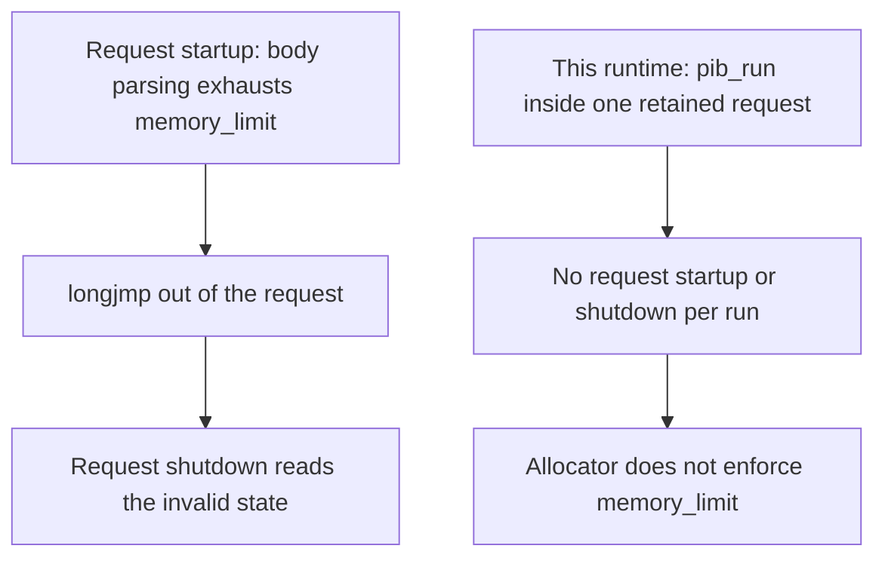

# Security Incidents and Planned Work

How named vulnerabilities and incident classes map onto the architecture, what the current release addresses, the PHP2Shell analysis, and the work still planned. The claims and their labels are on [Security](index.md).

## The CVE and Incident Map

Each row maps a published vulnerability or incident to what an attacker needs on a conventional
host and what changes inside a Drupflare site. The verdicts are Inferred from the architecture
above. No exploit was run against a Drupflare site. The verdict words are defined under
[How to Read the Claims](index.md#how-to-read-the-claims).

| Id                                                                                                                                                                     | Year       | Class                                          | Verdict   | Reason                                                                                                                    |
| ---------------------------------------------------------------------------------------------------------------------------------------------------------------------- | ---------- | ---------------------------------------------- | --------- | ------------------------------------------------------------------------------------------------------------------------- |
| [CVE-2014-3704](https://www.drupal.org/sa-core-2014-005)                                                                                                               | 2014       | SQL injection, Drupal 7 core                   | open      | Reads the same database                                                                                                   |
| [CVE-2018-7600](https://www.drupal.org/sa-core-2018-002)                                                                                                               | 2018       | Unauthenticated RCE, Drupal core               | contained | PHP runs in the sandbox; no shell for the observed miner payload (CVSS 9.8)                                               |
| [CVE-2018-7602](https://www.drupal.org/sa-core-2018-004)                                                                                                               | 2018       | RCE, Drupal 7 and 8                            | contained | As CVE-2018-7600                                                                                                          |
| [CVE-2019-6340](https://www.drupal.org/sa-core-2019-003)                                                                                                               | 2019       | RCE through REST input                         | contained | PHP runs in the sandbox                                                                                                   |
| [CVE-2020-13663](https://www.drupal.org/sa-core-2020-004)                                                                                                              | 2020       | CSRF in Form API                               | open      | Browser-side flaw                                                                                                         |
| [CVE-2026-108097](https://www.drupal.org/sa-core-2026-014)                                                                                                             | 2026       | RCE in Field UI, Drupal core                   | contained | PHP runs in the sandbox; lock pins 11.4.11, which includes the 11.4.10 fix                                                |
| [CVE-2019-11043](https://nvd.nist.gov/vuln/detail/CVE-2019-11043)                                                                                                      | 2019       | PHP-FPM buffer underflow via nginx             | removed   | No FPM, no nginx, no FastCGI socket                                                                                       |
| [CVE-2024-4577](https://nvd.nist.gov/vuln/detail/CVE-2024-4577)                                                                                                        | 2024       | PHP-CGI argument injection, Windows            | removed   | Needs the CGI SAPI on Windows with Apache                                                                                 |
| [CVE-2014-6271](https://nvd.nist.gov/vuln/detail/CVE-2014-6271)                                                                                                        | 2014       | Shellshock, Bash through CGI                   | removed   | No Bash and no CGI                                                                                                        |
| [CVE-2021-41773](https://nvd.nist.gov/vuln/detail/CVE-2021-41773)                                                                                                      | 2021       | Apache 2.4.49 path traversal                   | removed   | No Apache and no filesystem to traverse                                                                                   |
| [CVE-2016-3714](https://nvd.nist.gov/vuln/detail/CVE-2016-3714)                                                                                                        | 2016       | ImageMagick delegate shell injection           | removed   | No ImageMagick; no process to spawn                                                                                       |
| [CVE-2023-4966](https://nvd.nist.gov/vuln/detail/CVE-2023-4966)                                                                                                        | 2023       | CitrixBleed, edge appliance memory             | removed   | No appliance in the tenant's path                                                                                         |
| [CVE-2014-0160](https://nvd.nist.gov/vuln/detail/CVE-2014-0160)                                                                                                        | 2014       | Heartbleed, OpenSSL                            | removed   | PHP has no OpenSSL; TLS ends at Cloudflare                                                                                |
| [CVE-2026-7261](https://nvd.nist.gov/vuln/detail/CVE-2026-7261)                                                                                                        | 2026       | PHP SoapServer use-after-free                  | removed   | ext/soap is not compiled in (no `SoapServer` string in the binary)                                                        |
| runc [CVE-2019-5736](https://nvd.nist.gov/vuln/detail/CVE-2019-5736), [CVE-2024-21626](https://github.com/opencontainers/runc/security/advisories/GHSA-xr7r-f8xq-vfvv) | 2019, 2024 | Container runtime escape                       | removed   | The tenant has no container runtime; the platform does                                                                    |
| [CVE-2022-0847](https://nvd.nist.gov/vuln/detail/CVE-2022-0847), [CVE-2016-5195](https://nvd.nist.gov/vuln/detail/CVE-2016-5195)                                       | 2022, 2016 | Linux kernel privilege escalation              | removed   | Needs a local process on a Linux kernel the tenant can reach                                                              |
| [CVE-2026-109618](https://github.com/php/php-src/security/advisories/GHSA-w8hw-w9fx-j79w)                                                                              | 2026       | RCE via OOM corruption, PHP                    | removed   | The chain needs a request startup and shutdown cycle and a `memory_limit` bailout, and neither exists here                |
| [CVE-2026-109619](https://github.com/php/php-src/security/advisories/GHSA-6wmf-4rv5-p3rp)                                                                              | 2026       | RCE via stale global state, PHP                | removed   | The consumers run at request startup, which does not happen per request here, and no request memory is freed between runs |
| [php-src malicious commits](https://www.php.net/archive/2021.php)                                                                                                      | 2021       | Source supply chain                            | open      | A bad commit reaching a build is the same risk on any host                                                                |
| [Shai-Hulud npm worm](https://www.cisa.gov/news-events/alerts/2025/09/23/widespread-supply-chain-compromise-impacting-npm-ecosystem)                                   | 2025       | Trojaned releases through hijacked maintainers | open      | The class applies to any registry; the build and publish hosts run `postinstall`                                          |
| [Spectre on Workers](https://blog.cloudflare.com/revisiting-spectre-attacks-on-workers/)                                                                               | 2026       | Co-tenant timing leak                          | open      | Platform mitigations apply; not complete by Cloudflare's own statement                                                    |
| [Cloudbleed](https://blog.cloudflare.com/incident-report-on-memory-leak-caused-by-cloudflare-parser-bug/)                                                              | 2017       | Edge memory disclosure                         | open      | Platform-side; a tenant cannot prevent it                                                                                 |
| [Check Point workerd research](https://research.checkpoint.com/2026/when-agentic-glue-melts/)                                                                          | 2026       | Engine memory bugs, KV authorizer bypass       | open      | Cloudflare says fixed in production with no date; the local build refuses the rename, which is not the platform           |
| CVE-2026-87491 (CISA known-exploited catalog)                                                                                                                          | 2026       | V8 out-of-bounds write                         | open      | The entry names Chrome; whether the Workers build is affected was not established                                         |

## Classes Addressed in v1.0.4

The map above is about published incidents. This table is about attack classes a code-execution
foothold could use, with the verdict before and after the v1.0.4 work. Each "after" names its
evidence and its residual.

| Class                                                  | Before | After     | Evidence                                                                                      | Residual                                                                                                                                                      |
| ------------------------------------------------------ | ------ | --------- | --------------------------------------------------------------------------------------------- | ------------------------------------------------------------------------------------------------------------------------------------------------------------- |
| Owner and git credentials readable through SQL         | open   | contained | Measured, local `workerd`; [Credentials](controls/credentials.md#credentials-and-persistence) | Account holder; a pre-upgrade restore point; hosted rename fix undated                                                                                        |
| Planted module row survives a restart                  | open   | contained | Measured, local `workerd`                                                                     | Unclaimed sites, replica lanes, other SQL-resident paths                                                                                                      |
| Planted heap image restored on boot                    | open   | contained | Measured: restored by default before, refused after                                           | SQL write can delete images (a boot of cost)                                                                                                                  |
| PHP opens a raw socket through the glue                | open   | removed   | Measured, node: 3 constructed, 0                                                              | None known; the `cfw*` list is the only route out                                                                                                             |
| PHP calls a JavaScript global through vrzno            | open   | removed   | Measured, node: 3 recorded calls, 0                                                           | `cfw*` functions callable with any argument; a `TypeError` ends an invocation                                                                                 |
| Outbound guard bypass by spelling                      | open   | contained | Measured, unit                                                                                | Public name resolving to a private address; hosted link-local reach unmeasured                                                                                |
| Oversized chunked or multipart body                    | open   | contained | Measured, `serve-edge.spec.ts`                                                                | Platform 100 MB limit still the outer bound                                                                                                                   |
| A page stored for one visitor served to all            | open   | contained | Measured: stock pack varies nothing; modules that vary are not stored                         | A module varying by something other than the four named headers                                                                                               |
| Module headers dropped before a browser                | open   | contained | Measured, every tier                                                                          | R2 mirror carries none (`L`)                                                                                                                                  |
| Plugin embedding and clickjacking                      | open   | contained | Measured: header sent in report-only; no browser run                                          | Script injection needs a strict policy (`L`); a Drupal admin can remove the baseline                                                                          |
| PHP2Shell interim mitigations                          | open   | contained | Measured: values read back from the interpreter                                               | Package updated to 8.5.12; chains have no path here regardless                                                                                                |
| Stale write in the park extension                      | open   | removed   | Measured: native 21/1 without the fix, 22/0 with                                              | Present in every interpreter built before the fix                                                                                                             |
| Swapped Composer archive                               | open   | contained | Measured: drupal.org digests present and verified                                             | Packagist installs unverified                                                                                                                                 |
| Interpreter below the PHP floor ships                  | open   | contained | Measured: `inspect-build.sh` fails below the pin                                              | The workflow step has not run against a real attestation; one artifact was verified with the command, see [Patching](controls/build-and-patching.md#patching) |
| Tenant switches the outbound guard off                 | open   | removed   | Measured: four spellings refused from PHP, the owner route and KV                             | An operator can still set it in the environment                                                                                                               |
| Owner action leaves no trace                           | open   | contained | Measured: chain verifies and tamper is caught                                                 | Evidence against a site-level attacker only; PITR rewinds the log                                                                                             |
| `RESPONSE_HEADERS` removes the CSP baseline            | open   | open      | Read: writable from the PHP settings form                                                     | A maintainer decision                                                                                                                                         |
| `cfw_meta` authority keys (`git_remotes`, claim, OIDC) | open   | contained | Measured: `serve-restore.spec.ts`, `SELECT * FROM cfw_meta` holds none after a move           | Rolling the deploy back reads them as absent; PITR round trip not run                                                                                         |
| Planted row on a replica lane                          | open   | open      | Read: lanes hold no records                                                                   | `L`                                                                                                                                                           |

## PHP2Shell

PHP2Shell is the name given to two critical remote code execution vulnerabilities in PHP,
CVE-2026-109618 and CVE-2026-109619, published on 2026-10-21 and fixed in PHP 8.5.12, 8.4.27,
8.3.36 and 8.2.35. This section says what the advisories require, what the shipping interpreter does
about each requirement. The result: the published PHP2Shell chains do not work against a Drupflare
site, and the map marks both `removed`. The reason is the lifecycle described below. The sandbox does
not account for it: WebAssembly does not stop corruption inside the module.

### What the Advisories Say

CVE-2026-109618, "RCE via OOM corruption"
([GHSA-w8hw-w9fx-j79w](https://github.com/php/php-src/security/advisories/GHSA-w8hw-w9fx-j79w)):
"PHP uses `longjmp()` for out-of-memory (OOM) errors to exit the current context and abort handling
of the request", and "does not properly account for the early exit and leaves the request memory in
an invalid state". Request shutdown then reads that state. The validated exploit is against Apache
mod_php, where body parsing at request startup can exhaust `memory_limit` and shutdown still runs.
For PHP-FPM the advisory says "no complete FPM exploit has been demonstrated".

CVE-2026-109619, "RCE via stale global state"
([GHSA-6wmf-4rv5-p3rp](https://github.com/php/php-src/security/advisories/GHSA-6wmf-4rv5-p3rp)):
state owned by one request survives after its memory is freed, and a later operation on the same
worker reads it before normal initialization resets it. The exploit needs a producer, which is a fatal
error, timeout or OOM that skips a reset, and a consumer that runs before initialization. The
confirmed consumers are INI diagnostics raised while settings are applied and session upload
progress. The confirmed producer on PHP 8.5 is `fatal_error_backtraces`.

Both are CVSS v4 9.2, unauthenticated and network reachable. PHP's announcement says "there are no
complete mitigations, updating is the only safe choice" and names PHP-FPM, Apache with mod_php,
php-cgi, FrankenPHP and LiteSpeed as at risk
([php.net](https://www.php.net/archive/2026.php#2026-10-21-5)). It does not address embedded SAPIs.
Wiz reports working exploits on standard SAPIs against WordPress, Drupal and Joomla, including one
against Drupal that uses the fatal-error backtrace state
([Wiz](https://www.wiz.io/blog/php2shell-php-rce)).

### What the Shipping Interpreter Does

| Fact                                                                                      | Value                                                                   | Basis                                                       |
| ----------------------------------------------------------------------------------------- | ----------------------------------------------------------------------- | ----------------------------------------------------------- |
| PHP version                                                                               | 8.5.12                                                                  | Measured: `tests/integration/interpreter-lifecycle.spec.ts` |
| SAPI                                                                                      | `embed`                                                                 | Measured                                                    |
| A fatal error in one run leaves `$GLOBALS` and `error_get_last()` visible to the next run | yes                                                                     | Measured                                                    |
| Multipart bodies parsed by PHP's request startup                                          | no, parsed in userland                                                  | Measured: `tests/integration/multipart-submit.spec.ts`      |
| `USE_ZEND_ALLOC`                                                                          | `0`, the system allocator                                               | Measured                                                    |
| `memory_limit` enforced                                                                   | no: an 8M cap held 40 MB                                                | Measured, on 8.5.2; not repeated on 8.5.12                  |
| Where PHP 8.5.12 checks `memory_limit`                                                    | inside `zend_mm` paths a custom heap bypasses                           | Read: php-src `PHP-8.5.12` `Zend/zend_alloc.c`              |
| `malloc` failure under the system allocator                                               | `exit(1)`, no bailout                                                   | Read: the same file (8.5.2 was not diffed)                  |
| `session.upload_progress.enabled`, `fatal_error_backtraces`                               | both `0` at boot; `fatal_error_backtraces` can be set back by user code | Measured: read back from the interpreter                    |
| `file_uploads`, `expose_php`, `allow_url_include`                                         | all `0`                                                                 | Measured                                                    |
| OPcache                                                                                   | loaded, `opcache.enable=0`                                              | Measured                                                    |
| `soap`, `phar`                                                                            | not compiled in                                                         | Measured                                                    |

The two settings PHP lists as interim mitigations are off at boot, and the analysis below does not
depend on them. `session.upload_progress.enabled` is a per-directory setting that `ini_set` cannot
change, so boot is the only place it could be set. `fatal_error_backtraces` is a default and not a
ceiling, because user code can set it back.

### What Follows and What Does Not

These are Inferred from the table.

Where the published chain breaks in this runtime:

- The CVE-2026-109618 chain that was demonstrated starts at request startup and ends in request
  shutdown. This runtime runs code through `pib_run` inside one retained request and performs
  neither per request. Its allocator does not enforce `memory_limit`, so the `longjmp()` the
  advisory describes has no limit to fire on, and allocation failure ends the instance through
  `exit(1)` instead of leaving partial state behind.
- The CVE-2026-109619 consumers run before a request's normal initialization: per-request INI
  application and the upload-progress handler inside multipart startup. Neither happens per
  request here. A producer does leave state behind, but request memory is never freed between
  runs, so a stale pointer aims at live memory and not at reclaimed memory.

Neither published chain has a path in this runtime, which is the decision recorded in the map. The
interpreter was rebuilt at 8.5.12 on 2026-10-23 (UTC) and pinned in this repository the same day.
The 8.5.2 build contained the vulnerable code, and PHP says updating is the only complete mitigation.
A retained request can also keep per-extension state across a fatal error that a request shutdown
would reset. That is a logic hazard, of the kind
documented in [State That Survives Between Requests](not-removed.md#state-that-survives-between-requests), and not
a use-after-free, because request memory is never freed between runs. What would reverse the
decision is a working chain against this runtime. The public write-ups use standard SAPIs and
report none.

## A Request That Ran Its PHP Twice

Found and fixed on 2026-11-02, in the host and not in the interpreter. The object's park driver
parsed a request's printed output from its first `{`. When that brace belonged to a log line printed
before the result, such as SimpleSAMLphp's `%date{M j H:i:s}` debug lines, the parse failed and the
driver ran the whole request again from the top. A park that the interpreter refused did the same
thing, because finishing the refused chain discarded the final JSON. The first run's side effects were
already committed, so the second run met a consumed SAML state or a saved node.

The blast radius was every render on every site, since the park arms on all of them. One create-node
POST through a refused park made two nodes in the measured arm (`measured`, rows 2 to 4 for one
POST), and mail and outbound HTTP in the first run repeat the same way. Since the fix a request runs
once on every shape tested: a refused park finishes without the park and its JSON survives, and a
reply that does not parse is a render failure that `fillOne()` already handles, never a second run.
`tests/integration/park-double-run.spec.ts` counts entries into the program (7 of 8 cases fail on the
unfixed code) and `tests/unit/ops/json-reply.spec.ts` holds the brace case. A deployed check is
written down and has not run.

## Cron That Could Not Fetch

Found and fixed on 2026-11-02 while running strata's cron against a local object store. Cron units ran
through the runner that has no park, so an outbound request that was not already cached went to the
deferred transport and answered "endpoint answered 0". The security advisories unit queued its feed
fetch and was refused on every firing: 0 of 8 runs completed, against 8 of 8 with the parked runner
(`measured`, eight paired runs a side, 18 firings each). The announcements feed read 15 of 16 and now
reads 16 of 16. Whole-run fetch totals match (83 and 85), no park was refused in either arm, and the
largest isolate estimate moved 1.2 MB (118.18 and 119.41 MB). No firing in the fixed arm took longer
than 379 ms.

The update module's cron failed on every firing for a second reason. The cron boot never calls the
kernel's request step, so `$base_url` and the other request globals were unset and
`Crypt::hmacBase64()` received `NULL`. Release data never refreshed by cron on any site. With the
globals set in `src/site/php/kernel-boot.php`, one firing stored release data for `drupal`,
`admin_toolbar`, `ctools`, `pathauto` and `token`, wrote `update.last_check` and drained the fetch
queue from 5 rows to 0. The control stored none and left the queue at 5. The cron queue unit also
skips `update_fetch_tasks`, which has no worker plugin and drains inside the module's own hook.

`tests/integration/cron-wire.spec.ts` covers the parked runner and the globals (the globals case fails
on the unfixed code), and `tests/unit/ops/cron-chain.spec.ts` covers the queue filter. A deployed run
has not happened, and some release-history URLs are still requested twice in a firing, which is
unattributed.

## Planned Work

Items marked shipped are in v1.0.4 and measured as stated above. Everything else is
not built.

| Item                                                                      | Closes                                           | Size | State           |
| ------------------------------------------------------------------------- | ------------------------------------------------ | ---- | --------------- |
| Security headers, module-set headers, CSP baseline and report route       | Missing headers; Security Kit headers dropped    |      | v1.0.4, shipped |
| Owner credentials and heap and module integrity records in sealed storage | Plaintext token; planted persistence             |      | v1.0.4, shipped |
| Host import census gate, socket and vrzno closure, boot ini               | A new import joining the surface unreviewed      |      | v1.0.4, shipped |
| Owner audit log and `drangler audit`                                      | Owner actions leaving no trace                   |      | v1.0.4, shipped |
| `SECURITY.md` and a reporting route for researchers                       | A documented disclosure path                     |      | v1.0.4, shipped |
| Drupalgeddon 2 against three arms                                         | The comparison above, first case                 | XL   | not built       |
| Egress allow-list per site                                                | Open egress                                      | L    | v1.1            |
| Fleet security-release rollout, owner patching with rollback              | Manual PHP and Drupal patch delivery             | XL   | v1.1            |
| Integrity records carried to replica lanes                                | A planted row on the primary reaching lanes      | L    | not built       |
| Page mirror carries module headers                                        | R2 pages without headers                         | L    | not built       |
| Packagist digest trust (a signed lock)                                    | Packagist installs unverified                    | L    | not built       |
| Strict `script-src` with nonces                                           | Script injection under the baseline              | L    | not built       |
| `cfw_meta` authority keys out of SQL                                      | `git_remotes`, claim window, OIDC keys           | M    | built           |
| An EXPLAIN-based host-table policy at the SQL bridge                      | SQL access to host-owned tables                  | M-L  | not built       |
| Browser-lane proof of the CSP baseline, then `form-action`                | A baseline no browser has loaded                 | M    | not built       |
| A deployed probe for `process.env`, `Function` and link-local reach       | Three platform claims that were not measured     | S    | not built       |
| An audit entry for the first claim and a restore entry after PITR         | Two gaps in the audit log                        | S-M  | not built       |
| An owner action that adopts a package's current module rows               | A re-imported migrated site's code being refused | M    | not built       |
| `--source-ref` on the attestation check                                   | A feature branch build verifying                 | S    | not built       |
| Advisory checks for the other ten runtime packages                        | Unchecked npm dependencies                       | S    | not built       |
| The full three-arm comparison                                             | The unmeasured claim                             | XL   | v1.1            |
