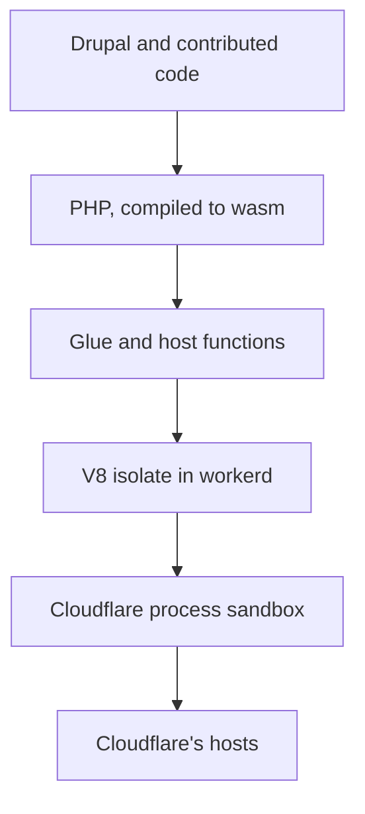

# Security

Drupflare runs unmodified Drupal 11 on PHP 8.5 compiled to WebAssembly, inside a Durable Object on
Cloudflare Workers. This page says what that changes about the attacks a Drupal site faces, what it
leaves alone, and how each statement was established. It is written for a security reviewer, and the
weak points sit beside the strong ones.

The short version: a bug in Drupal, a contributed module or PHP still compromises the site. What
changes is the next step. On a conventional host an attacker who can run code gets a process on an
operating system, with a shell, a filesystem, a network, neighbouring services and a kernel to
attack. Here the attacker gets a PHP interpreter inside two sandboxes with a fixed list of host
functions and no operating system to enumerate. Several well-known classes of server takeover have
no path left to run. Application-layer bugs, and the data inside the same object, are exposed
exactly as they were.

## Pages

- [What It Does Not Remove](not-removed.md): application bugs, sandbox escapes, side channels, supply chain and the other risks that remain.
- [How Much Safer](how-much-safer.md): the comparison against a conventional host and its references.

## How to Read the Claims

Every statement carries a tag for how it was established.

| Tag      | Meaning                                                                          |
| -------- | -------------------------------------------------------------------------------- |
| Read     | The source file or the primary document was read, and the line or quote is cited |
| Measured | A command or a test was run, and the command or the spec is named                |
| Inferred | It follows from the architecture and nothing was run against it                  |

Every row is closed to one of three verdicts. There is no fourth.

- `removed`: the attack path needs a component the object does not have.
- `contained`: the flaw or the attacker's foothold exists, and a control limits what it reaches or
  what it keeps. The control and its residual are named.
- `open`: the flaw works as it does on any host, or it could not be established either way. A claim
  that could not be established counts as `open` at full capacity, and the row says what would
  settle it.

A measurement taken on a local `workerd` is labelled that way. It runs the same runtime code as the
platform and not the platform's extra protections, so it never upgrades a row to `removed` by
itself.

No study measures how much a serverless or sandboxed runtime lowers breach probability. The page
does not put a percentage on safety. It counts attack classes instead, and the count is only as good
as the inference behind each row (see [How Much Safer](how-much-safer.md#how-much-safer)).

Sources were read through a page extractor. The quotes from Cloudflare's security model and Spectre
post, SA-CORE-2026-014, the Lehmann and Stiévenart abstracts and the GTIG report were also checked
against the live page. Check the live page before quoting any source to a third party, because
Cloudflare's pages and the PHP and Drupal advisories change.

## What Is Claimed and What Is Not

| Claim                                                                                         | Status                                                                                                                     |
| --------------------------------------------------------------------------------------------- | -------------------------------------------------------------------------------------------------------------------------- |
| There is no operating system, shell, web server or PHP-FPM pool in the site's trust boundary  | Read: [layers](#the-layers)                                                                                                |
| A PHP exploit runs inside WebAssembly linear memory and reaches the host only through imports | Read: webassembly.org security page                                                                                        |
| Cloudflare states a V8 patch gap under 24 hours                                               | Read: Cloudflare security model                                                                                            |
| Server-takeover classes (FPM, CGI, Shellshock, Apache, container and kernel escapes) are gone | Inferred: [map](incidents.md#the-cve-and-incident-map)                                                                     |
| PHP in the interpreter cannot open a socket, call a JavaScript global or spawn a process      | Measured: control 3 recorded calls, shipping glue 0; see [Host Surface](controls/index.md#host-surface)                    |
| An owner token stored by Drupflare can be read by code with SQL access                        | False since v1.0.4. Only its hash is kept, outside SQL: [Credentials](controls/credentials.md#credentials-and-persistence) |
| Arbitrary code execution is impossible                                                        | False. Any Drupal RCE runs PHP in the sandbox                                                                              |
| A compromised PHP cannot read the site's own data                                             | False. The database sits in the same object                                                                                |
| WebAssembly makes memory corruption harder to exploit than native                             | False. See [Memory Corruption](not-removed.md#memory-corruption-inside-the-sandbox)                                        |
| A published PHP2Shell chain works against a Drupflare site                                    | No. Each needs a per-request startup and shutdown cycle that does not exist here; see [PHP2Shell](incidents.md#php2shell)  |
| Drupflare is safer than a VPS                                                                 | Inferred, per attack class, and unmeasured as a whole: [How Much Safer](how-much-safer.md#how-much-safer)                  |

## The Layers

A request passes through these layers, from the attacker's side inward.

| Layer                       | What it is                                                       | Source                                         |
| --------------------------- | ---------------------------------------------------------------- | ---------------------------------------------- |
| Drupal and contributed code | Application authorization, SQL, templates                        | the site itself                                |
| PHP, compiled to wasm       | The interpreter in WebAssembly linear memory, built by `phasm`   | `interp.lock.json`                             |
| Glue and host functions     | 102 JavaScript imports from the module, plus 31 `cfw*` functions | [Host Surface](controls/index.md#host-surface) |
| V8 isolate in workerd       | The JavaScript sandbox that holds the module and the glue        | Cloudflare docs                                |
| Cloudflare process sandbox  | Linux namespaces and seccomp around the process                  | Cloudflare docs                                |
| Cloudflare's hosts          | The machine, which belongs to the platform                       | not in scope                                   |

The same stack as a diagram:

Cloudflare's security model page describes the last two. "The layer 2 sandbox uses Linux namespaces
and seccomp to prohibit all access to the filesystem and network." It also says that "Workers does
not allow our customers to upload native-code binaries to run on the Cloudflare network" and that
"the Workers patch gap is now under 24 hours", where the patch gap is the time between publishing a
V8 fix and deploying it ([Cloudflare](https://developers.cloudflare.com/workers/reference/security-model/)).
All three are Cloudflare's statements about its own platform. None was
independently measured here.

The same page carries two cautions. It says "Local `workerd` processes do not include every
defense-in-depth protection described here", and the workerd README is headed "WARNING: `workerd`
is not a hardened sandbox." The protections above belong to hosted Workers. A self-hosted `workerd`
needs a microVM or equivalent boundary around it, which is what the `isolated` mode of
[bastion](https://github.com/drupflare/bastion) provides.

The database sits inside the same object as PHP, with no boundary between the interpreter and the
site's own SQLite file. See [Data in the Same Object](not-removed.md#data-in-the-same-object).

## What the Architecture Removes

These classes need a component the object does not have.

- **A server process to take over.** There is no PHP-FPM pool, CGI handler, web server, SSH daemon
  or inbound socket. CVE-2019-11043 (PHP-FPM behind nginx), CVE-2024-4577 (PHP-CGI on Windows),
  CVE-2021-41773 (Apache path traversal) and CVE-2014-6271 (Shellshock through CGI) each need one.
- **A shell and delegates.** `posix_spawnp` aborts and the module has no process table, so
  command-injection classes such as ImageMagick delegates (CVE-2016-3714) have nothing to run.
  GD is not compiled in, and image operations run as JavaScript.
- **A kernel and a container runtime in the tenant's boundary.** Container and kernel escapes,
  including runc CVE-2019-5736, runc CVE-2024-21626, Dirty Pipe CVE-2022-0847 and Dirty COW
  CVE-2016-5195, start from a process on a shared Linux kernel. That kernel is Cloudflare's, and an
  attacker here needs a vulnerability in Cloudflare's runtime first.
- **An appliance in front of the application.** The CitrixBleed class (CVE-2023-4966) is a memory
  disclosure on an edge appliance. TLS ends at Cloudflare's edge, and PHP has no OpenSSL (`WITH_OPENSSL=0`).
- **A native binary upload.** Cloudflare accepts only JavaScript and WebAssembly.
- **A writable server filesystem that persists.** The in-memory filesystem is rebuilt on a new
  instance, and uploads live in the site's own file tables. The rebuild reads `cfw_module_file`, so
  a planted module row was a way back in; see [Credentials and Persistence](controls/credentials.md#credentials-and-persistence)
  for what now holds it.

Google's Threat Intelligence Group counted 90 zero-days exploited in the wild in 2025, with 43
(48%) in enterprise software and appliances and browsers under 10% of the total
([GTIG](https://cloud.google.com/blog/topics/threat-intelligence/2025-zero-day-review/)). The count is about products in general. It shows where attackers spend zero-days, and
it does not measure Drupflare.
